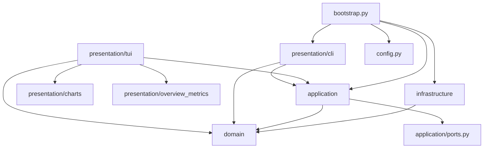

# Architecture

**Scope:** the active implementation under `plaivid_cli/` (not `plaivid_cli/legacy/`).
Navigation: [`../README.md`](../README.md) · [`SYSTEM_OVERVIEW.md`](SYSTEM_OVERVIEW.md) ·
[`COMPONENTS.md`](COMPONENTS.md) · [`DEPENDENCY_GRAPH.md`](DEPENDENCY_GRAPH.md).

## Architectural style

A **layered modular monolith with explicit ports/adapters** (hexagonal influence) and a
single composition root. One process serves either a one-shot CLI invocation or a Textual TUI.
Presentation depends inward on application/domain; application defines narrow outbound
`Protocol`s; infrastructure supplies concrete adapters; `bootstrap.py` is the only module that
wires all concrete classes together.

Evidence: `plaivid_cli/application/ports.py::PvmGateway`,
`plaivid_cli/bootstrap.py::build_runtime`, `README.md` ("supported direction is presentation →
application/domain → infrastructure through application ports"),
`tests/unit/test_architecture_boundaries.py::test_domain_application_and_infrastructure_import_boundaries`.

## Layers and responsibilities

| Layer | Path | Owns | Must not import |
|---|---|---|---|
| Domain | `plaivid_cli/domain/` | Immutable facts, enums, typed errors, pure policies, correlation, redaction | application, infrastructure, presentation, bootstrap |
| Application | `plaivid_cli/application/` | Use cases, one serialized read lane, mutation lane, session management, Overview scheduling/history, outbound `Protocol`s | infrastructure, presentation, bootstrap |
| Infrastructure | `plaivid_cli/infrastructure/` | Bounded child execution, `sbell`/PVM adapters + pure parsers, local host sampling, read-only audit, logging | application, presentation, bootstrap |
| Presentation | `plaivid_cli/presentation/` | CLI grammar/dispatch/handlers/serialization, Textual app/pages/components, pure formatters, chart renderer, theme | infrastructure, bootstrap |
| Composition root | `plaivid_cli/bootstrap.py` | `Runtime`, `build_runtime`, `main`, shutdown | — (wires everything) |
| Config | `plaivid_cli/config.py` | `Settings`, `load_settings`, `ConfigurationError` | — |

The "must not import" column is *verified*, not aspirational: `tests/unit/test_architecture_boundaries.py`
statically scans every `.py` in each layer and asserts those prefixes are absent. A second test
asserts TUI components import no application/infrastructure/bootstrap and that
`CheckableTable` is defined only in
`plaivid_cli/presentation/tui/components/checkable_table.py::CheckableTable`; a third forbids
cross-imports between sibling pages.

**Inferred observation (not enforced by a test):** the strong fan-in to
`plaivid_cli/domain/models/__init__.py` (53 importing modules) makes it a stable re-export
facade and a high-impact change point. See [`DEPENDENCY_GRAPH.md`](DEPENDENCY_GRAPH.md).

## Communication patterns

- **Synchronous calls inward.** CLI/TUI call `PlaividApplication` /
  `OperationCoordinator` / `SessionManager` directly
  (`plaivid_cli/presentation/cli/dispatch.py::run_command`).
- **One serialized read lane.** `CollectionCoordinator.request_refresh` returns a
  `Future[ApplicationSnapshot]` backed by `ThreadPoolExecutor(max_workers=1)`, coalesces equal
  requests, and keeps at most one bounded pending request (`CollectionSuperseded` is raised
  when a newer request replaces it). Blocking provider reads are wrapped by
  `plaivid_cli/application/collection/reader.py::SectionReader`.
- **One serialized mutation lane.** `OperationCoordinator` holds a `threading.Lock`, raises a
  generation barrier through `CollectionCoordinator.begin_mutation`, dispatches targets
  sequentially, then calls `end_mutation` and reconciles with `collect_once`.
- **Textual workers.** TUI uses `@work(thread=True)` for refresh, session, audit, and
  operation tasks, publishing results back with `call_from_thread`. Evidence:
  `plaivid_cli/presentation/tui/refresh.py::RefreshMixin`,
  `plaivid_cli/presentation/tui/session.py::SessionMixin`,
  `plaivid_cli/presentation/tui/audit.py::AuditMixin`.
- **Event/mixin composition.** `PlaividTui` inherits behavior from
  `LayoutMixin`, `SessionMixin`, `RefreshMixin`, `OverviewMixin`, `DesktopMixin`,
  `HostPageMixin`, `VirtualMachinesMixin`, `AuditMixin`; Textual `@on(...)` handlers are
  re-declared on the concrete `App` class because Textual discovers decorated handlers there.
  Evidence: `plaivid_cli/presentation/tui/app.py::PlaividTui` (comment at line 185).
- **Child-process boundary.** All external calls are argv-only (no shell), with bounded
  output/deadlines and a restricted default child environment
  (`plaivid_cli/infrastructure/process.py::_safe_child_environment`).

## State management

| State | Owner | Lifetime | Evidence |
|---|---|---|---|
| `Settings` (frozen dataclass) | `plaivid_cli/config.py::Settings` | process | `plaivid_cli/config.py` |
| `ApplicationSnapshot` + per-section `SectionSnapshot` | `CollectionCoordinator` | in-memory, per generation; last-good value retained per section | `plaivid_cli/application/collection/coordinator.py::CollectionCoordinator`, `plaivid_cli/domain/models/snapshots.py::ApplicationSnapshot` |
| Read generation / mutation barrier / pending intent | `CollectionCoordinator` | in-memory | `plaivid_cli/application/collection/coordinator.py::CollectionCoordinator` |
| TUI view state (selection, charts, history, desktop rows, caches) | `PlaividTui.__init__` attributes | TUI session; cleared on logout | `plaivid_cli/presentation/tui/app.py::PlaividTui`, `plaivid_cli/presentation/tui/session.py::SessionMixin` |
| `OverviewHistory` (1024-sample bounded deque) and `OverviewSchedule` | `PlaividTui` / `plaivid_cli/application/overview.py::OverviewHistory` | TUI session; 60-second wall-clock window | `plaivid_cli/application/overview.py`, `plaivid_cli/presentation/tui/refresh.py::RefreshMixin` |
| Session token | `SessionStore` → `session.json` | on-disk, user-only 0600/0700, atomic replace | `plaivid_cli/application/session.py::SessionStore` |
| Audit rows | PVM-owned SQLite | external, read-only | `plaivid_cli/infrastructure/audit.py::ReadOnlyAuditAdapter` |

No application-owned database exists; persistence is limited to the optional session token
cache. Reconnaissance: [`../contracts/DATA_MODELS.md`](../contracts/DATA_MODELS.md).

## Dependency direction (verified)

`bootstrap.py` is the only module that imports both application and infrastructure. Counts and
edge evidence: [`DEPENDENCY_GRAPH.md`](DEPENDENCY_GRAPH.md). Canonical standalone diagram:
[`../diagrams/dependency-overview.mmd`](../diagrams/dependency-overview.mmd).

## Important architectural constraints

1. **Layer import boundaries** are enforced by `tests/unit/test_architecture_boundaries.py`.
2. **`legacy/` is not shipped.** `setup.py::RuntimeBuildPy` and
   `[tool.setuptools.packages.find]` exclude it; `tests/unit/test_distribution.py` asserts the
   package list. See [`../workflows/BUILD.md`](../workflows/BUILD.md).
3. **Presentation never constructs adapters.** `bootstrap.build_runtime` is the composition
   root; TUI/CLI receive ready objects.
4. **Uncertain outcomes are preserved.** `OperationCoordinator._dispatch_one` maps documented
   `status=success` → `SUCCEEDED`, `status=failed` → `FAILED`, and anything else/transport
   failure → `OUTCOME_UNKNOWN`; it never claims the VM reached a terminal state.
   [`../contracts/MODULE_CONTRACTS.md`](../contracts/MODULE_CONTRACTS.md).
5. **Redaction applies at every output boundary.** `domain/redaction.py::redact_text` feeds
   CLI human/JSON output, TUI widgets, diagnostics, and adapter errors.
6. **Real-host semantics are unverified.** Request shapes are repository-evidenced only; see
   `docs/REAL_PVM_VALIDATION.md`.

## Verified facts vs inferred observations

- **Verified:** all layer/path/symbol claims above come from the named files and the AST-based
  boundary tests; collection/operation lane internals come from the named coordinator classes.
- **Inferred:** the "hexagonal influence" label, the high-impact status of
  `domain/models/__init__.py`, and the characterization of mixin composition as a deliberate
  workaround rather than a framework requirement (the code comment supports it but no test
  asserts it).
- **Unverified / out of scope:** actual PVM/Sball response semantics, deployment platform
  matrix, Python 3.12 runtime behavior in this workspace, and any release approval. See
  [`../maintenance/DOCUMENTATION_AUDIT.md`](../maintenance/DOCUMENTATION_AUDIT.md).
