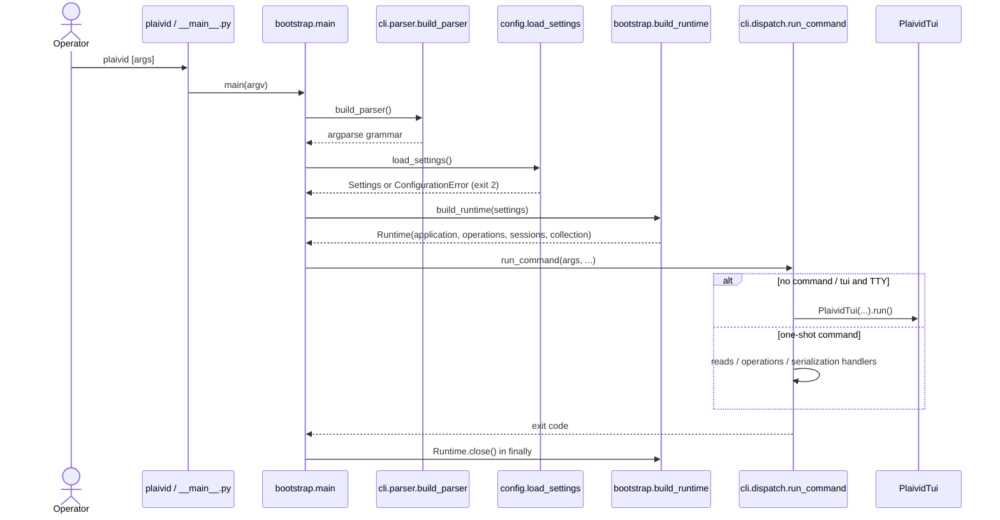
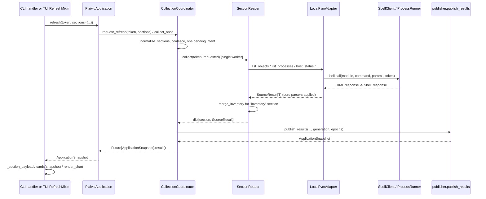
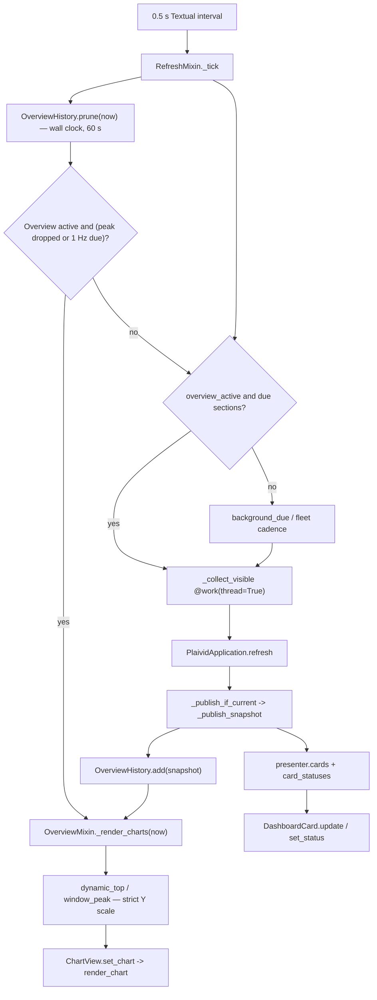

# Data flow

Navigation: [`../README.md`](../README.md) · [`ARCHITECTURE.md`](ARCHITECTURE.md) ·
[`../codebase/ENTRYPOINTS.md`](../codebase/ENTRYPOINTS.md). Canonical standalone diagrams:
[`../diagrams/system-context.mmd`](../diagrams/system-context.mmd),
[`../diagrams/component-architecture.mmd`](../diagrams/component-architecture.mmd),
[`../diagrams/dependency-overview.mmd`](../diagrams/dependency-overview.mmd).

The diagrams below are **flow-specific** sequence/flow views; they do not duplicate the
structure diagrams in `../diagrams/`.

## 1. Startup and command dispatch

Evidence: `plaivid_cli/bootstrap.py::main`, `plaivid_cli/presentation/cli/parser.py::build_parser`,
`plaivid_cli/presentation/cli/dispatch.py::run_command`, `tests/unit/test_bootstrap.py`.



`--help`, `--version`, `help`, `config`, `diagnostics` return **before** `build_runtime`.
A non-TTY request for the TUI returns `EXIT_REJECTED` (2).

## 2. Read / collection flow (CLI `inventory`, `host`, `detail`, and TUI refresh)

Evidence: `plaivid_cli/application/services.py::PlaividApplication`,
`plaivid_cli/application/collection/coordinator.py::CollectionCoordinator`,
`plaivid_cli/application/collection/reader.py::SectionReader`,
`plaivid_cli/application/collection/publisher.py::publish_results`.



Per-section last-good values and `CollectionStatus` are retained when a read fails; a
mutation barrier suppresses stale publication (`publish_results` checks epoch equality).
Section→source mapping is in [`../contracts/MODULE_CONTRACTS.md`](../contracts/MODULE_CONTRACTS.md).

## 3. Overview TUI refresh and chart rendering

Evidence: `plaivid_cli/presentation/tui/refresh.py::RefreshMixin`,
`plaivid_cli/presentation/tui/pages/overview/controller.py::OverviewMixin`,
`plaivid_cli/presentation/tui/pages/overview/presenter.py::cards`,
`plaivid_cli/application/overview.py::OverviewHistory`,
`plaivid_cli/presentation/charts/render.py::render_chart`.



The chart window advances even when collection stalls: `prune(now)` runs on every tick with
`time.monotonic()`, and a peak leaving the window shrinks the Y ceiling immediately.
`ChartView` composes pure `Series` values into Rich `Text`; grid dots stay a separate faint
layer. Tests: `tests/unit/test_graph_history.py`, `tests/unit/test_dashboard_chart_refactor.py`.

## 4. VM lifecycle operation (CLI and TUI)

Evidence: `plaivid_cli/presentation/cli/operations.py::_operate`,
`plaivid_cli/application/services.py::PlaividApplication`,
`plaivid_cli/application/operations/planner.py::OperationPlanner`,
`plaivid_cli/application/operations/coordinator.py::OperationCoordinator`,
`plaivid_cli/infrastructure/pvm/adapter/local.py::LocalPvmAdapter`.

```mermaid
sequenceDiagram
    actor Op as Operator
    participant UI as CLI _operate / VMOperationMixin
    participant A as PlaividApplication
    participant PL as OperationPlanner
    participant OC as OperationCoordinator
    participant CC as CollectionCoordinator
    participant G as LocalPvmAdapter
    participant OUT as serialization / TUI result panel
    Op->>UI: action + selectors (intent; no confirm prompt)
    UI->>A: inventory(token) -> SectionSnapshot
    UI->>A: resolve_targets(inventory, selectors)
    A-->>UI: TargetSelection(records, is_bulk)
    UI->>PL: create_plan(action, records, section, is_bulk)
    PL-->>UI: OperationPlan (generation + freshness bound)
    UI->>OC: execute(token, ..., plan)
    OC->>OC: re-create plan / reject stale plan
    OC->>CC: begin_mutation(generation barrier)
    loop each target, sequential
        OC->>G: dispatch_action(token, action, uuid)
        G-->>OC: PvmReply(status, errno, message)
        OC->>OC: SUCCEEDED / FAILED / OUTCOME_UNKNOWN
    end
    OC->>CC: end_mutation -> collect_once(inventory) reconcile
    OC-->>UI: OperationResult(aggregate, per-target outcomes)
    UI->>OUT: human rows or --json / TUI message
```

Bulk stops after a definite failure or unknown outcome and marks the rest `NOT_STARTED`.
Status→state mapping and exit codes: [`../contracts/API_CONTRACTS.md`](../contracts/API_CONTRACTS.md).

## 5. Session, audit, and desktop flows

- **Session:** `SessionMixin._resume_session` → `SessionManager.resume_or_login` →
  `SessionStore.load` (0600 JSON) or `PvmGateway.validate_session`; login requires
  `PLAIVID_ALLOW_CREDENTIAL_ARGV` and calls `LocalPvmAdapter.login`; `SessionStore.save`
  atomically writes the token. Logout clears caches, card statuses, chart history, and
  selection (`plaivid_cli/presentation/tui/session.py::SessionMixin`).
  Tests: `tests/unit/test_session_lifecycle.py`, `tests/unit/test_cli_and_tui.py`.
- **Audit:** `RefreshMixin.show_audit` / `show_desktop_audit` → `AuditMixin._request_audit`
  (thread worker) → `PlaividApplication.recent_audit` → `ReadOnlyAuditAdapter.recent` →
  `sqlite3` `mode=ro` → redacted panel text. Generic refresh does **not** poll audit.
  Tests: `tests/unit/test_audit_adapter.py`.
- **Virtual Desktops:** `DesktopMixin.desktop_action_requested` →
  `OperationCoordinator.create_desktop_plan` → `DesktopOperationExecutor.execute` (same
  mutation lane and outcome rules) → `presenter`-style panel updates. Desktop refresh cadence
  is floored by `plaivid_cli/presentation/tui/pages/virtual_desktops/policy.py::MIN_REFRESH_SECONDS`
  (15 s). Tests: `tests/unit/test_virtual_desktops.py`.

## Flow boundaries and unknowns

- All external data enters through `LocalPvmAdapter` / `ProcessRunner` or
  `ReadOnlyAuditAdapter`; no network API, no daemon, no scheduled OS job in this repository.
- `collect_once` and `request_refresh` do not cache to disk; snapshots are in-memory only.
- The exact PVM response semantics, permission behavior, and host metric schemas are
  **unverified** (owner-run checklist in `docs/REAL_PVM_VALIDATION.md`). Diagrams describe
  the implemented local control flow, not host behavior.
