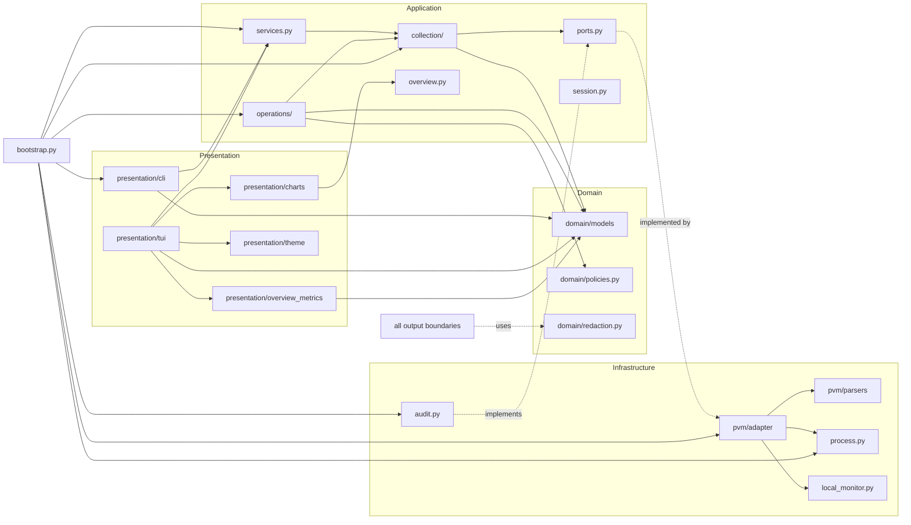

# Dependency graph

**Method:** AST-based import scan of every `.py` under `plaivid_cli/` (157 modules: 128 active,
29 legacy), deduplicated at module granularity, including `TYPE_CHECKING` imports. Recompute
every number below with `python scripts/validate_brain.py --dependency-stats` (read-only,
stdlib-only). An earlier exploration scan also included `tests/` (33 modules, 190 total).
Results were spot-checked in source. Navigation: [`../README.md`](../README.md) ·
[`ARCHITECTURE.md`](ARCHITECTURE.md) · [`../codebase/MODULE_INDEX.md`](../codebase/MODULE_INDEX.md).
Canonical diagram: [`../diagrams/dependency-overview.mmd`](../diagrams/dependency-overview.mmd).

## Direct dependencies (layer-level, verified)

| From | To | Edge count | Example |
|---|---|---|---|
| `presentation/tui/` | `presentation/theme.py` | 21 | `plaivid_cli/presentation/tui/pages/overview/page.py::OverviewPage` |
| `presentation/tui/` | `domain/` (core + models) | 28 | `plaivid_cli/presentation/tui/app.py::PlaividTui` |
| `presentation/overview_metrics/` | `domain/models/` | 10 | `plaivid_cli/presentation/overview_metrics/cpu.py::cpu_body` |
| `application/operations/` | `domain/` | 12 | `plaivid_cli/application/operations/coordinator.py::OperationCoordinator` |
| `infrastructure/pvm/` | `domain/` + `infrastructure/` core | 18 | `plaivid_cli/infrastructure/pvm/adapter/local.py::LocalPvmAdapter` |
| `application/collection/` | `domain/` | 9 | `plaivid_cli/application/collection/reader.py::SectionReader` |
| `presentation/cli/` | `application/`, `domain/`, `config.py` | 19 | `plaivid_cli/presentation/cli/dispatch.py::run_command` |
| `bootstrap.py` | application + infrastructure + CLI + config | 10 | `plaivid_cli/bootstrap.py::build_runtime` |

Counts are module-to-module import edges aggregated by source/target layer; they are a
coupling signal, not a complexity metric. **No active module imports `plaivid_cli/legacy/`.**
Legacy imports only `plaivid_cli/version.py` and `plaivid_cli/config.py` from the active tree
(7 edges) and has 54 internal edges.

## Shared / critical infrastructure modules (highest fan-in)

| Module | Importing modules | Why it matters |
|---|---|---|
| `plaivid_cli/domain/models/__init__.py` | 53 | Single re-export facade for 32 immutable domain types/enums; renaming an export breaks most layers. |
| `plaivid_cli/presentation/theme.py` | 23 | Palette + Rich text helpers used by every TUI widget and `ChartView`. |
| `plaivid_cli/presentation/tui/components/__init__.py` | 18 | Shared card/table/toolbar facade for all pages. |
| `plaivid_cli/domain/errors.py` | 14 | `AppError` taxonomy shared by application, infrastructure, and CLI. |
| `plaivid_cli/domain/redaction.py` | 14 | Pure `redact_text`, applied at all output boundaries. |
| `plaivid_cli/presentation/overview_metrics/common.py` | 11 | Shared `size`/`number`/`bar`/`row`/`body`/`finish` primitives. |
| `plaivid_cli/config.py` | 8 | `Settings` consumed by bootstrap, application, CLI. |

**High-coupling modules (most outgoing imports, active tree):** `plaivid_cli/presentation/tui/app.py` (18),
`plaivid_cli/infrastructure/pvm/adapter/local.py` (13), `plaivid_cli/bootstrap.py` (11),
`plaivid_cli/presentation/cli/dispatch.py` (11),
`plaivid_cli/presentation/overview_metrics/__init__.py` (11),
`plaivid_cli/application/operations/coordinator.py` (10),
`plaivid_cli/presentation/tui/pages/overview/components/__init__.py` (10),
`plaivid_cli/presentation/tui/pages/overview/host_controller.py` (9). The retired
`plaivid_cli/legacy/orchestrator.py` is the highest-coupling legacy module but is outside the
active graph. These are expected
composition/aggregation points, not necessarily problems.

## Architectural boundaries

`PvmGateway` / `MonitoringGateway` / `AuditGateway` in `plaivid_cli/application/ports.py` are
`typing.Protocol` definitions: infrastructure implements them structurally; application code
never imports a concrete adapter. This is the main inversion point.

## Potential circular dependencies

- A static, **type-only** cycle exists between `plaivid_cli/presentation/charts/grid.py` and
  `plaivid_cli/presentation/charts/render.py`: `render.py` imports grid geometry helpers at
  runtime (`_axis_row`, `_series_dots`, `bucketed`), while `grid.py` imports `Series` from
  `render.py` only under `if TYPE_CHECKING:` with `from __future__ import annotations`.
  There is **no runtime import cycle**. Verified by inspecting both import blocks.
  Adding a runtime value import from `grid.py` to `render.py` would create one — do not.
- SCC analysis over all 157 package modules (reproducible with
  `scripts/validate_brain.py --dependency-stats`) finds exactly one multi-node cycle:
  `plaivid_cli/presentation/charts/grid.py` ↔
  `plaivid_cli/presentation/charts/render.py`, the type-only cycle above. No other multi-node
  cycle exists
  after resolving relative imports correctly. An initial naive scan reported a legacy
  `commands/__init__.py` ↔ `commands/base.py` cycle; that was an artifact of mis-resolving
  `from .. import vms` in `plaivid_cli/legacy/commands/base.py` and is **not** a real cycle.
- `plaivid_cli/presentation/tui/pages/overview/__init__.py::__getattr__` is a lazy
  attribute facade; it defers importing `page.py` to avoid an eager import loop with card
  modules. It is a compatibility shim, not a second implementation.

## Boundary enforcement

- `tests/unit/test_architecture_boundaries.py` asserts domain/application/infrastructure import
  bans, presentation bans, TUI component purity, single `CheckableTable` definition, and no
  sibling-page imports.
- `tests/unit/test_distribution.py` asserts every active subpackage is packaged and
  `plaivid_cli.legacy*` is not.
- Changing an import direction requires updating this document and running both suites.
  See [`../workflows/TESTING.md`](../workflows/TESTING.md).
