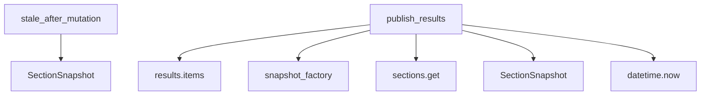

# Human-readable documentation for `publisher.py`

## 1. File overview

- **Source path:** `pvm_control_engine/src/pvm_control_engine/application/collection/publisher.py`
- **Language:** Python
- **File type:** Python package/module
- **Primary responsibility:** Last-good section publication policy for completed local collection requests.

## 2. Functional summary

Last-good section publication policy for completed local collection requests.

## 3. Inputs and outputs

Public call inputs are the parameters shown in the function and method signatures below. Defaults and annotations are preserved from source. Explicit return expressions are listed with each callable; exceptions and mutations are summarized in the behavior notes.

## 4. Execution flow

The module is invoked through its declared API rather than running as a standalone program. The main callables and their internal calls/returns are summarized in section 5; imports and cross-module links are listed in section 10.

## 5. Functions and methods

### `stale_after_mutation(prior: SectionSnapshot[object], section_name: str, *, generation: int, attempted_at: datetime, attempted_monotonic: float) -> SectionSnapshot[object]`

Invalidate a previously published collection section after a mutation.

### `publish_results(sections: dict[str, SectionSnapshot[object]], results: dict[str, SourceResult[object]], *, generation: int, current_epoch: int, mutation_epoch: int, started_at: datetime, started_mono: float, snapshot_factory: Callable[[], ApplicationSnapshot]) -> ApplicationSnapshot`

Publish results unless a mutation invalidated the read generation. The caller must hold the collection coordinator's reentrant lock throughout this call.

## 6. Classes and data structures

No classes are declared in this module.

## 7. Decision-making logic

The following branch conditions are present in the implementation; each selects the corresponding source-code path:

- `mutation_epoch != current_epoch`
- `not success and previous_value is not None and (status is not CollectionStatus.NEVER)`
- `prior` (with an `else` branch)
- `success` (with an `else` branch)
- `success` (with an `else` branch)
- `success` (with an `else` branch)
- `success` (with an `else` branch)
- `prior.last_good_value is not None` (with an `else` branch)
- `prior.last_good_value is not None` (with an `else` branch)
- `prior` (with an `else` branch)
- `prior` (with an `else` branch)
- `success` (with an `else` branch)
- `prior` (with an `else` branch)
- `prior` (with an `else` branch)

## 8. Loops and repeated operations

Iteration is performed by the following loops/comprehensions:

- `(name, result) in results.items()`

## 9. Error handling

No local `try`/`except` handler was found. Exceptions from called dependencies propagate unless caught by a caller.

No explicit `raise` statement was found in this module.

## 10. Dependencies and interactions

- **Project imports:** `pvm_control_engine.domain.models`.
- **Standard-library/third-party imports:** `__future__`, `time`, `collections.abc`, `datetime`.

Related module documentation:

- [`pvm_control_engine.domain.models`](../../domain/models/__init__.md)

## 11. Real-world scenario

Last-good section publication policy for completed local collection requests.

## 12. Technical details and limitations

Behavior is bounded by the source contracts and imported dependencies. Environment-specific integration details (for example, external daemon responses or deployment permissions) require validation in the target environment. The module-level AST scan identifies implementation structure but does not claim runtime outcomes for unexecuted branches.

## 13. Call-flow diagram

## 14. Human-readable summary

`publisher.py` is part of `pvm_control_engine`. Last-good section publication policy for completed local collection requests. Its concrete interfaces, data structures, decisions, error paths, and direct dependencies are documented above; identifiers and source filenames are retained verbatim.
