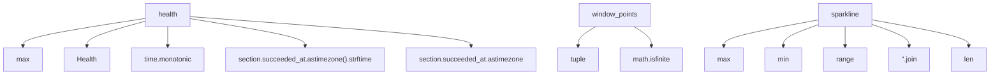

# Human-readable documentation for `overview.py`

## 1. File overview

- **Source path:** `pvm_control_engine/src/pvm_control_engine/application/overview.py`
- **Language:** Python
- **File type:** Python package/module
- **Primary responsibility:** Overview scheduling, bounded history and collection-backed health (no I/O).

## 2. Functional summary

Overview scheduling, bounded history and collection-backed health (no I/O).

## 3. Inputs and outputs

Public call inputs are the parameters shown in the function and method signatures below. Defaults and annotations are preserved from source. Explicit return expressions are listed with each callable; exceptions and mutations are summarized in the behavior notes.

## 4. Execution flow

The module is invoked through its declared API rather than running as a standalone program. The main callables and their internal calls/returns are summarized in section 5; imports and cross-module links are listed in section 10.

## 5. Functions and methods

### `health(section: SectionSnapshot[object] | None, cadence: float, *, now: float | None=None) -> Health`

Calls `max`, `Health`, `time.monotonic`, `section.succeeded_at.astimezone().strftime`, `section.succeeded_at.astimezone`. Reads or updates `clock`, `last`, `age`, `timeout`, `status`, `detail`. Explicit return value(s): `Health(status, age, section.succeeded_at.astimezone().strftime('%H:%M:%S') if section.succeeded_at e`, `Health('LOADING', None, None, None, 'Awaiting first sample')`, `Health('N/A', None, None, None, 'Unsupported or unverified source')`.

### `window_points(points: Iterable[tuple[float, float]], t_end: float, window: float=HISTORY_WINDOW_SECONDS) -> tuple[tuple[float, float], ...]`

Samples still visible in the rolling window ``[t_end - window, t_end]``. ``t_end`` is the current wall/monotonic clock, **not** the timestamp of the newest sample: during a collection stall the window keeps advancing, so old peaks leave it on time instead of pinning the chart scale forever.

### `sparkline(values: deque[tuple[float, float]], width: int=32) -> str`

Exactly ``width`` cells: samples are linearly resampled so the line spans the whole card.

### `OverviewSchedule.__init__(self, interval: float=3.0, host_status_interval: float=2.0) -> None`

Calls `self.set_interval`, `ValueError`, `math.isfinite`. Reads or updates `self.host_status_interval`, `self.active`, `self.busy`, `self.next_due`. No explicit return statement; the function returns `None` unless an exception interrupts execution. Can raise `ValueError('host_status_interval must be a finite positive number')`.

### `OverviewSchedule.set_interval(self, seconds: float) -> None`

Calls `hasattr`, `ValueError`, `math.isfinite`, `time.monotonic`. Reads or updates `self.interval`, `self.next_due['local']`. No explicit return statement; the function returns `None` unless an exception interrupts execution. Can raise `ValueError('Refresh must be a whole number of seconds from 1 to 60')`.

### `OverviewSchedule.enter(self) -> None`

Reads or updates `self.active`, `self.next_due`, `self.next_due['local']`, `self.next_due['host']`. No explicit return statement; the function returns `None` unless an exception interrupts execution.

### `OverviewSchedule.leave(self) -> None`

Reads or updates `self.active`. No explicit return statement; the function returns `None` unless an exception interrupts execution.

### `OverviewSchedule.reset(self) -> None`

Calls `self.leave`, `self.next_due.clear`. No explicit return statement; the function returns `None` unless an exception interrupts execution.

### `OverviewSchedule.background_due(self, *, now: float | None=None) -> tuple[str, ...]`

Keep the local graph history sampling while another tab is shown. Only the local /proc sample runs (no server request), at the same cadence as the Overview.

### `OverviewSchedule.due(self, *, now: float | None=None) -> tuple[str, ...]`

Calls `tuple`, `time.monotonic`, `self.next_due.get`, `sections.append`, `self.next_due.pop`. Reads or updates `clock`, `sections`, `self.next_due['local']`, `self.next_due['pvm']`, `self.next_due['host']`, `self.busy`. Explicit return value(s): `tuple(sections)`, `()`.

### `OverviewSchedule.finished(self) -> None`

Reads or updates `self.busy`. No explicit return statement; the function returns `None` unless an exception interrupts execution.

### `OverviewSchedule.rediscover(self) -> None`

Reads or updates `self.next_due['discovery']`. No explicit return statement; the function returns `None` unless an exception interrupts execution.

### `OverviewHistory.__init__(self, limit: int=1024) -> None`

Calls `deque`. Reads or updates `self.values`, `self._last_generation`, `self.last_verified_running`. No explicit return statement; the function returns `None` unless an exception interrupts execution.

### `OverviewHistory.prune(self, now: float | None=None) -> int`

Drop samples older than ``now - HISTORY_WINDOW_SECONDS`` from every series. ``now`` uses the same monotonic clock as ``SectionSnapshot.succeeded_monotonic``. Returns the number of dropped points so callers can tell that the window moved.

### `OverviewHistory.window(self, name: str, *, now: float | None=None, t_end: float | None=None) -> tuple[tuple[float, float], ...]`

Visible points for one series at the current wall-clock window end.

### `OverviewHistory.peak(self, name: str, *, now: float | None=None, t_end: float | None=None) -> float | None`

Highest *active* value in the visible window, or None when there is none.

### `OverviewHistory.add(self, snapshot: ApplicationSnapshot, *, now: float | None=None) -> None`

Append one validated sample and prune against the supplied wall clock. With ``now=None`` the newest sample's timestamp is used as the clock (the legacy, sample-relative behaviour). Pass ``now=time.monotonic()`` to enforce wall-clock pruning even when a sample arrives late or collection stalls.

## 6. Classes and data structures

### `Health`

- **Bases:** no explicit base class.
- **Description:** Class declared with bases: no explicit base class.
- **Annotated fields:**
  - `status: str`
  - `age: float | None`
  - `last_success: str | None`
  - `latency: float | None`
  - `detail: str`

### `OverviewSchedule`

- **Bases:** no explicit base class.
- **Description:** Single demand controller. The Textual app owns one timer and one worker.
- **Methods:** `__init__`, `set_interval`, `enter`, `leave`, `reset`, `background_due`, `due`, `finished`, `rediscover`.

### `OverviewHistory`

- **Bases:** no explicit base class.
- **Description:** Timestamped local samples for the Overview graphs. Missing samples are never stored as zero. The 60-second window is anchored to the *clock*, not to the last sample: ``prune`` can be called on every UI tick so the visible history shrinks even when collection stalls. ``add`` keeps its original behaviour when no explicit clock is supplied, which lets callers feed synthetic/fixture timestamps in tests.
- **Methods:** `__init__`, `prune`, `window`, `peak`, `add`.

### Module-level values

- `HISTORY_WINDOW_SECONDS` = `60.0`

## 7. Decision-making logic

The following branch conditions are present in the implementation; each selects the corresponding source-code path:

- `section is None`
- `section.status is CollectionStatus.UNSUPPORTED`
- `age is None` (with an `else` branch)
- `age is None and section.attempted_monotonic is not None and (clock - section.attempted_monotonic > timeout)`
- `len(values) < 2`
- `now is None` (with an `else` branch)
- `last is not None` (with an `else` branch)
- `age > timeout` (with an `else` branch)
- `not math.isfinite(host_status_interval) or host_status_interval <= 0`
- `not math.isfinite(seconds) or not 1 <= seconds <= 60`
- `hasattr(self, 'next_due')`
- `not self.next_due` (with an `else` branch)
- `self.active or self.busy`
- `clock >= self.next_due.get('local', float('inf'))`
- `not self.active or self.busy`
- `clock >= self.next_due.get('discovery', float('inf'))`
- `clock >= self.next_due.get('local', float('inf'))`
- `clock >= self.next_due.get('pvm', float('inf'))`
- `clock >= self.next_due.get('host', float('inf'))`
- `sections`
- `section is None or section.generation == self._last_generation or section.status is not CollectionStatus.CURRENT`
- `not isinstance(sample, LocalHostSample) or section.succeeded_monotonic is None`
- `section.attempted_at` (with an `else` branch)
- `age > 2 * cadence or section.status not in (CollectionStatus.CURRENT, CollectionStatus.PARTIAL)` (with an `else` branch)
- `section.succeeded_at` (with an `else` branch)
- `now is None` (with an `else` branch)
- `now is None` (with an `else` branch)
- `now is None` (with an `else` branch)
- `t_end is not None` (with an `else` branch)
- `now is None` (with an `else` branch)
- `value is not None and math.isfinite(value)`
- `section.status is CollectionStatus.PARTIAL` (with an `else` branch)
- `now is None` (with an `else` branch)
- `sample.memory_used is not None and sample.memory_total` (with an `else` branch)
- `high > low` (with an `else` branch)

## 8. Loops and repeated operations

Iteration is performed by the following loops/comprehensions:

- `column in range(width)`
- `series in self.values.values()`
- `(key, value) in metrics.items()`
- `while series and series[0][0] < cutoff`
- `(_, value) in values (comprehension)`
- `(stamp, value) in points (comprehension)`
- `name in ('cpu', 'memory', 'load', 'load5', 'load15') (comprehension)`
- `value in cells (comprehension)`
- `(_, value) in self.window(name, now=now, t_end=t_end) (comprehension)`

## 9. Error handling

No local `try`/`except` handler was found. Exceptions from called dependencies propagate unless caught by a caller.

Explicitly raised exception expressions: `ValueError('host_status_interval must be a finite positive number')`, `ValueError('Refresh must be a whole number of seconds from 1 to 60')`.

## 10. Dependencies and interactions

- **Project imports:** `pvm_control_engine.domain.models`.
- **Standard-library/third-party imports:** `__future__`, `math`, `time`, `collections`, `collections.abc`, `dataclasses`.

Related module documentation:

- [`pvm_control_engine.domain.models`](../domain/models/__init__.md)

## 11. Real-world scenario

Overview scheduling, bounded history and collection-backed health (no I/O).

## 12. Technical details and limitations

Behavior is bounded by the source contracts and imported dependencies. Environment-specific integration details (for example, external daemon responses or deployment permissions) require validation in the target environment. The module-level AST scan identifies implementation structure but does not claim runtime outcomes for unexecuted branches.

## 13. Call-flow diagram

## 14. Human-readable summary

`overview.py` is part of `pvm_control_engine`. Overview scheduling, bounded history and collection-backed health (no I/O). Its concrete interfaces, data structures, decisions, error paths, and direct dependencies are documented above; identifiers and source filenames are retained verbatim.
