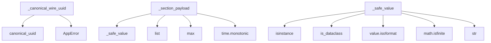

# Human-readable documentation for `service.py`

## 1. File overview

- **Source path:** `pvm_control_engine/src/pvm_control_engine/application/service.py`
- **Language:** Python
- **File type:** Python package/module
- **Primary responsibility:** Engine-facing allowlisted service for the local JSON-RPC boundary.

## 2. Functional summary

Engine-facing allowlisted service for the local JSON-RPC boundary.

## 3. Inputs and outputs

Public call inputs are the parameters shown in the function and method signatures below. Defaults and annotations are preserved from source. Explicit return expressions are listed with each callable; exceptions and mutations are summarized in the behavior notes.

## 4. Execution flow

The module is invoked through its declared API rather than running as a standalone program. The main callables and their internal calls/returns are summarized in section 5; imports and cross-module links are listed in section 10.

## 5. Functions and methods

### `_canonical_wire_uuid(value: str) -> str`

Calls `canonical_uuid`, `AppError`. Reads or updates `canonical`. Explicit return value(s): `canonical`. Can raise `AppError(ErrorKind.POLICY, 'VM identifier must be a canonical UUID', code='INVALID_UUID')`.

### `_section_payload(section, value) -> dict[str, Any]`

Calls `_safe_value`, `list`, `max`, `time.monotonic`. Explicit return value(s): `{'status': section.status.value, 'generation': section.generation, 'source': section.source, 'attemp`, `{'status': 'unavailable', 'value': None, 'error': 'no data returned'}`.

### `_safe_value(value: object) -> Any`

Calls `isinstance`, `is_dataclass`, `value.isoformat`, `math.isfinite`, `str`. Reads or updates `blocked`. Explicit return value(s): `None`, `value`, `value if math.isfinite(value) else None`, `value.value`.

### `EngineService.__init__(self, *, application, auth: AuthProvider, registry: CommandRegistry) -> None`

Reads or updates `self.application`, `self.auth`, `self.registry`. No explicit return statement; the function returns `None` unless an exception interrupts execution.

### `EngineService._session(self)`

Calls `self.auth.session`. Explicit return value(s): `self.auth.session()`.

### `EngineService.login(self, username: str, password: str) -> dict[str, Any]`

Calls `self.registry.get('user.login').execute`, `self.registry.get`. Reads or updates `(session, created)`. Explicit return value(s): `{'authenticated': True, 'username': session.username, 'new_session': created}`.

### `EngineService.logout(self) -> dict[str, bool]`

Calls `self.registry.get('user.logout').execute`, `self.registry.get`. Explicit return value(s): `{'authenticated': False}`.

### `EngineService.snapshot(self, sections: tuple[str, ...]) -> dict[str, Any]`

Calls `self._session`, `self.application.refresh`, `any`, `AppError`, `len`. Reads or updates `allowed`, `session`, `snapshot`. Explicit return value(s): `{'generation': snapshot.generation, 'sections': {name: _section_payload(section, section.value if se`. Can raise `AppError(ErrorKind.POLICY, 'unsupported snapshot sections', code='INVALID_SECTIONS')`.

### `EngineService.list_vms(self) -> dict[str, Any]`

Calls `self.registry.get('user.objects').execute`, `_section_payload`, `isinstance`, `self.registry.get`. Reads or updates `section`, `value`. Explicit return value(s): `_section_payload(section, value)`.

### `EngineService.vm_detail(self, uuid: str) -> dict[str, Any]`

Calls `_canonical_wire_uuid`, `self.registry.get('user.objects').execute`, `_section_payload`, `isinstance`, `self.registry.get`. Reads or updates `key`, `section`, `value`. Explicit return value(s): `_section_payload(section, value)`.

### `EngineService.host_status(self) -> dict[str, Any]`

Calls `self.registry.get('sball.show').execute`, `_section_payload`, `self.registry.get`. Reads or updates `section`. Explicit return value(s): `_section_payload(section, section.value if section else None)`.

### `EngineService.host_metrics(self) -> dict[str, Any]`

Calls `self.registry.get('monitoring.metrics').execute`, `_section_payload`, `self.registry.get`. Reads or updates `section`. Explicit return value(s): `_section_payload(section, section.value if section else None)`.

### `EngineService.desktop_list(self) -> dict[str, Any]`

Calls `self.registry.get('user.objects').execute`, `_section_payload`, `self.registry.get`. Reads or updates `section`. Explicit return value(s): `_section_payload(section, section.value if section else None)`.

### `EngineService.dashboard(self) -> dict[str, Any]`

Calls `self.registry.get('user.objects').execute`, `_section_payload`, `self.registry.get`. Reads or updates `section`. Explicit return value(s): `_section_payload(section, section.value if section else None)`.

### `EngineService.tap_mapping(self) -> dict[str, Any]`

Calls `self.registry.get('user.objects').execute`, `_section_payload`, `self.registry.get`. Reads or updates `section`. Explicit return value(s): `_section_payload(section, section.value if section else None)`.

### `EngineService.nic_list(self) -> dict[str, Any]`

Calls `self.registry.get('network.nic_list').execute`, `_section_payload`, `self.registry.get`. Reads or updates `section`. Explicit return value(s): `_section_payload(section, section.value if section else None)`.

### `EngineService.local_host(self) -> dict[str, Any]`

Calls `self.registry.get('local.host_metrics').execute`, `_section_payload`, `self.registry.get`. Reads or updates `section`. Explicit return value(s): `_section_payload(section, section.value if section else None)`.

### `EngineService.nic_samples(self) -> dict[str, Any]`

Calls `self.registry.get('local.nic_samples').execute`, `_section_payload`, `self.registry.get`. Reads or updates `(physical, samples)`. Explicit return value(s): `{'physical_nics': _section_payload(physical, physical.value if physical else None), 'nic_samples': _`.

### `EngineService.recent_audit(self, limit: int=100) -> dict[str, Any]`

Calls `self.registry.get('local.audit').execute`, `isinstance`, `AppError`, `_safe_value`, `self.registry.get`. Reads or updates `entries`. Explicit return value(s): `{'entries': _safe_value(entries), 'limit': limit}`. Can raise `AppError(ErrorKind.POLICY, 'audit limit must be between 1 and 500', code='INVALID_LIMIT')`.

### `EngineService.operate(self, action: str, uuid: str | None=None, uuids: tuple[str, ...] | None=None) -> dict[str, Any]`

Calls `self.registry.vm_action`, `_safe_value`, `AppError`, `command.execute`, `command.execute_many`. Reads or updates `command`, `result`. Explicit return value(s): `_safe_value(result)`. Can raise `AppError(ErrorKind.POLICY, 'provide exactly one UUID or UUID list', code='INVALID_UUID')`.

### `EngineService.operate_desktop(self, action: str, uuids: tuple[str, ...]) -> dict[str, Any]`

Calls `self.registry.get('desktop.operate').execute`, `_safe_value`, `self.registry.get`. Reads or updates `result`. Explicit return value(s): `_safe_value(result)`.

## 6. Classes and data structures

### `EngineService`

- **Bases:** no explicit base class.
- **Description:** Authenticate once per request, then delegate only to registered commands.
- **Methods:** `__init__`, `_session`, `login`, `logout`, `snapshot`, `list_vms`, `vm_detail`, `host_status`, `host_metrics`, `desktop_list`, `dashboard`, `tap_mapping`, `nic_list`, `local_host`, `nic_samples`, `recent_audit`, `operate`, `operate_desktop`.

## 7. Decision-making logic

The following branch conditions are present in the implementation; each selects the corresponding source-code path:

- `canonical != value`
- `section is None`
- `value is None or isinstance(value, (str, int, bool))`
- `isinstance(value, float)`
- `isinstance(value, Enum)`
- `isinstance(value, (datetime, date))`
- `isinstance(value, dict)`
- `isinstance(value, (tuple, list, set, frozenset))`
- `is_dataclass(value)`
- `not sections or len(sections) > len(allowed) or len(set(sections)) != len(sections) or any((item not in allowed for item in sections))`
- `not isinstance(value, InventoryData)`
- `not isinstance(value, VMDetail)`
- `isinstance(limit, bool) or not isinstance(limit, int) or (not 1 <= limit <= 500)`
- `(uuid is None) == (uuids is None)`
- `type(value).__name__ != 'AuditEntry'`
- `section.value is not None` (with an `else` branch)
- `section.value is not None` (with an `else` branch)
- `uuid is not None` (with an `else` branch)
- `section.succeeded_monotonic is not None` (with an `else` branch)
- `math.isfinite(value)` (with an `else` branch)
- `section` (with an `else` branch)
- `section` (with an `else` branch)
- `section` (with an `else` branch)
- `section` (with an `else` branch)
- `section` (with an `else` branch)
- `section` (with an `else` branch)
- `section` (with an `else` branch)
- `physical` (with an `else` branch)
- `samples` (with an `else` branch)
- `section.value is not None` (with an `else` branch)

## 8. Loops and repeated operations

Iteration is performed by the following loops/comprehensions:

- `(key, item) in value.items() (comprehension)`
- `item in value (comprehension)`
- `item in fields(value) (comprehension)`
- `name in sections (comprehension)`
- `item in sections (comprehension)`

## 9. Error handling

The module contains these exception-handling clauses:

- `try` block (line 152) handles: ValueError.

Explicitly raised exception expressions: `AppError(ErrorKind.POLICY, 'VM identifier must be a canonical UUID', code='INVALID_UUID')`, `AppError(ErrorKind.POLICY, 'unsupported snapshot sections', code='INVALID_SECTIONS')`, `AppError(ErrorKind.POLICY, 'audit limit must be between 1 and 500', code='INVALID_LIMIT')`, `AppError(ErrorKind.POLICY, 'provide exactly one UUID or UUID list', code='INVALID_UUID')`.

## 10. Dependencies and interactions

- **Project imports:** `pvm_control_engine.auth.provider`, `pvm_control_engine.domain.errors`, `pvm_control_engine.domain.models`, `pvm_control_engine.infrastructure.sbell.commands.registry`.
- **Standard-library/third-party imports:** `__future__`, `math`, `time`, `dataclasses`, `datetime`, `enum`, `typing`.

Related module documentation:

- [`pvm_control_engine.auth.provider`](../auth/provider.md)
- [`pvm_control_engine.domain.errors`](../domain/errors.md)
- [`pvm_control_engine.domain.models`](../domain/models/__init__.md)
- [`pvm_control_engine.infrastructure.sbell.commands.registry`](../infrastructure/sbell/commands/registry.md)

## 11. Real-world scenario

Engine-facing allowlisted service for the local JSON-RPC boundary.

## 12. Technical details and limitations

Behavior is bounded by the source contracts and imported dependencies. Environment-specific integration details (for example, external daemon responses or deployment permissions) require validation in the target environment. The module-level AST scan identifies implementation structure but does not claim runtime outcomes for unexecuted branches.

## 13. Call-flow diagram

## 14. Human-readable summary

`service.py` is part of `pvm_control_engine`. Engine-facing allowlisted service for the local JSON-RPC boundary. Its concrete interfaces, data structures, decisions, error paths, and direct dependencies are documented above; identifiers and source filenames are retained verbatim.
