# Human-readable documentation for `services.py`

## 1. File overview

- **Source path:** `pvm_control_engine/src/pvm_control_engine/application/services.py`
- **Language:** Python
- **File type:** Python package/module
- **Primary responsibility:** Application-facing read and target-selection use cases.

## 2. Functional summary

Application-facing read and target-selection use cases.

## 3. Inputs and outputs

Public call inputs are the parameters shown in the function and method signatures below. Defaults and annotations are preserved from source. Explicit return expressions are listed with each callable; exceptions and mutations are summarized in the behavior notes.

## 4. Execution flow

The module is invoked through its declared API rather than running as a standalone program. The main callables and their internal calls/returns are summarized in section 5; imports and cross-module links are listed in section 10.

## 5. Functions and methods

### `_record_order(record: VMRecord) -> tuple[int, str, str]`

Calls `record.name.casefold`. Explicit return value(s): `(0 if record.process_seen else 1, record.name.casefold(), record.uuid)`.

### `_is_group_selector(selector: str) -> bool`

Calls `selector.casefold().split`, `selector.casefold`. Reads or updates `prefix`. Explicit return value(s): `prefix in {'state', 'process', 'tag'}`.

### `_resolve_one(records: tuple[VMRecord, ...], selector: str) -> list[VMRecord]`

Calls `selector.casefold`, `lowered.startswith`, `lowered.isdecimal`, `lowered.partition(':')[2].strip`, `AppError`. Reads or updates `lowered`, `exact`, `state`, `accepted`, `presence`, `index`. Explicit return value(s): `[record for record in records if record.name.casefold().startswith(lowered)]`, `[record for record in records if record.state.casefold() in accepted]`, `[record for record in records if record.process_seen is (presence == 'present')]`, `[ordered[index - 1]] if 1 <= index <= len(ordered) else []`. Can raise `AppError(ErrorKind.POLICY, 'tag selectors are unsupported by the local object contract')`, `AppError(ErrorKind.POLICY, 'state selector requires a state')`, `AppError(ErrorKind.POLICY, 'process selector must be process:present or process:missing')`.

### `as_inventory(section: SectionSnapshot[object]) -> InventoryData`

Typed helper used by the presenters without coupling them to storage.

### `as_vm_detail(section: SectionSnapshot[object]) -> VMDetail`

Calls `isinstance`, `AppError`. Reads or updates `value`. Explicit return value(s): `value`. Can raise `AppError(ErrorKind.COLLECTION, section.error or 'VM detail is unavailable')`.

### `as_host_status(section: SectionSnapshot[object] | None) -> HostStatus | None`

Calls `isinstance`. Reads or updates `value`. Explicit return value(s): `value if isinstance(value, HostStatus) else None`, `None`.

### `as_host_metrics(section: SectionSnapshot[object] | None) -> HostMetrics | None`

Calls `isinstance`. Reads or updates `value`. Explicit return value(s): `value if isinstance(value, HostMetrics) else None`, `None`.

### `TargetSelection.uuids(self) -> tuple[str, ...]`

Calls `tuple`. Explicit return value(s): `tuple((record.uuid for record in self.records))`.

### `PlaividApplication.__init__(self, provider: PvmGateway, collection: CollectionCoordinator, settings: Settings, audit: AuditGateway | None=None) -> None`

Reads or updates `self.provider`, `self.collection`, `self.settings`, `self.audit`. No explicit return statement; the function returns `None` unless an exception interrupts execution.

### `PlaividApplication.refresh(self, token: str, *, sections: Iterable[str]=('inventory', 'host_status', 'host_metrics')) -> ApplicationSnapshot`

Calls `self.collection.collect_once`. Explicit return value(s): `self.collection.collect_once(token, sections=sections)`.

### `PlaividApplication.inventory(self, token: str) -> tuple[ApplicationSnapshot, SectionSnapshot[object]]`

Calls `self.refresh`, `snapshot.section`, `AppError`. Reads or updates `snapshot`, `section`. Explicit return value(s): `(snapshot, section)`. Can raise `AppError(ErrorKind.COLLECTION, 'inventory collection did not produce a section')`.

### `PlaividApplication.detail(self, token: str, uuid: str) -> SectionSnapshot[object]`

Calls `canonical_uuid`, `self.refresh`, `snapshot.section`, `AppError`. Reads or updates `key`, `snapshot`, `section`. Explicit return value(s): `section`. Can raise `AppError(ErrorKind.COLLECTION, 'VM detail collection did not produce a section')`.

### `PlaividApplication.host_status(self, token: str) -> SectionSnapshot[object] | None`

Calls `self.refresh(token, sections=('host_status',)).section`, `self.refresh`. Explicit return value(s): `self.refresh(token, sections=('host_status',)).section('host_status')`.

### `PlaividApplication.host_metrics(self, token: str) -> SectionSnapshot[object] | None`

Calls `self.refresh(token, sections=('host_metrics',)).section`, `self.refresh`. Explicit return value(s): `self.refresh(token, sections=('host_metrics',)).section('host_metrics')`.

### `PlaividApplication.tap_mapping(self, token: str) -> SectionSnapshot[object] | None`

Calls `self.refresh(token, sections=('tap_mapping',)).section`, `self.refresh`. Explicit return value(s): `self.refresh(token, sections=('tap_mapping',)).section('tap_mapping')`.

### `PlaividApplication.recent_audit(self, limit: int=100) -> tuple[AuditEntry, ...]`

Calls `self.audit.recent`, `AppError`. Explicit return value(s): `self.audit.recent(limit)`. Can raise `AppError(ErrorKind.AUDIT, 'audit database is not configured')`.

### `PlaividApplication.resolve_targets(inventory: InventoryData, selectors: Iterable[str]) -> TargetSelection`

Calls `tuple`, `any`, `resolved.sort`, `TargetSelection`, `AppError`. Reads or updates `raw`, `resolved`, `bulk`, `targets`, `matches`, `names`. Explicit return value(s): `TargetSelection(tuple(resolved), bulk, raw)`, `TargetSelection(targets, True, raw)`. Can raise `AppError(ErrorKind.POLICY, 'at least one VM selector is required')`, `AppError(ErrorKind.POLICY, "'all' cannot be combined with other selectors")`, `AppError(ErrorKind.POLICY, 'inventory contains no actionable VM records')`, `AppError(ErrorKind.POLICY, f'no VM matches selector {selector!r}')`.

### `PlaividApplication.inventory_value(section: SectionSnapshot[object]) -> InventoryData`

Calls `AppError`, `isinstance`, `section.status.value.replace`. Reads or updates `value`. Explicit return value(s): `value`. Can raise `AppError(ErrorKind.COLLECTION, section.error or f"inventory is {section.status.value.replace('_', ' `, `AppError(ErrorKind.COLLECTION, 'inventory has no current object records')`.

## 6. Classes and data structures

### `TargetSelection`

- **Bases:** no explicit base class.
- **Description:** Class declared with bases: no explicit base class.
- **Annotated fields:**
  - `records: tuple[VMRecord, ...]`
  - `is_bulk: bool`
  - `selectors: tuple[str, ...]`
- **Methods:** `uuids`.

### `PlaividApplication`

- **Bases:** no explicit base class.
- **Description:** Small facade shared by command-line and Textual presentations.
- **Methods:** `__init__`, `refresh`, `inventory`, `detail`, `host_status`, `host_metrics`, `tap_mapping`, `recent_audit`, `resolve_targets`, `inventory_value`.

## 7. Decision-making logic

The following branch conditions are present in the implementation; each selects the corresponding source-code path:

- `lowered.startswith('state:')`
- `lowered.startswith('process:')`
- `lowered.startswith('tag:')`
- `lowered.isdecimal()`
- `key`
- `exact`
- `not isinstance(value, VMDetail)`
- `section is None`
- `section is None`
- `section is None`
- `section is None`
- `self.audit is None`
- `not raw`
- `len(raw) == 1 and raw[0].casefold() == 'all'`
- `any((item.casefold() == 'all' for item in raw))`
- `section.status not in {CollectionStatus.CURRENT, CollectionStatus.PARTIAL}`
- `not isinstance(value, InventoryData)`
- `not state`
- `presence not in {'present', 'missing'}`
- `isinstance(section.value, VMDetail)` (with an `else` branch)
- `isinstance(section.value, HostStatus)` (with an `else` branch)
- `isinstance(value, HostStatus)` (with an `else` branch)
- `isinstance(section.value, HostMetrics)` (with an `else` branch)
- `isinstance(value, HostMetrics)` (with an `else` branch)
- `not targets`
- `not matches`
- `len(matches) > 1 and (not _is_group_selector(selector))`
- `record.process_seen` (with an `else` branch)
- `state == 'running'` (with an `else` branch)
- `1 <= index <= len(ordered)` (with an `else` branch)
- `any((existing.uuid == record.uuid for existing in resolved))`

## 8. Loops and repeated operations

Iteration is performed by the following loops/comprehensions:

- `selector in raw`
- `record in matches`
- `record in records (comprehension)`
- `record in records (comprehension)`
- `record in records (comprehension)`
- `record in records (comprehension)`
- `record in records (comprehension)`
- `record in self.records (comprehension)`
- `item in selectors (comprehension)`
- `item in raw (comprehension)`
- `item in raw (comprehension)`
- `record in matches[:4] (comprehension)`
- `existing in resolved (comprehension)`

## 9. Error handling

The module contains these exception-handling clauses:

- `try` block (line 167) handles: ValueError.

Explicitly raised exception expressions: `AppError(ErrorKind.POLICY, 'tag selectors are unsupported by the local object contract')`, `AppError(ErrorKind.COLLECTION, section.error or 'VM detail is unavailable')`, `AppError(ErrorKind.COLLECTION, 'inventory collection did not produce a section')`, `AppError(ErrorKind.COLLECTION, 'VM detail collection did not produce a section')`, `AppError(ErrorKind.AUDIT, 'audit database is not configured')`, `AppError(ErrorKind.POLICY, 'at least one VM selector is required')`, `AppError(ErrorKind.POLICY, "'all' cannot be combined with other selectors")`, `AppError(ErrorKind.COLLECTION, section.error or f"inventory is {section.status.value.replace('_', ' `, `AppError(ErrorKind.COLLECTION, 'inventory has no current object records')`, `AppError(ErrorKind.POLICY, 'state selector requires a state')`, `AppError(ErrorKind.POLICY, 'process selector must be process:present or process:missing')`, `AppError(ErrorKind.POLICY, 'inventory contains no actionable VM records')`.

## 10. Dependencies and interactions

- **Project imports:** `pvm_control_engine.application.collection`, `pvm_control_engine.application.ports`, `pvm_control_engine.config`, `pvm_control_engine.domain.errors`, `pvm_control_engine.domain.models`.
- **Standard-library/third-party imports:** `__future__`, `collections.abc`, `dataclasses`.

Related module documentation:

- [`pvm_control_engine.application.collection`](collection/__init__.md)
- [`pvm_control_engine.application.ports`](ports.md)
- [`pvm_control_engine.config`](../config.md)
- [`pvm_control_engine.domain.errors`](../domain/errors.md)
- [`pvm_control_engine.domain.models`](../domain/models/__init__.md)

## 11. Real-world scenario

Application-facing read and target-selection use cases.

## 12. Technical details and limitations

Behavior is bounded by the source contracts and imported dependencies. Environment-specific integration details (for example, external daemon responses or deployment permissions) require validation in the target environment. The module-level AST scan identifies implementation structure but does not claim runtime outcomes for unexecuted branches.

## 13. Call-flow diagram

```mermaid
flowchart TD
  _record_order["_record_order"] --> call_0["record.name.casefold"]
  _is_group_selector["_is_group_selector"] --> call_1["selector.casefold().split"]
  _is_group_selector["_is_group_selector"] --> call_2["selector.casefold"]
  _resolve_one["_resolve_one"] --> call_3["selector.casefold"]
  _resolve_one["_resolve_one"] --> call_4["lowered.startswith"]
  _resolve_one["_resolve_one"] --> call_5["lowered.isdecimal"]
  _resolve_one["_resolve_one"] --> call_6["lowered.partition(':')[2].strip"]
  _resolve_one["_resolve_one"] --> call_7["AppError"]
  as_inventory["as_inventory"] --> call_8["PlaividApplication.inventory_value"]
  as_vm_detail["as_vm_detail"] --> call_9["isinstance"]
  as_vm_detail["as_vm_detail"] --> call_10["AppError"]
  as_host_status["as_host_status"] --> call_11["isinstance"]
```

## 14. Human-readable summary

`services.py` is part of `pvm_control_engine`. Application-facing read and target-selection use cases. Its concrete interfaces, data structures, decisions, error paths, and direct dependencies are documented above; identifiers and source filenames are retained verbatim.
