# Human-readable documentation for `bootstrap.py`

## 1. File overview

- **Source path:** `pvm_control_engine/src/pvm_control_engine/bootstrap.py`
- **Language:** Python
- **File type:** Python package/module
- **Primary responsibility:** Engine CLI, configuration boundary, and process lifecycle policy.

## 2. Functional summary

Engine CLI, configuration boundary, and process lifecycle policy.

## 3. Inputs and outputs

Public call inputs are the parameters shown in the function and method signatures below. Defaults and annotations are preserved from source. Explicit return expressions are listed with each callable; exceptions and mutations are summarized in the behavior notes.

## 4. Execution flow

The module is invoked through its declared API rather than running as a standalone program. The main callables and their internal calls/returns are summarized in section 5; imports and cross-module links are listed in section 10.

## 5. Functions and methods

### `_parse_socket_mode(value: str) -> int`

Calls `int`, `argparse.ArgumentTypeError`. Reads or updates `mode`. Explicit return value(s): `mode`. Can raise `argparse.ArgumentTypeError('socket mode must be 0600 or 0660')`.

### `_parser() -> argparse.ArgumentParser`

Calls `argparse.ArgumentParser`, `parser.add_subparsers`, `subparsers.add_parser`, `login.add_argument`, `serve.add_argument`. Reads or updates `parser`, `subparsers`, `login`, `serve`. Explicit return value(s): `parser`.

### `_interactive_login(settings: Settings, username: str | None) -> int`

Calls `(username or settings.default_username).strip`, `getpass.getpass`, `print`, `sys.stdin.isatty`, `ProcessRunner`. Reads or updates `selected_user`, `password`, `runner`, `sbell`, `provider`, `sessions`. Explicit return value(s): `0`, `2`, `1`.

### `_socket_path(args: argparse.Namespace, settings: Settings) -> str`

Calls `os.environ.get`, `str`, `Path`. Reads or updates `configured_path`, `runtime_dir`. Explicit return value(s): `str(Path(runtime_dir) / 'pvm-control-engine.sock')`, `configured_path`.

### `_run_runtime(runtime: EngineRuntime) -> int`

Calls `signal.getsignal`, `signal.signal`, `runtime.serve`, `runtime.close`, `runtime.server.request_shutdown`. Reads or updates `old_handler`, `handler_installed`. Explicit return value(s): `0`, `130`, `1`.

### `main(argv: Sequence[str] | None=None) -> int`

Calls `_parser().parse_args`, `_run_runtime`, `load_settings`, `build_runtime`, `_parser`. Reads or updates `args`, `settings`, `allowed_uids`, `runtime`. Explicit return value(s): `_run_runtime(runtime)`, `_interactive_login(settings, args.username)`, `2`.

## 6. Classes and data structures

No classes are declared in this module.

## 7. Decision-making logic

The following branch conditions are present in the implementation; each selects the corresponding source-code path:

- `mode not in {384, 432}`
- `not sys.stdin.isatty()`
- `configured_path`
- `args.command == 'login'`
- `handler_installed`

## 8. Loops and repeated operations

No explicit loops or comprehensions were found.

## 9. Error handling

The module contains these exception-handling clauses:

- `try` block (line 24) handles: ValueError.
- `try` block (line 74) handles: Exception.
- `try` block (line 113) handles: no typed handler.
- `try` block (line 138) handles: (ConfigurationError, ValueError, OSError, RuntimeError).
- `try` block (line 117) handles: KeyboardInterrupt, OSError.
- `try` block (line 129) handles: no typed handler.

Explicitly raised exception expressions: `argparse.ArgumentTypeError('socket mode must be 0600 or 0660')`.

## 10. Dependencies and interactions

- **Project imports:** `pvm_control_engine.application.session_manager`, `pvm_control_engine.auth.session_store`, `pvm_control_engine.composition`, `pvm_control_engine.config`, `pvm_control_engine.infrastructure.process`, `pvm_control_engine.infrastructure.pvm.adapter`, `pvm_control_engine.infrastructure.pvm.sbell`, `pvm_control_engine.infrastructure.sbell.commands.user.login`.
- **Standard-library/third-party imports:** `__future__`, `argparse`, `getpass`, `os`, `signal`, `sys`, `collections.abc`, `pathlib`.

Related module documentation:

- [`pvm_control_engine.application.session_manager`](application/session_manager.md)
- [`pvm_control_engine.auth.session_store`](auth/session_store.md)
- [`pvm_control_engine.composition`](composition.md)
- [`pvm_control_engine.config`](config.md)
- [`pvm_control_engine.infrastructure.process`](infrastructure/process.md)
- [`pvm_control_engine.infrastructure.pvm.adapter`](infrastructure/pvm/adapter/__init__.md)
- [`pvm_control_engine.infrastructure.pvm.sbell`](infrastructure/pvm/sbell.md)
- [`pvm_control_engine.infrastructure.sbell.commands.user.login`](infrastructure/sbell/commands/user/login.md)

## 11. Real-world scenario

Engine CLI, configuration boundary, and process lifecycle policy.

## 12. Technical details and limitations

Behavior is bounded by the source contracts and imported dependencies. Environment-specific integration details (for example, external daemon responses or deployment permissions) require validation in the target environment. The module-level AST scan identifies implementation structure but does not claim runtime outcomes for unexecuted branches.

## 13. Call-flow diagram

```mermaid
flowchart TD
  _parse_socket_mode["_parse_socket_mode"] --> call_0["int"]
  _parse_socket_mode["_parse_socket_mode"] --> call_1["argparse.ArgumentTypeError"]
  _parser["_parser"] --> call_2["argparse.ArgumentParser"]
  _parser["_parser"] --> call_3["parser.add_subparsers"]
  _parser["_parser"] --> call_4["subparsers.add_parser"]
  _parser["_parser"] --> call_5["login.add_argument"]
  _parser["_parser"] --> call_6["serve.add_argument"]
  _interactive_login["_interactive_login"] --> call_7["(username or settings.default_username).strip"]
  _interactive_login["_interactive_login"] --> call_8["getpass.getpass"]
  _interactive_login["_interactive_login"] --> call_9["print"]
  _interactive_login["_interactive_login"] --> call_10["sys.stdin.isatty"]
  _interactive_login["_interactive_login"] --> call_11["ProcessRunner"]
```

## 14. Human-readable summary

`bootstrap.py` is part of `pvm_control_engine`. Engine CLI, configuration boundary, and process lifecycle policy. Its concrete interfaces, data structures, decisions, error paths, and direct dependencies are documented above; identifiers and source filenames are retained verbatim.
