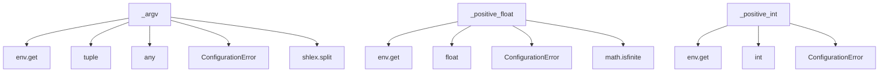

# Human-readable documentation for `config.py`

## 1. File overview

- **Source path:** `pvm_control_engine/src/pvm_control_engine/config.py`
- **Language:** Python
- **File type:** Python package/module
- **Primary responsibility:** Validated runtime configuration loaded at the composition boundary.

## 2. Functional summary

Validated runtime configuration loaded at the composition boundary.

## 3. Inputs and outputs

Public call inputs are the parameters shown in the function and method signatures below. Defaults and annotations are preserved from source. Explicit return expressions are listed with each callable; exceptions and mutations are summarized in the behavior notes.

## 4. Execution flow

The module is invoked through its declared API rather than running as a standalone program. The main callables and their internal calls/returns are summarized in section 5; imports and cross-module links are listed in section 10.

## 5. Functions and methods

### `_argv(env: Mapping[str, str], name: str, default: str) -> tuple[str, ...]`

Calls `env.get`, `tuple`, `any`, `ConfigurationError`, `shlex.split`. Reads or updates `raw`, `parts`. Explicit return value(s): `parts`. Can raise `ConfigurationError(f'{name} must define a non-empty executable argv')`, `ConfigurationError(f'{name} contains invalid quoting')`.

### `_positive_float(env: Mapping[str, str], name: str, default: str) -> float`

Calls `env.get`, `float`, `ConfigurationError`, `math.isfinite`. Reads or updates `raw`, `value`. Explicit return value(s): `value`. Can raise `ConfigurationError(f'{name} must be a finite positive number')`, `ConfigurationError(f'{name} must be numeric')`.

### `_positive_int(env: Mapping[str, str], name: str, default: str) -> int`

Calls `env.get`, `int`, `ConfigurationError`. Reads or updates `raw`, `value`. Explicit return value(s): `value`. Can raise `ConfigurationError(f'{name} must be a positive integer')`, `ConfigurationError(f'{name} must be an integer')`.

### `_optional_positive_float(env: Mapping[str, str], name: str) -> float | None`

Calls `env.get`, `float`, `ConfigurationError`, `raw.strip`, `math.isfinite`. Reads or updates `raw`, `value`. Explicit return value(s): `value`, `None`. Can raise `ConfigurationError(f'{name} must be a finite positive number when configured')`, `ConfigurationError(f'{name} must be numeric')`.

### `_enabled(env: Mapping[str, str], name: str) -> bool`

Calls `env.get(name, '').strip().lower`, `env.get(name, '').strip`, `env.get`. Explicit return value(s): `env.get(name, '').strip().lower() in {'1', 'true', 'yes', 'on'}`.

### `load_settings(environ: Mapping[str, str] | None=None) -> Settings`

Calls `Path`, `Path(env.get('PLAIVID_STATE_DIR', str(state_home / 'plaivid'))).expanduser`, `env.get`, `env.get('PLAIVID_USER', 'manage').strip`, `env.get('PLAIVID_LOG_LEVEL', 'WARNING').upper`. Reads or updates `env`, `state_home`, `state_dir`, `output_raw`, `username`, `log_level`. Explicit return value(s): `Settings(sbell_argv=_argv(env, 'PLAIVID_SBELL', 'sudo sbell'), running_vms_argv=_argv(env, 'PLAIVID_`. Can raise `ConfigurationError('PLAIVID_MAX_OUTPUT_BYTES must be at least 1024')`, `ConfigurationError('PLAIVID_USER cannot be empty')`, `ConfigurationError('PLAIVID_LOG_LEVEL is not a supported logging level')`, `ConfigurationError('PLAIVID_MAX_OUTPUT_BYTES must be an integer')`.

## 6. Classes and data structures

### `ConfigurationError`

- **Bases:** ValueError.
- **Description:** A required runtime setting is invalid or unsafe.

### `Settings`

- **Bases:** no explicit base class.
- **Description:** Class declared with bases: no explicit base class.
- **Annotated fields:**
  - `sbell_argv: tuple[str, ...]`
  - `running_vms_argv: tuple[str, ...]`
  - `process_timeout: float`
  - `max_output_bytes: int`
  - `refresh_interval: float`
  - `state_dir: Path`
  - `session_file: Path`
  - `default_username: str`
  - `allow_credential_argv: bool`
  - `max_inventory_age_seconds: float | None`
  - `audit_database: Path`
  - `log_level: str`
  - `host_status_interval: float` (default: `2.0`)
  - `action_timeout: float` (default: `10.0`)
  - `max_concurrency: int` (default: `3`)

## 7. Decision-making logic

The following branch conditions are present in the implementation; each selects the corresponding source-code path:

- `not parts or any((not part for part in parts))`
- `not math.isfinite(value) or value <= 0`
- `value <= 0`
- `raw is None or not raw.strip()`
- `not math.isfinite(value) or value <= 0`
- `max_output < 1024`
- `not username`
- `log_level not in {'DEBUG', 'INFO', 'WARNING', 'ERROR', 'CRITICAL'}`
- `environ is None` (with an `else` branch)

## 8. Loops and repeated operations

Iteration is performed by the following loops/comprehensions:

- `part in parts (comprehension)`

## 9. Error handling

The module contains these exception-handling clauses:

- `try` block (line 19) handles: ValueError.
- `try` block (line 30) handles: (TypeError, ValueError).
- `try` block (line 41) handles: (TypeError, ValueError).
- `try` block (line 54) handles: ValueError.
- `try` block (line 91) handles: ValueError.

Explicitly raised exception expressions: `ConfigurationError(f'{name} must define a non-empty executable argv')`, `ConfigurationError(f'{name} must be a finite positive number')`, `ConfigurationError(f'{name} must be a positive integer')`, `ConfigurationError(f'{name} must be a finite positive number when configured')`, `ConfigurationError('PLAIVID_MAX_OUTPUT_BYTES must be at least 1024')`, `ConfigurationError('PLAIVID_USER cannot be empty')`, `ConfigurationError('PLAIVID_LOG_LEVEL is not a supported logging level')`, `ConfigurationError(f'{name} contains invalid quoting')`, `ConfigurationError(f'{name} must be numeric')`, `ConfigurationError(f'{name} must be an integer')`, `ConfigurationError('PLAIVID_MAX_OUTPUT_BYTES must be an integer')`.

## 10. Dependencies and interactions

- **Project imports:** none directly declared.
- **Standard-library/third-party imports:** `__future__`, `math`, `os`, `shlex`, `collections.abc`, `dataclasses`, `pathlib`.

## 11. Real-world scenario

Validated runtime configuration loaded at the composition boundary.

## 12. Technical details and limitations

Behavior is bounded by the source contracts and imported dependencies. Environment-specific integration details (for example, external daemon responses or deployment permissions) require validation in the target environment. The module-level AST scan identifies implementation structure but does not claim runtime outcomes for unexecuted branches.

## 13. Call-flow diagram

## 14. Human-readable summary

`config.py` is part of `pvm_control_engine`. Validated runtime configuration loaded at the composition boundary. Its concrete interfaces, data structures, decisions, error paths, and direct dependencies are documented above; identifiers and source filenames are retained verbatim.
