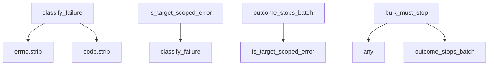

# Human-readable documentation for `policies.py`

## 1. File overview

- **Source path:** `pvm_control_engine/src/pvm_control_engine/domain/policies.py`
- **Language:** Python
- **File type:** Python package/module
- **Primary responsibility:** Pure operation risk and freshness policies.

## 2. Functional summary

Pure operation risk and freshness policies.

## 3. Inputs and outputs

Public call inputs are the parameters shown in the function and method signatures below. Defaults and annotations are preserved from source. Explicit return expressions are listed with each callable; exceptions and mutations are summarized in the behavior notes.

## 4. Execution flow

The module is invoked through its declared API rather than running as a standalone program. The main callables and their internal calls/returns are summarized in section 5; imports and cross-module links are listed in section 10.

## 5. Functions and methods

### `action_policy(action: Action) -> ActionPolicy`

Explicit return value(s): `_POLICIES[action]`.

### `bulk_may_dispatch(*, action: Action, is_bulk: bool, complete: bool, fresh: bool, max_age_seconds: float | None) -> bool`

Return whether a bulk plan has the required inventory evidence.

### `classify_failure(errno: str | None, *, code: str | None=None, default: FailureScope=FailureScope.TARGET) -> FailureScope`

Classify a dispatched failure using explicit session identifiers. A healthy daemon plus an error that is not known to be session-wide is treated as target-scoped. This includes previously unknown PVM errnos, which is required to isolate target-specific storage/disk failures. Callers must reject undispatched failures and daemon-offline outcomes before this helper.

### `is_target_scoped_error(outcome: TargetOutcome, *, daemon_alive: bool=True) -> bool`

True when a failure is isolated to a dispatched target. Session/auth/contract errnos and local process-start failures stop further submission. Any other dispatched error is target-scoped only while the daemon liveness probe is healthy. Healthy-daemon action timeouts remain uncertain but do not block other targets; they are never retried.

### `outcome_stops_batch(outcome: TargetOutcome, *, daemon_alive: bool=True) -> bool`

True when this outcome must abort the rest of a bulk batch.

### `batch_stop_reason(outcome: TargetOutcome, *, daemon_alive: bool=True) -> str`

Short, operator-safe reason recorded on targets skipped by a stop. Shared by both executors so the VM and Desktop paths cannot diverge.

### `bulk_must_stop(outcomes: Iterable[TargetOutcome]) -> bool`

True if any recorded outcome requires stopping the batch.

## 6. Classes and data structures

### `FailureScope`

- **Bases:** StrEnum.
- **Description:** Whether a per-target failure is local to that target or batch-wide.

### Module-level values

- `_POLICIES` = `{Action.START: ActionPolicy(Action.START, RiskLevel.MODERATE), Action.STOP: ActionPolicy(Action.STOP, RiskLevel.HIGH), Action.KILL: ActionPolicy(Action.KILL, RiskLevel.CRITICAL), A`
- `TARGET_SCOPED_ERRNOS` (`frozenset[str]`) = `frozenset({'146'})`
- `SESSION_SCOPED_ERRNOS` (`frozenset[str]`) = `frozenset({'39', '40', '106', '107', '108', '137', '185'})`
- `SESSION_SCOPED_CODES` (`frozenset[str]`) = `frozenset({'PROCESS_START_FAILED', 'DAEMON_OFFLINE', 'CREDENTIAL_ARGV_ACK_REQUIRED', 'WORKER_FAILURE'})`
- `COMMAND_TIMEOUT_CODE` = `'PVM_COMMAND_TIMEOUT'`
- `DAEMON_OFFLINE_REASON` = `'Daemon Offline'`
- `STOP_STATES` (`frozenset[OperationState]`) = `frozenset({OperationState.FAILED, OperationState.REJECTED, OperationState.OUTCOME_UNKNOWN})`

## 7. Decision-making logic

The following branch conditions are present in the implementation; each selects the corresponding source-code path:

- `not is_bulk`
- `max_age_seconds is None or max_age_seconds <= 0`
- `not complete or not fresh`
- `errno is not None and errno.strip() in SESSION_SCOPED_ERRNOS`
- `code is not None and code.strip() in SESSION_SCOPED_CODES`
- `errno is not None and errno.strip() in TARGET_SCOPED_ERRNOS`
- `not daemon_alive or not outcome.dispatched`
- `not daemon_alive`
- `not daemon_alive`
- `outcome.state is OperationState.OUTCOME_UNKNOWN`

## 8. Loops and repeated operations

Iteration is performed by the following loops/comprehensions:

- `outcome in outcomes (comprehension)`

## 9. Error handling

No local `try`/`except` handler was found. Exceptions from called dependencies propagate unless caught by a caller.

No explicit `raise` statement was found in this module.

## 10. Dependencies and interactions

- **Project imports:** `pvm_control_engine.domain.models`.
- **Standard-library/third-party imports:** `__future__`, `collections.abc`, `enum`.

Related module documentation:

- [`pvm_control_engine.domain.models`](models/__init__.md)

## 11. Real-world scenario

Pure operation risk and freshness policies.

## 12. Technical details and limitations

Behavior is bounded by the source contracts and imported dependencies. Environment-specific integration details (for example, external daemon responses or deployment permissions) require validation in the target environment. The module-level AST scan identifies implementation structure but does not claim runtime outcomes for unexecuted branches.

## 13. Call-flow diagram

## 14. Human-readable summary

`policies.py` is part of `pvm_control_engine`. Pure operation risk and freshness policies. Its concrete interfaces, data structures, decisions, error paths, and direct dependencies are documented above; identifiers and source filenames are retained verbatim.
