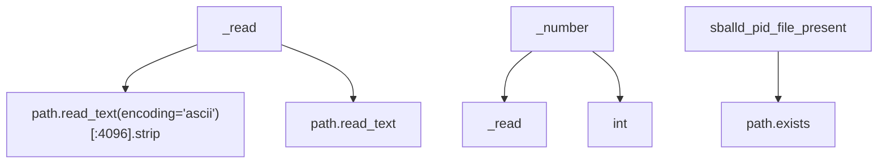

# Human-readable documentation for `local_monitor.py`

## 1. File overview

- **Source path:** `pvm_control_engine/src/pvm_control_engine/infrastructure/local_monitor.py`
- **Language:** Python
- **File type:** Python package/module
- **Primary responsibility:** Bounded local read-only Linux host and physical-interface sampling.

## 2. Functional summary

Bounded local read-only Linux host and physical-interface sampling.

## 3. Inputs and outputs

Public call inputs are the parameters shown in the function and method signatures below. Defaults and annotations are preserved from source. Explicit return expressions are listed with each callable; exceptions and mutations are summarized in the behavior notes.

## 4. Execution flow

The module is invoked through its declared API rather than running as a standalone program. The main callables and their internal calls/returns are summarized in section 5; imports and cross-module links are listed in section 10.

## 5. Functions and methods

### `_read(path: Path) -> str | None`

Calls `path.read_text(encoding='ascii')[:4096].strip`, `path.read_text`. Explicit return value(s): `path.read_text(encoding='ascii')[:4096].strip()`, `None`.

### `_number(path: Path) -> int | None`

Calls `_read`, `int`. Reads or updates `text`, `result`. Explicit return value(s): `result if result is not None and result >= 0 else None`, `None`.

### `sballd_pid_file_present(path: Path=SBALLD_PID_FILE) -> bool | None`

Whether the sballd PID file exists. None when the check itself fails (e.g. permissions).

### `LinuxMonitor.__init__(self, proc: Path=Path('/proc'), sys_net: Path=Path('/sys/class/net')) -> None`

Calls `Path`. Reads or updates `self.proc`, `self.sys_net`, `self._cpu`, `self._nic`. No explicit return statement; the function returns `None` unless an exception interrupts execution.

### `LinuxMonitor.host(self) -> LocalHostSample`

Calls `_read`, `(_read(self.proc / 'meminfo') or '').splitlines`, `memory.get`, `(_read(self.proc / 'loadavg') or '').split`, `(_read(self.proc / 'uptime') or '').split`. Reads or updates `stat`, `cpu`, `memory`, `total_mem`, `available`, `used`. Explicit return value(s): `LocalHostSample(hostname=socket.gethostname() or None, cpu_percent=cpu, memory_used=used, memory_tot`. Can raise `ValueError('non-finite host measurement')`.

### `LinuxMonitor.physical(self, name: str) -> bool`

Calls `bool`, `(self.sys_net / name / 'device').exists`, `_DEVICE.fullmatch`. Explicit return value(s): `name not in {'.', '..'} and bool(_DEVICE.fullmatch(name)) and (self.sys_net / name / 'device').exist`.

### `LinuxMonitor.nics(self, devices: tuple[PhysicalNic, ...]) -> tuple[NicSample, ...]`

Calls `time.monotonic`, `sorted`, `tuple`, `self._nic.get`, `samples.append`. Reads or updates `now`, `names`, `self._nic`, `samples`, `base`, `counters`. Explicit return value(s): `tuple(samples)`.

## 6. Classes and data structures

### `LinuxMonitor`

- **Bases:** no explicit base class.
- **Description:** Class declared with bases: no explicit base class.
- **Methods:** `__init__`, `host`, `physical`, `nics`.

### Module-level values

- `_DEVICE` = `re.compile('^[A-Za-z0-9_.:-]{1,32}$')`
- `_COUNTERS` = `('rx_bytes', 'tx_bytes', 'rx_packets', 'tx_packets', 'rx_errors', 'tx_errors', 'rx_dropped', 'tx_dropped', 'rx_crc_errors')`
- `SBALLD_PID_FILE` = `Path('/var/run/pvm/sballd.pid')`

## 7. Decision-making logic

The following branch conditions are present in the implementation; each selects the corresponding source-code path:

- `result is not None and result >= 0` (with an `else` branch)
- `stat`
- `text is not None` (with an `else` branch)
- `len(values) >= 4`
- `fields and fields[0].isdigit() and (len(fields) == 1 or fields[1] == 'kB')`
- `total_mem is not None and available is not None and (0 <= available <= total_mem)` (with an `else` branch)
- `any((value is not None and (not math.isfinite(value)) for value in (*loads, up)))`
- `previous and now > previous[0]`
- `self._cpu is not None`
- `len(load) >= 3` (with an `else` branch)
- `uptime` (with an `else` branch)
- `rx is not None and previous[1] is not None and (rx >= previous[1])`
- `tx is not None and previous[2] is not None and (tx >= previous[2])`
- `parts[0] == 'cpu'` (with an `else` branch)
- `total_delta > 0 and 0 <= idle_delta <= total_delta`
- `len(values) > 4` (with an `else` branch)
- `len(fields) > 1` (with an `else` branch)

## 8. Loops and repeated operations

Iteration is performed by the following loops/comprehensions:

- `line in (_read(self.proc / 'meminfo') or '').splitlines()`
- `name in sorted(names)`
- `device in devices (comprehension)`
- `(key, value) in self._nic.items() (comprehension)`
- `key in _COUNTERS (comprehension)`
- `value in (*loads, up) (comprehension)`
- `part in parts[1:] (comprehension)`
- `part in load[:3] (comprehension)`

## 9. Error handling

The module contains these exception-handling clauses:

- `try` block (line 28) handles: (OSError, UnicodeError).
- `try` block (line 36) handles: ValueError.
- `try` block (line 48) handles: OSError.
- `try` block (line 94) handles: ValueError.
- `try` block (line 66) handles: ValueError.

Explicitly raised exception expressions: `ValueError('non-finite host measurement')`.

## 10. Dependencies and interactions

- **Project imports:** `pvm_control_engine.domain.overview`.
- **Standard-library/third-party imports:** `__future__`, `math`, `re`, `socket`, `time`, `pathlib`.

Related module documentation:

- [`pvm_control_engine.domain.overview`](../domain/overview.md)

## 11. Real-world scenario

Bounded local read-only Linux host and physical-interface sampling.

## 12. Technical details and limitations

Behavior is bounded by the source contracts and imported dependencies. Environment-specific integration details (for example, external daemon responses or deployment permissions) require validation in the target environment. The module-level AST scan identifies implementation structure but does not claim runtime outcomes for unexecuted branches.

## 13. Call-flow diagram

## 14. Human-readable summary

`local_monitor.py` is part of `pvm_control_engine`. Bounded local read-only Linux host and physical-interface sampling. Its concrete interfaces, data structures, decisions, error paths, and direct dependencies are documented above; identifiers and source filenames are retained verbatim.
