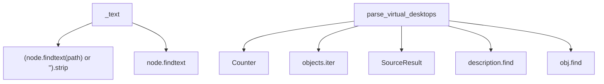

# Human-readable documentation for `desktops.py`

## 1. File overview

- **Source path:** `pvm_control_engine/src/pvm_control_engine/infrastructure/pvm/desktops.py`
- **Language:** Python
- **File type:** Python package/module
- **Primary responsibility:** Pure parser for the operator-verified Lite Desktop list response.

## 2. Functional summary

Pure parser for the operator-verified Lite Desktop list response.

## 3. Inputs and outputs

Public call inputs are the parameters shown in the function and method signatures below. Defaults and annotations are preserved from source. Explicit return expressions are listed with each callable; exceptions and mutations are summarized in the behavior notes.

## 4. Execution flow

The module is invoked through its declared API rather than running as a standalone program. The main callables and their internal calls/returns are summarized in section 5; imports and cross-module links are listed in section 10.

## 5. Functions and methods

### `_text(node: ET.Element, path: str) -> str | None`

Calls `(node.findtext(path) or '').strip`, `node.findtext`. Reads or updates `value`. Explicit return value(s): `value or None`.

### `parse_virtual_desktops(description: ET.Element) -> SourceResult[tuple[VirtualDesktop, ...]]`

Exclude invalid/duplicate identities; never confuse an absent wrapper with zero rows.

## 6. Classes and data structures

No classes are declared in this module.

## 7. Decision-making logic

The following branch conditions are present in the implementation; each selects the corresponding source-code path:

- `objects is None`
- `duplicates`
- `description.tag == 'objects'` (with an `else` branch)
- `_text(obj, 'type') != 'pvm_desktop_lite_virtual_desktop'`
- `issues` (with an `else` branch)
- `machine is not None` (with an `else` branch)
- `machine is not None` (with an `else` branch)
- `machine is not None` (with an `else` branch)
- `machine is not None` (with an `else` branch)
- `machine is not None` (with an `else` branch)
- `machine is not None` (with an `else` branch)

## 8. Loops and repeated operations

Iteration is performed by the following loops/comprehensions:

- `obj in objects.iter('pvm_desktop_obj')`
- `(uuid, count) in counts.items() (comprehension)`
- `item in candidates (comprehension)`

## 9. Error handling

The module contains these exception-handling clauses:

- `try` block (line 34) handles: ValueError.

No explicit `raise` statement was found in this module.

## 10. Dependencies and interactions

- **Project imports:** `pvm_control_engine.domain.desktops`, `pvm_control_engine.domain.models`, `pvm_control_engine.infrastructure.pvm.parsers`.
- **Standard-library/third-party imports:** `__future__`, `xml.etree.ElementTree`, `collections`.

Related module documentation:

- [`pvm_control_engine.domain.desktops`](../../domain/desktops.md)
- [`pvm_control_engine.domain.models`](../../domain/models/__init__.md)
- [`pvm_control_engine.infrastructure.pvm.parsers`](parsers/__init__.md)

## 11. Real-world scenario

Pure parser for the operator-verified Lite Desktop list response.

## 12. Technical details and limitations

Behavior is bounded by the source contracts and imported dependencies. Environment-specific integration details (for example, external daemon responses or deployment permissions) require validation in the target environment. The module-level AST scan identifies implementation structure but does not claim runtime outcomes for unexecuted branches.

## 13. Call-flow diagram

## 14. Human-readable summary

`desktops.py` is part of `pvm_control_engine`. Pure parser for the operator-verified Lite Desktop list response. Its concrete interfaces, data structures, decisions, error paths, and direct dependencies are documented above; identifiers and source filenames are retained verbatim.
