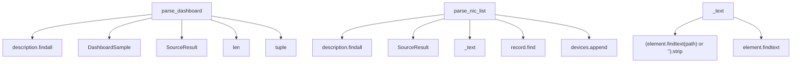

# Human-readable documentation for `overview.py`

## 1. File overview

- **Source path:** `pvm_control_engine/src/pvm_control_engine/infrastructure/pvm/overview.py`
- **Language:** Python
- **File type:** Python package/module
- **Primary responsibility:** Conservative parsers for the proposed dashboard and NIC-list read response. Only dashboard paths supplied in the integration specification are interpreted. The NIC-list *command* is documented, but its response schema is not: do not invent XML fields and present guessed devices as physical network interfaces.

## 2. Functional summary

Conservative parsers for the proposed dashboard and NIC-list read response. Only dashboard paths supplied in the integration specification are interpreted. The NIC-list *command* is documented, but its response schema is not: do not invent XML fields and present guessed devices as physical network interfaces.

## 3. Inputs and outputs

Public call inputs are the parameters shown in the function and method signatures below. Defaults and annotations are preserved from source. Explicit return expressions are listed with each callable; exceptions and mutations are summarized in the behavior notes.

## 4. Execution flow

The module is invoked through its declared API rather than running as a standalone program. The main callables and their internal calls/returns are summarized in section 5; imports and cross-module links are listed in section 10.

## 5. Functions and methods

### `parse_dashboard(description: ET.Element) -> SourceResult[DashboardSample]`

Calls `description.findall`, `DashboardSample`, `SourceResult`, `len`, `tuple`. Reads or updates `hosts`, `host`, `cpus`, `sample`, `value`. Explicit return value(s): `SourceResult(sample, CollectionStatus.CURRENT if host is not None else CollectionStatus.PARTIAL, 'us`, `SourceResult(None, CollectionStatus.UNAVAILABLE, 'user/objects/dashboard', error='multiple hosts; ho`, `value[:limit] or None`, `None`.

### `parse_nic_list(description: ET.Element) -> SourceResult[tuple[PhysicalNic, ...]]`

Parse ``sbell network nic-list``: one ``<nic>`` per record under ``nic_list``. ``<device>`` (e.g. ``eno4``) is the Linux interface name and becomes ``PhysicalNic.name``; ``<name>`` (e.g. ``NIC4``) is the PVM identifier. Any record missing either one fails closed.

### `_text(element: ET.Element, path: str, limit: int) -> str | None`

Calls `(element.findtext(path) or '').strip`, `element.findtext`. Reads or updates `value`. Explicit return value(s): `value[:limit] or None`.

### Lexically nested definitions

#### `parse_dashboard.field(path: str, limit: int=64) -> str | None`

Calls `(host.findtext(path) or '').strip`, `host.findtext`. Reads or updates `value`. Explicit return value(s): `value[:limit] or None`, `None`.

## 6. Classes and data structures

No classes are declared in this module.

## 7. Decision-making logic

The following branch conditions are present in the implementation; each selects the corresponding source-code path:

- `len(hosts) > 1`
- `not lists`
- `hosts` (with an `else` branch)
- `host is not None` (with an `else` branch)
- `host is None`
- `name is None or device is None`
- `redundant is not None`
- `host is not None` (with an `else` branch)

## 8. Loops and repeated operations

Iteration is performed by the following loops/comprehensions:

- `record in (nic for nic_list in lists for nic in nic_list.findall('nic'))`
- `nic_list in lists (comprehension)`
- `nic in nic_list.findall('nic') (comprehension)`
- `cpu in host.findall('cpus/cpu') (comprehension)`

## 9. Error handling

No local `try`/`except` handler was found. Exceptions from called dependencies propagate unless caught by a caller.

No explicit `raise` statement was found in this module.

## 10. Dependencies and interactions

- **Project imports:** `pvm_control_engine.domain.models`, `pvm_control_engine.domain.overview`.
- **Standard-library/third-party imports:** `__future__`, `xml.etree.ElementTree`.

Related module documentation:

- [`pvm_control_engine.domain.models`](../../domain/models/__init__.md)
- [`pvm_control_engine.domain.overview`](../../domain/overview.md)

## 11. Real-world scenario

Conservative parsers for the proposed dashboard and NIC-list read response. Only dashboard paths supplied in the integration specification are interpreted. The NIC-list *command* is documented, but its response schema is not: do not invent XML fields and present guessed devices as physical network interfaces.

## 12. Technical details and limitations

Behavior is bounded by the source contracts and imported dependencies. Environment-specific integration details (for example, external daemon responses or deployment permissions) require validation in the target environment. The module-level AST scan identifies implementation structure but does not claim runtime outcomes for unexecuted branches.

## 13. Call-flow diagram

## 14. Human-readable summary

`overview.py` is part of `pvm_control_engine`. Conservative parsers for the proposed dashboard and NIC-list read response. Only dashboard paths supplied in the integration specification are interpreted. The NIC-list *command* is documented, but its response schema is not: do not invent XML fields and present guessed devices as physical network interfaces. Its concrete interfaces, data structures, decisions, error paths, and direct dependencies are documented above; identifiers and source filenames are retained verbatim.
