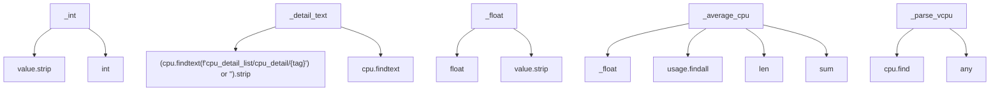

# Human-readable documentation for `common.py`

## 1. File overview

- **Source path:** `pvm_control_engine/src/pvm_control_engine/infrastructure/pvm/parsers/common.py`
- **Language:** Python
- **File type:** Python package/module
- **Primary responsibility:** Shared safe numeric and XML text conversions used by PVM parsers.

## 2. Functional summary

Shared safe numeric and XML text conversions used by PVM parsers.

## 3. Inputs and outputs

Public call inputs are the parameters shown in the function and method signatures below. Defaults and annotations are preserved from source. Explicit return expressions are listed with each callable; exceptions and mutations are summarized in the behavior notes.

## 4. Execution flow

The module is invoked through its declared API rather than running as a standalone program. The main callables and their internal calls/returns are summarized in section 5; imports and cross-module links are listed in section 10.

## 5. Functions and methods

### `_int(value: str | None) -> int | None`

Calls `value.strip`, `int`. Reads or updates `text`, `parsed`. Explicit return value(s): `parsed if parsed >= 0 else None`, `None`.

### `_detail_text(cpu: ET.Element | None, tag: str) -> str | None`

Text of ``cpu_info/cpu_detail_list/cpu_detail/<tag>`` (first logical CPU), or None.

### `_float(value: str | None) -> float | None`

Calls `float`, `value.strip`. Reads or updates `parsed`. Explicit return value(s): `parsed if parsed >= 0 else None`, `None`.

### `_average_cpu(usage: ET.Element | None) -> tuple[float | None, int | None]`

Calls `_float`, `usage.findall`, `len`, `sum`. Reads or updates `values`, `valid`. Explicit return value(s): `(sum(valid) / len(valid), len(values)) if valid else (None, len(values) or None)`, `(None, None)`.

### `_parse_vcpu(cpu: ET.Element | None) -> int | None`

Calls `cpu.find`, `any`, `_int`, `vcpu.findtext`. Reads or updates `vcpu`, `parts`, `total`. Explicit return value(s): `total`, `None`.

### `_real(value: str | None) -> float | None`

Signed decimal (temperatures may be negative); None for missing or non-finite text.

### `_text(element: ET.Element | None, path: str) -> str | None`

Calls `(element.findtext(path) or '').strip`, `element.findtext`. Reads or updates `value`. Explicit return value(s): `value or None`, `None`.

## 6. Classes and data structures

No classes are declared in this module.

## 7. Decision-making logic

The following branch conditions are present in the implementation; each selects the corresponding source-code path:

- `value is None`
- `not text`
- `cpu is None`
- `value is None`
- `usage is None`
- `cpu is None`
- `vcpu is None`
- `any((value is None or value < 1 for value in parts))`
- `value is None`
- `element is None`
- `parsed >= 0` (with an `else` branch)
- `parsed >= 0` (with an `else` branch)
- `valid` (with an `else` branch)
- `parsed == parsed and parsed not in (float('inf'), float('-inf'))` (with an `else` branch)

## 8. Loops and repeated operations

Iteration is performed by the following loops/comprehensions:

- `part in parts`
- `cpu in usage.findall('cpus/cpu') (comprehension)`
- `value in values (comprehension)`
- `key in ('socket', 'core', 'thread') (comprehension)`
- `value in parts (comprehension)`

## 9. Error handling

The module contains these exception-handling clauses:

- `try` block (line 14) handles: ValueError.
- `try` block (line 31) handles: (AttributeError, ValueError).
- `try` block (line 66) handles: (AttributeError, ValueError).

No explicit `raise` statement was found in this module.

## 10. Dependencies and interactions

- **Project imports:** none directly declared.
- **Standard-library/third-party imports:** `__future__`, `xml.etree.ElementTree`.

## 11. Real-world scenario

Shared safe numeric and XML text conversions used by PVM parsers.

## 12. Technical details and limitations

Behavior is bounded by the source contracts and imported dependencies. Environment-specific integration details (for example, external daemon responses or deployment permissions) require validation in the target environment. The module-level AST scan identifies implementation structure but does not claim runtime outcomes for unexecuted branches.

## 13. Call-flow diagram

## 14. Human-readable summary

`common.py` is part of `pvm_control_engine`. Shared safe numeric and XML text conversions used by PVM parsers. Its concrete interfaces, data structures, decisions, error paths, and direct dependencies are documented above; identifiers and source filenames are retained verbatim.
