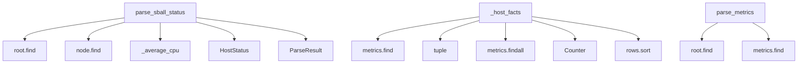

# Human-readable documentation for `host.py`

## 1. File overview

- **Source path:** `pvm_control_engine/src/pvm_control_engine/infrastructure/pvm/parsers/host.py`
- **Language:** Python
- **File type:** Python package/module
- **Primary responsibility:** Sball host status and host telemetry XML parsers.

## 2. Functional summary

Sball host status and host telemetry XML parsers.

## 3. Inputs and outputs

Public call inputs are the parameters shown in the function and method signatures below. Defaults and annotations are preserved from source. Explicit return expressions are listed with each callable; exceptions and mutations are summarized in the behavior notes.

## 4. Execution flow

The module is invoked through its declared API rather than running as a standalone program. The main callables and their internal calls/returns are summarized in section 5; imports and cross-module links are listed in section 10.

## 5. Functions and methods

### `parse_sball_status(root: ET.Element) -> ParseResult[HostStatus | None]`

Calls `root.find`, `node.find`, `_average_cpu`, `HostStatus`, `ParseResult`. Reads or updates `node`, `usage`, `info`, `root_fs`, `(cpu_pct, cpu_count)`, `total`. Explicit return value(s): `ParseResult(status, CollectionStatus.CURRENT, source='sball/show')`, `ParseResult(None, CollectionStatus.UNAVAILABLE, source='sball/show', quality_issues=('node status un`, `ParseResult(status, CollectionStatus.PARTIAL, source='sball/show', quality_issues=('resource usage u`.

### `_host_facts(metrics: ET.Element, system: ET.Element | None) -> HostFacts`

Fields from system_info, load_stats, process_stats, system_stats and the lists.

### `parse_metrics(root: ET.Element) -> ParseResult[HostMetrics | None]`

Calls `root.find`, `metrics.find`, `metrics.findall`, `HostMetrics`, `ParseResult`. Reads or updates `metrics`, `cpu`, `memory`, `swap`, `system`, `interfaces`. Explicit return value(s): `ParseResult(value, CollectionStatus.CURRENT, source='monitoring/metrics')`, `ParseResult(None, CollectionStatus.UNAVAILABLE, source='monitoring/metrics', quality_issues=('metric`.

## 6. Classes and data structures

### `HostFacts`

- **Bases:** TypedDict.
- **Description:** Class declared with bases: TypedDict.
- **Annotated fields:**
  - `host_id: str | None`
  - `platform_family: str | None`
  - `kernel_version: str | None`
  - `virtualization: str | None`
  - `boot_time: str | None`
  - `uptime_seconds: int | None`
  - `cpu_count: int | None`
  - `run_queue: int | None`
  - `blocked_tasks: int | None`
  - `blocked_percent: float | None`
  - `total_tasks: int | None`
  - `num_processes: int | None`
  - `num_threads: int | None`
  - `open_fds: int | None`
  - `context_switches: int | None`
  - `interrupts: int | None`
  - `forks: int | None`
  - `temperatures: tuple[TemperatureReading, ...]`
  - `users: tuple[UserSession, ...]`
  - `processes: tuple[ProcessSample, ...]`
  - `process_total: int | None`
  - `command_summary: tuple[tuple[str, int], ...]`

### Module-level values

- `ParseResult` = `SourceResult`
- `_PROCESS_LIMIT` = `50`
- `_REAL_FILESYSTEMS` = `frozenset({'ext2', 'ext3', 'ext4', 'xfs', 'btrfs', 'vfat', 'zfs', 'nfs', 'nfs4'})`

## 7. Decision-making logic

The following branch conditions are present in the implementation; each selects the corresponding source-code path:

- `node is None`
- `node_id is None and usage is not None`
- `usage is None`
- `metrics is None`
- `usage is not None` (with an `else` branch)
- `usage is not None` (with an `else` branch)
- `info is not None` (with an `else` branch)
- `info is not None` (with an `else` branch)
- `pid is None`
- `procs is not None` (with an `else` branch)
- `kind.strip().lower() == 'loopback'`
- `name`
- `filesystem not in _REAL_FILESYSTEMS or total is None or total <= 0`
- `system is not None` (with an `else` branch)
- `load is not None` (with an `else` branch)
- `load is not None` (with an `else` branch)
- `load is not None` (with an `else` branch)
- `load is not None` (with an `else` branch)
- `load is not None` (with an `else` branch)
- `procs is not None` (with an `else` branch)
- `procs is not None` (with an `else` branch)
- `sysstats is not None` (with an `else` branch)
- `sysstats is not None` (with an `else` branch)
- `sysstats is not None` (with an `else` branch)
- `total is not None` (with an `else` branch)
- `mountpoint.startswith('/DataStore')` (with an `else` branch)
- `usage is not None` (with an `else` branch)
- `usage is not None` (with an `else` branch)
- `total is not None and free is not None` (with an `else` branch)
- `info is not None` (with an `else` branch)
- `info is not None` (with an `else` branch)
- `info is not None` (with an `else` branch)
- `root_fs is not None` (with an `else` branch)
- `root_fs is not None` (with an `else` branch)
- `'VirtualFlash' in mountpoint or 'FlashMount' in mountpoint` (with an `else` branch)
- …and 13 additional conditional nodes.

## 8. Loops and repeated operations

Iteration is performed by the following loops/comprehensions:

- `item in metrics.findall('.//process_info_item')`
- `item in metrics.findall('network_info/interface_list/interface')`
- `item in metrics.findall('disk_info/disk_partition_list/disk_partition')`
- `item in metrics.findall('.//temperature_stat') (comprehension)`
- `item in metrics.findall('.//user_stat') (comprehension)`
- `row in rows (comprehension)`
- `part in (_text(system, 'virtualization_system'), _text(system, 'virtualization_role')) (comprehension)`
- `part in (system.findtext('platform') if system is not None else None, system.findtext('platform_version') if system is not None else None) (comprehension)`

## 9. Error handling

No local `try`/`except` handler was found. Exceptions from called dependencies propagate unless caught by a caller.

No explicit `raise` statement was found in this module.

## 10. Dependencies and interactions

- **Project imports:** `pvm_control_engine.domain.models`, `.common`.
- **Standard-library/third-party imports:** `__future__`, `xml.etree.ElementTree`, `collections`, `typing`.

Related module documentation:

- [`pvm_control_engine.domain.models`](../../../domain/models/__init__.md)

## 11. Real-world scenario

Sball host status and host telemetry XML parsers.

## 12. Technical details and limitations

Behavior is bounded by the source contracts and imported dependencies. Environment-specific integration details (for example, external daemon responses or deployment permissions) require validation in the target environment. The module-level AST scan identifies implementation structure but does not claim runtime outcomes for unexecuted branches.

## 13. Call-flow diagram

## 14. Human-readable summary

`host.py` is part of `pvm_control_engine`. Sball host status and host telemetry XML parsers. Its concrete interfaces, data structures, decisions, error paths, and direct dependencies are documented above; identifiers and source filenames are retained verbatim.
