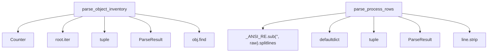

# Human-readable documentation for `inventory.py`

## 1. File overview

- **Source path:** `pvm_control_engine/src/pvm_control_engine/infrastructure/pvm/parsers/inventory.py`
- **Language:** Python
- **File type:** Python package/module
- **Primary responsibility:** VM object and running-process inventory parsers.

## 2. Functional summary

VM object and running-process inventory parsers.

## 3. Inputs and outputs

Public call inputs are the parameters shown in the function and method signatures below. Defaults and annotations are preserved from source. Explicit return expressions are listed with each callable; exceptions and mutations are summarized in the behavior notes.

## 4. Execution flow

The module is invoked through its declared API rather than running as a standalone program. The main callables and their internal calls/returns are summarized in section 5; imports and cross-module links are listed in section 10.

## 5. Functions and methods

### `parse_object_inventory(root: ET.Element) -> ParseResult[tuple[ObjectVM, ...]]`

Parse defined VM facts and report bad/duplicate UUID records as partial.

### `parse_process_rows(raw: str) -> ParseResult[tuple[ProcessObservation, ...]]`

Parse recognized pvm-running-vms rows; malformed data is partial.

## 6. Classes and data structures

No classes are declared in this module.

### Module-level values

- `ParseResult` = `SourceResult`
- `_OBJECT_RE` = `re.compile('^\\s*(\\d+)\\s+(\\d+)\\s+(\\S+)\\s+(\\d+)\\s+(\\d+)\\s+(\\d+)\\s+([0-9a-fA-F-]{36})\\s+(.+?)\\s*$')`
- `_ANSI_RE` = `re.compile('\\x1b\\[[0-?]*[ -/]*[@-~]')`
- `_PROCESS_TITLE_RE` = `re.compile('^List of running virtual machines:\\s*$', re.IGNORECASE)`
- `_PROCESS_HEADER_RE` = `re.compile('^ROW\\s+PID\\s+UPTIME\\s+PORT\\s+VCPU\\s+MEMORY\\s+UUID\\s+NAME\\s*$', re.IGNORECASE)`
- `_PROCESS_VCPU_TOTAL_RE` = `re.compile('^Total\\s+VCPU\\s*:\\s*(\\d+)(?:\\s*\\(\\d+\\))?\\s*$', re.IGNORECASE)`
- `_PROCESS_MEMORY_TOTAL_RE` = `re.compile('^Total\\s+Memory\\s*:\\s*\\d+(?:\\s*\\(\\d+\\))?(?:\\s*(?:GB|MB))?\\s*$', re.IGNORECASE)`

## 7. Decision-making logic

The following branch conditions are present in the implementation; each selects the corresponding source-code path:

- `duplicates`
- `row_numbers and (not saw_header)`
- `row_numbers and row_numbers != list(range(1, len(row_numbers) + 1))`
- `vcpu_total is not None and sum((row.vcpu or 0 for row in candidates)) != vcpu_total`
- `duplicates`
- `issues` (with an `else` branch)
- `not stripped or _PROCESS_TITLE_RE.fullmatch(stripped) or _PROCESS_MEMORY_TOTAL_RE.fullmatch(stripped)`
- `_PROCESS_HEADER_RE.fullmatch(stripped)`
- `(total := _PROCESS_VCPU_TOTAL_RE.fullmatch(stripped))`
- `match is None`
- `issues` (with an `else` branch)
- `machine is not None` (with an `else` branch)
- `machine is not None` (with an `else` branch)
- `machine is not None` (with an `else` branch)
- `machine is not None` (with an `else` branch)
- `machine is not None` (with an `else` branch)

## 8. Loops and repeated operations

Iteration is performed by the following loops/comprehensions:

- `obj in root.iter('pvm_vmm_obj')`
- `line in _ANSI_RE.sub('', raw).splitlines()`
- `item in candidates`
- `(uuid, count) in counts.items() (comprehension)`
- `(uuid, group) in groups.items() (comprehension)`
- `item in candidates (comprehension)`
- `item in candidates (comprehension)`
- `row in candidates (comprehension)`

## 9. Error handling

The module contains these exception-handling clauses:

- `try` block (line 42) handles: ValueError.
- `try` block (line 103) handles: (ValueError, TypeError).

No explicit `raise` statement was found in this module.

## 10. Dependencies and interactions

- **Project imports:** `pvm_control_engine.domain.models`, `.common`.
- **Standard-library/third-party imports:** `__future__`, `re`, `xml.etree.ElementTree`, `collections`.

Related module documentation:

- [`pvm_control_engine.domain.models`](../../../domain/models/__init__.md)

## 11. Real-world scenario

VM object and running-process inventory parsers.

## 12. Technical details and limitations

Behavior is bounded by the source contracts and imported dependencies. Environment-specific integration details (for example, external daemon responses or deployment permissions) require validation in the target environment. The module-level AST scan identifies implementation structure but does not claim runtime outcomes for unexecuted branches.

## 13. Call-flow diagram

## 14. Human-readable summary

`inventory.py` is part of `pvm_control_engine`. VM object and running-process inventory parsers. Its concrete interfaces, data structures, decisions, error paths, and direct dependencies are documented above; identifiers and source filenames are retained verbatim.
