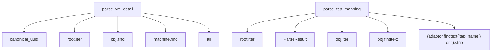

# Human-readable documentation for `vm_detail.py`

## 1. File overview

- **Source path:** `pvm_control_engine/src/pvm_control_engine/infrastructure/pvm/parsers/vm_detail.py`
- **Language:** Python
- **File type:** Python package/module
- **Primary responsibility:** On-demand VM detail and tap mapping XML parsers.

## 2. Functional summary

On-demand VM detail and tap mapping XML parsers.

## 3. Inputs and outputs

Public call inputs are the parameters shown in the function and method signatures below. Defaults and annotations are preserved from source. Explicit return expressions are listed with each callable; exceptions and mutations are summarized in the behavior notes.

## 4. Execution flow

The module is invoked through its declared API rather than running as a standalone program. The main callables and their internal calls/returns are summarized in section 5; imports and cross-module links are listed in section 10.

## 5. Functions and methods

### `parse_vm_detail(root: ET.Element, requested_uuid: str) -> ParseResult[VMDetail | None]`

Parse an on-demand object detail response for one canonical UUID.

### `parse_tap_mapping(root: ET.Element) -> ParseResult[dict[str, str]]`

Parse optional tap mapping from the separately requested object query.

## 6. Classes and data structures

No classes are declared in this module.

### Module-level values

- `ParseResult` = `SourceResult`

## 7. Decision-making logic

The following branch conditions are present in the implementation; each selects the corresponding source-code path:

- `len(matches) != 1`
- `machine is None`
- `all((part is not None and part > 0 for part in parts))`
- `console_element is not None`
- `cpu is not None` (with an `else` branch)
- `canonical_uuid(obj.findtext('uuid') or '') == target`
- `matches` (with an `else` branch)
- `topology is not None` (with an `else` branch)
- `tap`
- `part is not None` (with an `else` branch)

## 8. Loops and repeated operations

Iteration is performed by the following loops/comprehensions:

- `obj in root.iter('pvm_vmm_obj')`
- `obj in root.iter('pvm_vmm_obj')`
- `part in parts`
- `adaptor in obj.iter('net_adaptor')`
- `name in ('socket', 'core', 'thread') (comprehension)`
- `part in parts (comprehension)`
- `item in machine.findall('hardware/disk_manager/disk_list/disk') (comprehension)`
- `item in machine.findall('hardware/net_adaptor_list/net_adaptor') (comprehension)`
- `part in parts (comprehension)`

## 9. Error handling

The module contains these exception-handling clauses:

- `try` block (line 29) handles: ValueError.

No explicit `raise` statement was found in this module.

## 10. Dependencies and interactions

- **Project imports:** `pvm_control_engine.domain.models`, `.common`.
- **Standard-library/third-party imports:** `__future__`, `xml.etree.ElementTree`.

Related module documentation:

- [`pvm_control_engine.domain.models`](../../../domain/models/__init__.md)

## 11. Real-world scenario

On-demand VM detail and tap mapping XML parsers.

## 12. Technical details and limitations

Behavior is bounded by the source contracts and imported dependencies. Environment-specific integration details (for example, external daemon responses or deployment permissions) require validation in the target environment. The module-level AST scan identifies implementation structure but does not claim runtime outcomes for unexecuted branches.

## 13. Call-flow diagram

## 14. Human-readable summary

`vm_detail.py` is part of `pvm_control_engine`. On-demand VM detail and tap mapping XML parsers. Its concrete interfaces, data structures, decisions, error paths, and direct dependencies are documented above; identifiers and source filenames are retained verbatim.
