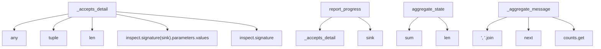

# Human-readable documentation for `results.py`

## 1. File overview

- **Source path:** `pvm_control_engine/src/pvm_control_engine/infrastructure/sbell/commands/vm/results.py`
- **Language:** Python
- **File type:** Python package/module
- **Primary responsibility:** Aggregate per-target lifecycle outcomes without hiding uncertainty.

## 2. Functional summary

Aggregate per-target lifecycle outcomes without hiding uncertainty.

## 3. Inputs and outputs

Public call inputs are the parameters shown in the function and method signatures below. Defaults and annotations are preserved from source. Explicit return expressions are listed with each callable; exceptions and mutations are summarized in the behavior notes.

## 4. Execution flow

The module is invoked through its declared API rather than running as a standalone program. The main callables and their internal calls/returns are summarized in section 5; imports and cross-module links are listed in section 10.

## 5. Functions and methods

### `_accepts_detail(sink: ProgressSink) -> bool`

Calls `any`, `tuple`, `len`, `inspect.signature(sink).parameters.values`, `inspect.signature`. Reads or updates `positional`, `params`. Explicit return value(s): `len(positional) >= 3`, `True`.

### `report_progress(sink: ProgressSink | None, target_uuid: str, state: OperationState, detail: str='') -> None`

Calls `_accepts_detail`, `sink`. Explicit return value(s): `None`.

### `aggregate_state(outcomes: tuple[TargetOutcome, ...]) -> OperationState`

Apply the documented precedence without hiding any uncertain target.

### `_aggregate_message(state: OperationState, outcomes: list[TargetOutcome]) -> str`

Calls `', '.join`, `next`, `counts.get`, `counts.items`. Reads or updates `counts`, `summary`, `failure`, `counts[outcome.state]`. Explicit return value(s): `summary`, `f'{summary}; do not retry until reconciled'`, `f'{summary}; accepted commands are not proof of completion'`.

## 6. Classes and data structures

No classes are declared in this module.

### Module-level values

- `ProgressSink` = `Callable[..., None]`

## 7. Decision-making logic

The following branch conditions are present in the implementation; each selects the corresponding source-code path:

- `any((p.kind is inspect.Parameter.VAR_POSITIONAL for p in params))`
- `sink is None`
- `not outcomes`
- `OperationState.OUTCOME_UNKNOWN in states`
- `OperationState.COMMAND_ACCEPTED_UNCONFIRMED in states`
- `succeeded == len(outcomes)`
- `succeeded`
- `OperationState.FAILED in states`
- `states <= {OperationState.REJECTED, OperationState.NOT_STARTED}`
- `states == {OperationState.CANCELLED_BEFORE_DISPATCH}`
- `OperationState.NOT_STARTED in states`
- `failure`
- `state is OperationState.OUTCOME_UNKNOWN`
- `state is OperationState.COMMAND_ACCEPTED_UNCONFIRMED`
- `_accepts_detail(sink)` (with an `else` branch)

## 8. Loops and repeated operations

Iteration is performed by the following loops/comprehensions:

- `outcome in outcomes`
- `p in params (comprehension)`
- `outcome in outcomes (comprehension)`
- `p in params (comprehension)`
- `outcome in outcomes (comprehension)`
- `(key, count) in counts.items() (comprehension)`
- `outcome in outcomes (comprehension)`

## 9. Error handling

The module contains these exception-handling clauses:

- `try` block (line 18) handles: (TypeError, ValueError).
- `try` block (line 40) handles: Exception.

No explicit `raise` statement was found in this module.

## 10. Dependencies and interactions

- **Project imports:** `pvm_control_engine.domain.models`.
- **Standard-library/third-party imports:** `__future__`, `inspect`, `collections.abc`.

Related module documentation:

- [`pvm_control_engine.domain.models`](../../../../domain/models/__init__.md)

## 11. Real-world scenario

Aggregate per-target lifecycle outcomes without hiding uncertainty.

## 12. Technical details and limitations

Behavior is bounded by the source contracts and imported dependencies. Environment-specific integration details (for example, external daemon responses or deployment permissions) require validation in the target environment. The module-level AST scan identifies implementation structure but does not claim runtime outcomes for unexecuted branches.

## 13. Call-flow diagram

## 14. Human-readable summary

`results.py` is part of `pvm_control_engine`. Aggregate per-target lifecycle outcomes without hiding uncertainty. Its concrete interfaces, data structures, decisions, error paths, and direct dependencies are documented above; identifiers and source filenames are retained verbatim.
