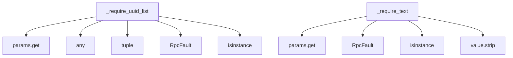

# Human-readable documentation for `dispatcher.py`

## 1. File overview

- **Source path:** `pvm_control_engine/src/pvm_control_engine/ipc/dispatcher.py`
- **Language:** Python
- **File type:** Python package/module
- **Primary responsibility:** Allowlisted versioned JSON-RPC methods over the local socket.

## 2. Functional summary

Allowlisted versioned JSON-RPC methods over the local socket.

## 3. Inputs and outputs

Public call inputs are the parameters shown in the function and method signatures below. Defaults and annotations are preserved from source. Explicit return expressions are listed with each callable; exceptions and mutations are summarized in the behavior notes.

## 4. Execution flow

The module is invoked through its declared API rather than running as a standalone program. The main callables and their internal calls/returns are summarized in section 5; imports and cross-module links are listed in section 10.

## 5. Functions and methods

### `_require_uuid_list(params: dict[str, Any]) -> tuple[str, ...]`

Calls `params.get`, `any`, `tuple`, `RpcFault`, `isinstance`. Reads or updates `values`. Explicit return value(s): `tuple(values)`. Can raise `RpcFault(-32602, 'Invalid params')`.

### `_require_text(params: dict[str, Any], name: str) -> None`

Calls `params.get`, `RpcFault`, `isinstance`, `value.strip`. Reads or updates `value`. No explicit return statement; the function returns `None` unless an exception interrupts execution. Can raise `RpcFault(-32602, 'Invalid params')`.

### `RpcDispatcher.__init__(self, service) -> None`

Reads or updates `self.service`. No explicit return statement; the function returns `None` unless an exception interrupts execution.

### `RpcDispatcher.handle(self, request: dict[str, Any]) -> dict[str, Any]`

Calls `request.get`, `failure`, `success`, `isinstance`, `set`. Reads or updates `request_id`, `method`, `(allowed, required)`, `params`, `result`, `data`. Explicit return value(s): `failure(request_id, -32601, 'Method not found')`, `failure(request_id, -32602, 'Invalid params')`, `failure(None, -32600, 'Invalid Request')`, `failure(request_id, -32602, 'Provide exactly one uuid or uuids parameter')`. Can raise `RpcFault(-32602, 'Invalid params')`.

## 6. Classes and data structures

### `RpcDispatcher`

- **Bases:** no explicit base class.
- **Description:** Class declared with bases: no explicit base class.
- **Methods:** `__init__`, `handle`.

### Module-level values

- `METHODS` = `{'engine.health': (set(), set()), 'overview.dashboard': (set(), set()), 'snapshot.collect': ({'sections'}, {'sections'}), 'vm.list': (set(), set()), 'vm.get': ({'uuid'}, {'uuid'}),`

## 7. Decision-making logic

The following branch conditions are present in the implementation; each selects the corresponding source-code path:

- `not isinstance(values, list) or not values or len(values) > 100`
- `any((not isinstance(value, str) or not value for value in values))`
- `not isinstance(value, str) or not value.strip()`
- `not isinstance(method, str) or method not in METHODS`
- `not isinstance(params, dict) or set(params) - allowed or (not required.issubset(params))`
- `'id' not in request`
- `method == 'vm.operate' and ('uuid' in params) == ('uuids' in params)`
- `method == 'engine.health'` (with an `else` branch)
- `method == 'overview.dashboard'` (with an `else` branch)
- `any((secret in message.casefold() for secret in ('password', 'token', 'argv', 'sballd')))`
- `method == 'snapshot.collect'` (with an `else` branch)
- `not isinstance(sections, list) or any((not isinstance(item, str) for item in sections))`
- `method == 'vm.list'` (with an `else` branch)
- `method == 'vm.get'` (with an `else` branch)
- `method == 'host.status'` (with an `else` branch)
- `method == 'host.metrics'` (with an `else` branch)
- `method == 'host.local'` (with an `else` branch)
- `method == 'network.nic_list'` (with an `else` branch)
- `method == 'network.nic_samples'` (with an `else` branch)
- `method == 'desktop.list'` (with an `else` branch)
- `method == 'audit.recent'` (with an `else` branch)
- `isinstance(limit, bool) or not isinstance(limit, int)`
- `method == 'vm.tap_mapping'` (with an `else` branch)
- `method == 'session.logout'` (with an `else` branch)
- `method == 'vm.operate'` (with an `else` branch)
- `'uuid' in params` (with an `else` branch)

## 8. Loops and repeated operations

Iteration is performed by the following loops/comprehensions:

- `value in values (comprehension)`
- `secret in ('password', 'token', 'argv', 'sballd') (comprehension)`
- `item in sections (comprehension)`

## 9. Error handling

The module contains these exception-handling clauses:

- `try` block (line 48) handles: RpcFault, AppError, (ValueError, TypeError), Exception.

Explicitly raised exception expressions: `RpcFault(-32602, 'Invalid params')`.

## 10. Dependencies and interactions

- **Project imports:** `pvm_control_engine.domain.errors`, `.protocol`.
- **Standard-library/third-party imports:** `__future__`, `typing`.

Related module documentation:

- [`pvm_control_engine.domain.errors`](../domain/errors.md)

## 11. Real-world scenario

Allowlisted versioned JSON-RPC methods over the local socket.

## 12. Technical details and limitations

Behavior is bounded by the source contracts and imported dependencies. Environment-specific integration details (for example, external daemon responses or deployment permissions) require validation in the target environment. The module-level AST scan identifies implementation structure but does not claim runtime outcomes for unexecuted branches.

## 13. Call-flow diagram

## 14. Human-readable summary

`dispatcher.py` is part of `pvm_control_engine`. Allowlisted versioned JSON-RPC methods over the local socket. Its concrete interfaces, data structures, decisions, error paths, and direct dependencies are documented above; identifiers and source filenames are retained verbatim.
