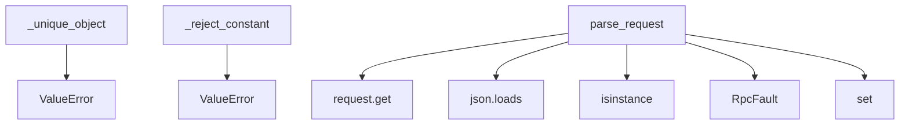

# Human-readable documentation for `protocol.py`

## 1. File overview

- **Source path:** `pvm_control_engine/src/pvm_control_engine/ipc/protocol.py`
- **Language:** Python
- **File type:** Python package/module
- **Primary responsibility:** Strict JSON-RPC 2.0 validation and safe error envelopes.

## 2. Functional summary

Strict JSON-RPC 2.0 validation and safe error envelopes.

## 3. Inputs and outputs

Public call inputs are the parameters shown in the function and method signatures below. Defaults and annotations are preserved from source. Explicit return expressions are listed with each callable; exceptions and mutations are summarized in the behavior notes.

## 4. Execution flow

The module is invoked through its declared API rather than running as a standalone program. The main callables and their internal calls/returns are summarized in section 5; imports and cross-module links are listed in section 10.

## 5. Functions and methods

### `_unique_object(pairs)`

Calls `ValueError`. Reads or updates `value`, `value[key]`. Explicit return value(s): `value`. Can raise `ValueError('duplicate JSON key')`.

### `_reject_constant(_value)`

Calls `ValueError`. No explicit return statement; the function returns `None` unless an exception interrupts execution. Can raise `ValueError('non-standard JSON constant')`.

### `parse_request(raw: bytes) -> dict[str, Any]`

Calls `request.get`, `json.loads`, `isinstance`, `RpcFault`, `set`. Reads or updates `request_id`, `request`. Explicit return value(s): `request`. Can raise `RpcFault(-32600, 'Invalid Request')`, `RpcFault(-32700, 'Parse error')`.

### `success(request_id: Any, result: Any) -> dict[str, Any]`

Explicit return value(s): `{'jsonrpc': '2.0', 'id': request_id, 'result': result}`.

### `failure(request_id: Any, code: int, message: str, data: dict[str, Any] | None=None) -> dict[str, Any]`

Reads or updates `error`, `error['data']`. Explicit return value(s): `{'jsonrpc': '2.0', 'id': request_id, 'error': error}`.

### `RpcFault.__init__(self, code: int, message: str, data: dict[str, Any] | None=None) -> None`

Calls `super().__init__`, `super`. Reads or updates `(self.code, self.message, self.data)`. No explicit return statement; the function returns `None` unless an exception interrupts execution.

## 6. Classes and data structures

### `RpcFault`

- **Bases:** Exception.
- **Description:** Class declared with bases: Exception.
- **Methods:** `__init__`.

### Module-level values

- `MAX_MESSAGE_BYTES` = `1048576`

## 7. Decision-making logic

The following branch conditions are present in the implementation; each selects the corresponding source-code path:

- `not isinstance(request, dict)`
- `set(request) - {'jsonrpc', 'method', 'params', 'id'}`
- `request.get('jsonrpc') != '2.0' or not isinstance(request.get('method'), str)`
- `'id' in request and (isinstance(request_id, bool) or not isinstance(request_id, (str, int, type(None))))`
- `not isinstance(request.get('params', {}), dict)`
- `data`
- `key in value`

## 8. Loops and repeated operations

Iteration is performed by the following loops/comprehensions:

- `(key, item) in pairs`

## 9. Error handling

The module contains these exception-handling clauses:

- `try` block (line 31) handles: (UnicodeDecodeError, json.JSONDecodeError, ValueError, RecursionError).

Explicitly raised exception expressions: `ValueError('non-standard JSON constant')`, `RpcFault(-32600, 'Invalid Request')`, `ValueError('duplicate JSON key')`, `RpcFault(-32700, 'Parse error')`.

## 10. Dependencies and interactions

- **Project imports:** none directly declared.
- **Standard-library/third-party imports:** `__future__`, `json`, `typing`.

## 11. Real-world scenario

Strict JSON-RPC 2.0 validation and safe error envelopes.

## 12. Technical details and limitations

Behavior is bounded by the source contracts and imported dependencies. Environment-specific integration details (for example, external daemon responses or deployment permissions) require validation in the target environment. The module-level AST scan identifies implementation structure but does not claim runtime outcomes for unexecuted branches.

## 13. Call-flow diagram

## 14. Human-readable summary

`protocol.py` is part of `pvm_control_engine`. Strict JSON-RPC 2.0 validation and safe error envelopes. Its concrete interfaces, data structures, decisions, error paths, and direct dependencies are documented above; identifiers and source filenames are retained verbatim.
