# Human-readable documentation for `test_audit_adapter.py`

## 1. File overview

- **Source path:** `pvm_control_engine/tests/unit/test_audit_adapter.py`
- **Language:** Python
- **File type:** Pytest test module
- **Primary responsibility:** Pytest unit tests for `test_audit_adapter_is_read_only_and_filters_internal_rows`, `test_audit_schema_failure_is_explicit`, `test_audit_limit_is_bounded`.

## 2. Functional summary

Pytest unit tests for `test_audit_adapter_is_read_only_and_filters_internal_rows`, `test_audit_schema_failure_is_explicit`, `test_audit_limit_is_bounded`.

## 3. Inputs and outputs

Pytest supplies fixtures and any declared parameters to the test functions. The observable outputs are assertion results and any expected exceptions or side effects; test functions are not application APIs.

## 4. Execution flow

Pytest discovers `test_*` functions, prepares their fixtures, executes each case, and reports failed assertions or unexpected exceptions. See the test-case inventory below for the named scenarios.

## 5. Functions and methods

### Test cases

#### `test_audit_adapter_is_read_only_and_filters_internal_rows(tmp_path: Path) -> None`

Calls `_database`, `ReadOnlyAuditAdapter`, `adapter.recent`, `sqlite3.connect`, `connection.close`. Reads or updates `path`, `adapter`, `entries`, `connection`. No explicit return statement; the function returns `None` unless an exception interrupts execution.

#### `test_audit_schema_failure_is_explicit(tmp_path: Path) -> None`

Calls `_database`, `pytest.raises`, `ReadOnlyAuditAdapter(path).recent`, `ReadOnlyAuditAdapter`. Reads or updates `path`. No explicit return statement; the function returns `None` unless an exception interrupts execution.

#### `test_audit_limit_is_bounded(tmp_path: Path) -> None`

Calls `ReadOnlyAuditAdapter`, `pytest.raises`, `adapter.recent`. Reads or updates `adapter`. No explicit return statement; the function returns `None` unless an exception interrupts execution.

### Helpers

#### `_database(path: Path, *, schema: bool=True) -> None`

Calls `sqlite3.connect`, `connection.commit`, `connection.close`, `connection.execute`, `connection.executemany`. Reads or updates `connection`. No explicit return statement; the function returns `None` unless an exception interrupts execution.

## 6. Classes and data structures

No classes are declared in this module.

## 7. Decision-making logic

The following branch conditions are present in the implementation; each selects the corresponding source-code path:

- `schema`

## 8. Loops and repeated operations

No explicit loops or comprehensions were found.

## 9. Error handling

No local `try`/`except` handler was found. Exceptions from called dependencies propagate unless caught by a caller.

No explicit `raise` statement was found in this module.

## 10. Dependencies and interactions

- **Project imports:** `pvm_control_engine.domain.errors`, `pvm_control_engine.infrastructure.audit`.
- **Standard-library/third-party imports:** `__future__`, `sqlite3`, `pathlib`, `pytest`.

Related module documentation:

- [`pvm_control_engine.domain.errors`](../../src/pvm_control_engine/domain/errors.md)
- [`pvm_control_engine.infrastructure.audit`](../../src/pvm_control_engine/infrastructure/audit.md)

## 11. Real-world scenario

A maintainer runs this module as part of the unit-test suite to verify the named contracts against controlled fixtures, temporary files, or fake dependencies. These tests demonstrate only the cases they assert; they do not establish behavior outside those inputs.

## 12. Technical details and limitations

This file is verification code, not a production entry point. Its coverage is limited to its fixtures and assertions. External daemon behavior is not proven unless a test explicitly invokes and validates that external component.

## 13. Call-flow diagram

```mermaid
flowchart TD
  _database["_database"] --> call_0["sqlite3.connect"]
  _database["_database"] --> call_1["connection.commit"]
  _database["_database"] --> call_2["connection.close"]
  _database["_database"] --> call_3["connection.execute"]
  _database["_database"] --> call_4["connection.executemany"]
  test_audit_adapter_is_read_only_and_filters_internal_rows["test_audit_adapter_is_read_only_and_filters_internal_rows"] --> call_5["_database"]
  test_audit_adapter_is_read_only_and_filters_internal_rows["test_audit_adapter_is_read_only_and_filters_internal_rows"] --> call_6["ReadOnlyAuditAdapter"]
  test_audit_adapter_is_read_only_and_filters_internal_rows["test_audit_adapter_is_read_only_and_filters_internal_rows"] --> call_7["adapter.recent"]
  test_audit_adapter_is_read_only_and_filters_internal_rows["test_audit_adapter_is_read_only_and_filters_internal_rows"] --> call_8["sqlite3.connect"]
  test_audit_adapter_is_read_only_and_filters_internal_rows["test_audit_adapter_is_read_only_and_filters_internal_rows"] --> call_9["connection.close"]
  test_audit_schema_failure_is_explicit["test_audit_schema_failure_is_explicit"] --> call_10["_database"]
  test_audit_schema_failure_is_explicit["test_audit_schema_failure_is_explicit"] --> call_11["pytest.raises"]
```

## 14. Human-readable summary

`test_audit_adapter.py` is part of `pvm_control_engine`. Pytest unit tests for `test_audit_adapter_is_read_only_and_filters_internal_rows`, `test_audit_schema_failure_is_explicit`, `test_audit_limit_is_bounded`. Its concrete interfaces, data structures, decisions, error paths, and direct dependencies are documented above; identifiers and source filenames are retained verbatim.
