# Human-readable documentation for `test_engine_auth_provider.py`

## 1. File overview

- **Source path:** `pvm_control_engine/tests/unit/test_engine_auth_provider.py`
- **Language:** Python
- **File type:** Pytest test module
- **Primary responsibility:** Pytest unit tests for `test_auth_provider_returns_only_a_valid_cached_session_token`, `test_auth_provider_clears_expired_cache_and_rejects_missing_session`, `test_auth_provider_does_not_hide_credential_gate_or_process_errors`.

## 2. Functional summary

Pytest unit tests for `test_auth_provider_returns_only_a_valid_cached_session_token`, `test_auth_provider_clears_expired_cache_and_rejects_missing_session`, `test_auth_provider_does_not_hide_credential_gate_or_process_errors`.

## 3. Inputs and outputs

Pytest supplies fixtures and any declared parameters to the test functions. The observable outputs are assertion results and any expected exceptions or side effects; test functions are not application APIs.

## 4. Execution flow

Pytest discovers `test_*` functions, prepares their fixtures, executes each case, and reports failed assertions or unexpected exceptions. See the test-case inventory below for the named scenarios.

## 5. Functions and methods

### Test cases

#### `test_auth_provider_returns_only_a_valid_cached_session_token()`

Calls `PvmSession`, `Store`, `Gateway`, `AuthProvider`, `auth.token`. Reads or updates `session`, `store`, `gateway`, `auth`. No explicit return statement; the function returns `None` unless an exception interrupts execution.

#### `test_auth_provider_clears_expired_cache_and_rejects_missing_session()`

Calls `Store`, `AuthProvider`, `PvmSession`, `Gateway`, `pytest.raises`. Reads or updates `store`, `auth`. No explicit return statement; the function returns `None` unless an exception interrupts execution.

#### `test_auth_provider_does_not_hide_credential_gate_or_process_errors()`

Calls `AppError`, `AuthProvider`, `Store`, `Gateway`, `pytest.raises`. Reads or updates `failure`, `auth`. No explicit return statement; the function returns `None` unless an exception interrupts execution.

## 6. Classes and data structures

### `Store`

- **Bases:** no explicit base class.
- **Description:** Class declared with bases: no explicit base class.
- **Methods:** `__init__`, `load`, `clear`.

### `Gateway`

- **Bases:** no explicit base class.
- **Description:** Class declared with bases: no explicit base class.
- **Methods:** `__init__`, `validate_session`.

## 7. Decision-making logic

The following branch conditions are present in the implementation; each selects the corresponding source-code path:

- `self.error is not None`

## 8. Loops and repeated operations

No explicit loops or comprehensions were found.

## 9. Error handling

No local `try`/`except` handler was found. Exceptions from called dependencies propagate unless caught by a caller.

Explicitly raised exception expressions: `self.error`.

## 10. Dependencies and interactions

- **Project imports:** `pvm_control_engine.auth.provider`, `pvm_control_engine.domain.errors`, `pvm_control_engine.domain.models`.
- **Standard-library/third-party imports:** `__future__`, `pytest`.

Related module documentation:

- [`pvm_control_engine.auth.provider`](../../src/pvm_control_engine/auth/provider.md)
- [`pvm_control_engine.domain.errors`](../../src/pvm_control_engine/domain/errors.md)
- [`pvm_control_engine.domain.models`](../../src/pvm_control_engine/domain/models/__init__.md)

## 11. Real-world scenario

A maintainer runs this module as part of the unit-test suite to verify the named contracts against controlled fixtures, temporary files, or fake dependencies. These tests demonstrate only the cases they assert; they do not establish behavior outside those inputs.

## 12. Technical details and limitations

This file is verification code, not a production entry point. Its coverage is limited to its fixtures and assertions. External daemon behavior is not proven unless a test explicitly invokes and validates that external component.

## 13. Call-flow diagram

```mermaid
flowchart TD
  test_auth_provider_returns_only_a_valid_cached_session_token["test_auth_provider_returns_only_a_valid_cached_session_token"] --> call_0["PvmSession"]
  test_auth_provider_returns_only_a_valid_cached_session_token["test_auth_provider_returns_only_a_valid_cached_session_token"] --> call_1["Store"]
  test_auth_provider_returns_only_a_valid_cached_session_token["test_auth_provider_returns_only_a_valid_cached_session_token"] --> call_2["Gateway"]
  test_auth_provider_returns_only_a_valid_cached_session_token["test_auth_provider_returns_only_a_valid_cached_session_token"] --> call_3["AuthProvider"]
  test_auth_provider_returns_only_a_valid_cached_session_token["test_auth_provider_returns_only_a_valid_cached_session_token"] --> call_4["auth.token"]
  test_auth_provider_clears_expired_cache_and_rejects_missing_session["test_auth_provider_clears_expired_cache_and_rejects_missing_session"] --> call_5["Store"]
  test_auth_provider_clears_expired_cache_and_rejects_missing_session["test_auth_provider_clears_expired_cache_and_rejects_missing_session"] --> call_6["AuthProvider"]
  test_auth_provider_clears_expired_cache_and_rejects_missing_session["test_auth_provider_clears_expired_cache_and_rejects_missing_session"] --> call_7["PvmSession"]
  test_auth_provider_clears_expired_cache_and_rejects_missing_session["test_auth_provider_clears_expired_cache_and_rejects_missing_session"] --> call_8["Gateway"]
  test_auth_provider_clears_expired_cache_and_rejects_missing_session["test_auth_provider_clears_expired_cache_and_rejects_missing_session"] --> call_9["pytest.raises"]
  test_auth_provider_does_not_hide_credential_gate_or_process_errors["test_auth_provider_does_not_hide_credential_gate_or_process_errors"] --> call_10["AppError"]
  test_auth_provider_does_not_hide_credential_gate_or_process_errors["test_auth_provider_does_not_hide_credential_gate_or_process_errors"] --> call_11["AuthProvider"]
```

## 14. Human-readable summary

`test_engine_auth_provider.py` is part of `pvm_control_engine`. Pytest unit tests for `test_auth_provider_returns_only_a_valid_cached_session_token`, `test_auth_provider_clears_expired_cache_and_rejects_missing_session`, `test_auth_provider_does_not_hide_credential_gate_or_process_errors`. Its concrete interfaces, data structures, decisions, error paths, and direct dependencies are documented above; identifiers and source filenames are retained verbatim.
