# Human-readable documentation for `test_engine_vm_operations.py`

## 1. File overview

- **Source path:** `pvm_control_engine/tests/unit/test_engine_vm_operations.py`
- **Language:** Python
- **File type:** Pytest test module
- **Primary responsibility:** Pytest unit tests for `test_each_vm_command_owns_fixed_sbell_action_and_exact_parameters`, `test_start_xml_escapes_untrusted_text_and_uuid_resolver_rejects_non_uuid`, `test_bulk_kill_is_validated_once_and_keeps_target_order`, `test_vm_resolver_rejects_unsafe_targets_before_dispatch` and related cases.

## 2. Functional summary

Pytest unit tests for `test_each_vm_command_owns_fixed_sbell_action_and_exact_parameters`, `test_start_xml_escapes_untrusted_text_and_uuid_resolver_rejects_non_uuid`, `test_bulk_kill_is_validated_once_and_keeps_target_order`, `test_vm_resolver_rejects_unsafe_targets_before_dispatch` and related cases.

## 3. Inputs and outputs

Pytest supplies fixtures and any declared parameters to the test functions. The observable outputs are assertion results and any expected exceptions or side effects; test functions are not application APIs.

## 4. Execution flow

Pytest discovers `test_*` functions, prepares their fixtures, executes each case, and reports failed assertions or unexpected exceptions. See the test-case inventory below for the named scenarios.

## 5. Functions and methods

### Test cases

#### `test_each_vm_command_owns_fixed_sbell_action_and_exact_parameters(tmp_path)`

Calls `create_commands`, `commands.items`, `command.execute`, `len`, `record`. Reads or updates `expected`, `(commands, app, collection, auth, sbell)`, `result`. No explicit return statement; the function returns `None` unless an exception interrupts execution.

#### `test_start_xml_escapes_untrusted_text_and_uuid_resolver_rejects_non_uuid(tmp_path)`

Calls `create_commands`, `pytest.raises`, `start.execute`, `record`. Reads or updates `(commands, app, _collection, _auth, sbell)`, `start`. No explicit return statement; the function returns `None` unless an exception interrupts execution.

#### `test_bulk_kill_is_validated_once_and_keeps_target_order(tmp_path)`

Calls `create_commands`, `commands[Action.KILL].execute_many`, `all`, `record`, `tuple`. Reads or updates `records`, `(commands, app, collection, auth, sbell)`, `result`. No explicit return statement; the function returns `None` unless an exception interrupts execution.

#### `test_vm_resolver_rejects_unsafe_targets_before_dispatch(tmp_path, inputs, error_code)`

Calls `pytest.mark.parametrize`, `create_commands`, `pytest.raises`, `commands[Action.KILL].execute_many`, `record`. Reads or updates `(commands, app, collection, _auth, sbell)`. No explicit return statement; the function returns `None` unless an exception interrupts execution.

#### `test_freshness_rejection_and_unknown_timeout_never_claim_success(tmp_path)`

Calls `create_commands`, `AppError`, `commands[Action.STOP].execute`, `pytest.raises`, `stale_commands[Action.STOP].execute`. Reads or updates `(stale_commands, _, stale_collection, _, stale_sbell)`, `timeout`, `(commands, _, collection, _, sbell)`, `result`. No explicit return statement; the function returns `None` unless an exception interrupts execution.

#### `test_bulk_stops_after_definite_failure_and_marks_unstarted_targets(tmp_path)`

Calls `FakeSbell`, `create_commands`, `commands[Action.STOP].execute_many`, `len`, `Reply`. Reads or updates `sbell`, `(commands, _, collection, _, _)`, `result`. No explicit return statement; the function returns `None` unless an exception interrupts execution.

### Helpers

#### `record(uuid: str) -> VMRecord`

Calls `VMRecord`, `ObjectVM`. Explicit return value(s): `VMRecord(ObjectVM(uuid=uuid, name=f'vm-{uuid[:4]}', state='stopped'))`.

#### `create_commands(tmp_path: Path, records: tuple[VMRecord, ...], *, sbell=None, fresh=True)`

Calls `load_settings`, `FakeApplication`, `FakeCollection`, `VMOperationCoordinator`, `FakeAuth`. Reads or updates `settings`, `app`, `collection`, `coordinator`, `auth`, `transport`. Explicit return value(s): `(commands, app, collection, auth, transport)`.

## 6. Classes and data structures

### `FakeAuth`

- **Bases:** no explicit base class.
- **Description:** Class declared with bases: no explicit base class.
- **Methods:** `__init__`, `token`.

### `FakeApplication`

- **Bases:** no explicit base class.
- **Description:** Class declared with bases: no explicit base class.
- **Methods:** `__init__`, `inventory`.

### `FakeCollection`

- **Bases:** no explicit base class.
- **Description:** Class declared with bases: no explicit base class.
- **Methods:** `__init__`, `is_fresh`, `begin_mutation`, `end_mutation`, `collect_once`.

### `FakeGateway`

- **Bases:** no explicit base class.
- **Description:** Class declared with bases: no explicit base class.
- **Methods:** `__init__`, `is_daemon_alive`.

### `FakeSbell`

- **Bases:** no explicit base class.
- **Description:** Class declared with bases: no explicit base class.
- **Methods:** `__init__`, `call`.

### `Reply`

- **Bases:** no explicit base class.
- **Description:** Class declared with bases: no explicit base class.
- **Methods:** `__init__`, `reply`.

### Module-level values

- `UUID_A` = `'481e458c-c6ba-4fe7-88f6-26a59e416568'`
- `UUID_B` = `'067928e8-631b-4f0a-b748-325990172e6e'`
- `NOW` = `datetime.now(UTC)`

## 7. Decision-making logic

The following branch conditions are present in the implementation; each selects the corresponding source-code path:

- `self.replies`
- `isinstance(result, Exception)`
- `error_code == 'INVALID_TARGET_COUNT'` (with an `else` branch)
- `error_code == 'VM_NOT_FOUND'` (with an `else` branch)

## 8. Loops and repeated operations

Iteration is performed by the following loops/comprehensions:

- `(action, command) in commands.items()`
- `call in sbell.calls (comprehension)`
- `target in result.targets (comprehension)`
- `target in result.targets (comprehension)`
- `n in range(101) (comprehension)`
- `item in records (comprehension)`

## 9. Error handling

No local `try`/`except` handler was found. Exceptions from called dependencies propagate unless caught by a caller.

Explicitly raised exception expressions: `result`.

## 10. Dependencies and interactions

- **Project imports:** `pvm_control_engine.config`, `pvm_control_engine.domain.errors`, `pvm_control_engine.domain.models`, `pvm_control_engine.infrastructure.sbell.commands.vm.common`, `pvm_control_engine.infrastructure.sbell.commands.vm.kill`, `pvm_control_engine.infrastructure.sbell.commands.vm.pause`, `pvm_control_engine.infrastructure.sbell.commands.vm.reset`, `pvm_control_engine.infrastructure.sbell.commands.vm.resume`, `pvm_control_engine.infrastructure.sbell.commands.vm.start`, `pvm_control_engine.infrastructure.sbell.commands.vm.stop`, `pvm_control_engine.targets.vm_resolver`.
- **Standard-library/third-party imports:** `__future__`, `datetime`, `pathlib`, `pytest`.

Related module documentation:

- [`pvm_control_engine.config`](../../src/pvm_control_engine/config.md)
- [`pvm_control_engine.domain.errors`](../../src/pvm_control_engine/domain/errors.md)
- [`pvm_control_engine.domain.models`](../../src/pvm_control_engine/domain/models/__init__.md)
- [`pvm_control_engine.infrastructure.sbell.commands.vm.common`](../../src/pvm_control_engine/infrastructure/sbell/commands/vm/common.md)
- [`pvm_control_engine.infrastructure.sbell.commands.vm.kill`](../../src/pvm_control_engine/infrastructure/sbell/commands/vm/kill.md)
- [`pvm_control_engine.infrastructure.sbell.commands.vm.pause`](../../src/pvm_control_engine/infrastructure/sbell/commands/vm/pause.md)
- [`pvm_control_engine.infrastructure.sbell.commands.vm.reset`](../../src/pvm_control_engine/infrastructure/sbell/commands/vm/reset.md)
- [`pvm_control_engine.infrastructure.sbell.commands.vm.resume`](../../src/pvm_control_engine/infrastructure/sbell/commands/vm/resume.md)
- [`pvm_control_engine.infrastructure.sbell.commands.vm.start`](../../src/pvm_control_engine/infrastructure/sbell/commands/vm/start.md)
- [`pvm_control_engine.infrastructure.sbell.commands.vm.stop`](../../src/pvm_control_engine/infrastructure/sbell/commands/vm/stop.md)
- [`pvm_control_engine.targets.vm_resolver`](../../src/pvm_control_engine/targets/vm_resolver.md)

## 11. Real-world scenario

A maintainer runs this module as part of the unit-test suite to verify the named contracts against controlled fixtures, temporary files, or fake dependencies. These tests demonstrate only the cases they assert; they do not establish behavior outside those inputs.

## 12. Technical details and limitations

This file is verification code, not a production entry point. Its coverage is limited to its fixtures and assertions. External daemon behavior is not proven unless a test explicitly invokes and validates that external component.

## 13. Call-flow diagram

```mermaid
flowchart TD
  record["record"] --> call_0["VMRecord"]
  record["record"] --> call_1["ObjectVM"]
  create_commands["create_commands"] --> call_2["load_settings"]
  create_commands["create_commands"] --> call_3["FakeApplication"]
  create_commands["create_commands"] --> call_4["FakeCollection"]
  create_commands["create_commands"] --> call_5["VMOperationCoordinator"]
  create_commands["create_commands"] --> call_6["FakeAuth"]
  test_each_vm_command_owns_fixed_sbell_action_and_exact_parameters["test_each_vm_command_owns_fixed_sbell_action_and_exact_parameters"] --> call_7["create_commands"]
  test_each_vm_command_owns_fixed_sbell_action_and_exact_parameters["test_each_vm_command_owns_fixed_sbell_action_and_exact_parameters"] --> call_8["commands.items"]
  test_each_vm_command_owns_fixed_sbell_action_and_exact_parameters["test_each_vm_command_owns_fixed_sbell_action_and_exact_parameters"] --> call_9["command.execute"]
  test_each_vm_command_owns_fixed_sbell_action_and_exact_parameters["test_each_vm_command_owns_fixed_sbell_action_and_exact_parameters"] --> call_10["len"]
  test_each_vm_command_owns_fixed_sbell_action_and_exact_parameters["test_each_vm_command_owns_fixed_sbell_action_and_exact_parameters"] --> call_11["record"]
```

## 14. Human-readable summary

`test_engine_vm_operations.py` is part of `pvm_control_engine`. Pytest unit tests for `test_each_vm_command_owns_fixed_sbell_action_and_exact_parameters`, `test_start_xml_escapes_untrusted_text_and_uuid_resolver_rejects_non_uuid`, `test_bulk_kill_is_validated_once_and_keeps_target_order`, `test_vm_resolver_rejects_unsafe_targets_before_dispatch` and related cases. Its concrete interfaces, data structures, decisions, error paths, and direct dependencies are documented above; identifiers and source filenames are retained verbatim.
