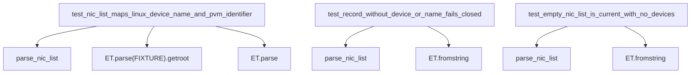

# Human-readable documentation for `test_nic_list_parser.py`

## 1. File overview

- **Source path:** `pvm_control_engine/tests/unit/test_nic_list_parser.py`
- **Language:** Python
- **File type:** Pytest test module
- **Primary responsibility:** Pytest unit tests for `test_nic_list_maps_linux_device_name_and_pvm_identifier`, `test_record_without_device_or_name_fails_closed`, `test_empty_nic_list_is_current_with_no_devices`.

## 2. Functional summary

Pytest unit tests for `test_nic_list_maps_linux_device_name_and_pvm_identifier`, `test_record_without_device_or_name_fails_closed`, `test_empty_nic_list_is_current_with_no_devices`.

## 3. Inputs and outputs

Pytest supplies fixtures and any declared parameters to the test functions. The observable outputs are assertion results and any expected exceptions or side effects; test functions are not application APIs.

## 4. Execution flow

Pytest discovers `test_*` functions, prepares their fixtures, executes each case, and reports failed assertions or unexpected exceptions. See the test-case inventory below for the named scenarios.

## 5. Functions and methods

### Test cases

#### `test_nic_list_maps_linux_device_name_and_pvm_identifier()`

Calls `parse_nic_list`, `ET.parse(FIXTURE).getroot`, `ET.parse`. Reads or updates `result`, `eno4`. No explicit return statement; the function returns `None` unless an exception interrupts execution.

#### `test_record_without_device_or_name_fails_closed()`

Calls `parse_nic_list`, `ET.fromstring`. Reads or updates `xml`, `result`. No explicit return statement; the function returns `None` unless an exception interrupts execution.

#### `test_empty_nic_list_is_current_with_no_devices()`

Calls `parse_nic_list`, `ET.fromstring`. Reads or updates `result`. No explicit return statement; the function returns `None` unless an exception interrupts execution.

## 6. Classes and data structures

No classes are declared in this module.

### Module-level values

- `FIXTURE` = `Path(__file__).parents[1] / 'fixtures' / 'nic-list.xml'`

## 7. Decision-making logic

No explicit conditional or pattern-matching branches were found in the module AST.

## 8. Loops and repeated operations

Iteration is performed by the following loops/comprehensions:

- `nic in result.value (comprehension)`

## 9. Error handling

No local `try`/`except` handler was found. Exceptions from called dependencies propagate unless caught by a caller.

No explicit `raise` statement was found in this module.

## 10. Dependencies and interactions

- **Project imports:** `pvm_control_engine.domain.models`, `pvm_control_engine.infrastructure.pvm.overview`.
- **Standard-library/third-party imports:** `xml.etree.ElementTree`, `pathlib`.

Related module documentation:

- [`pvm_control_engine.domain.models`](../../src/pvm_control_engine/domain/models/__init__.md)
- [`pvm_control_engine.infrastructure.pvm.overview`](../../src/pvm_control_engine/infrastructure/pvm/overview.md)

## 11. Real-world scenario

A maintainer runs this module as part of the unit-test suite to verify the named contracts against controlled fixtures, temporary files, or fake dependencies. These tests demonstrate only the cases they assert; they do not establish behavior outside those inputs.

## 12. Technical details and limitations

This file is verification code, not a production entry point. Its coverage is limited to its fixtures and assertions. External daemon behavior is not proven unless a test explicitly invokes and validates that external component.

## 13. Call-flow diagram

## 14. Human-readable summary

`test_nic_list_parser.py` is part of `pvm_control_engine`. Pytest unit tests for `test_nic_list_maps_linux_device_name_and_pvm_identifier`, `test_record_without_device_or_name_fails_closed`, `test_empty_nic_list_is_current_with_no_devices`. Its concrete interfaces, data structures, decisions, error paths, and direct dependencies are documented above; identifiers and source filenames are retained verbatim.
