# Human-readable documentation for `test_process_runner.py`

## 1. File overview

- **Source path:** `pvm_control_engine/tests/unit/test_process_runner.py`
- **Language:** Python
- **File type:** Pytest test module
- **Primary responsibility:** Pytest unit tests for `test_process_runner_preserves_argument_boundaries`, `test_process_runner_bounds_retained_output`, `test_process_runner_times_out_and_reaps_direct_child`, `test_process_runner_timeout_kills_descendant_process_group` and related cases.

## 2. Functional summary

Pytest unit tests for `test_process_runner_preserves_argument_boundaries`, `test_process_runner_bounds_retained_output`, `test_process_runner_times_out_and_reaps_direct_child`, `test_process_runner_timeout_kills_descendant_process_group` and related cases.

## 3. Inputs and outputs

Pytest supplies fixtures and any declared parameters to the test functions. The observable outputs are assertion results and any expected exceptions or side effects; test functions are not application APIs.

## 4. Execution flow

Pytest discovers `test_*` functions, prepares their fixtures, executes each case, and reports failed assertions or unexpected exceptions. See the test-case inventory below for the named scenarios.

## 5. Functions and methods

### Test cases

#### `test_process_runner_preserves_argument_boundaries() -> None`

Calls `ProcessRunner`, `runner.run`, `result.stdout.strip`. Reads or updates `runner`, `result`. No explicit return statement; the function returns `None` unless an exception interrupts execution.

#### `test_process_runner_bounds_retained_output() -> None`

Calls `ProcessRunner`, `runner.run`, `len`, `result.stdout.encode`. Reads or updates `runner`, `result`. No explicit return statement; the function returns `None` unless an exception interrupts execution.

#### `test_process_runner_times_out_and_reaps_direct_child() -> None`

Calls `ProcessRunner`, `time.monotonic`, `pytest.raises`, `runner.run`. Reads or updates `runner`, `started`. No explicit return statement; the function returns `None` unless an exception interrupts execution.

#### `test_process_runner_timeout_kills_descendant_process_group(tmp_path) -> None`

Calls `time.sleep`, `pytest.skip`, `pytest.raises`, `ProcessRunner(timeout=0.1, terminate_grace=0.5).run`, `marker.exists`. Reads or updates `marker`, `grandchild`, `parent`. No explicit return statement; the function returns `None` unless an exception interrupts execution.

#### `test_process_runner_does_not_inherit_ambient_secret_environment(monkeypatch) -> None`

Calls `monkeypatch.setenv`, `ProcessRunner(timeout=2).run`, `result.stdout.strip`, `ProcessRunner`. Reads or updates `result`. No explicit return statement; the function returns `None` unless an exception interrupts execution.

#### `test_process_runner_preserves_nonzero_exit_status() -> None`

Calls `ProcessRunner(timeout=2).run`, `ProcessRunner`. Reads or updates `result`. No explicit return statement; the function returns `None` unless an exception interrupts execution.

#### `test_process_runner_reports_missing_executable_without_argv() -> None`

Calls `pytest.raises`, `ProcessRunner(timeout=1).run`, `ProcessRunner`. No explicit return statement; the function returns `None` unless an exception interrupts execution.

#### `test_process_runner_rejects_non_finite_timeouts_before_spawn(timeout: float) -> None`

Calls `pytest.mark.parametrize`, `ProcessRunner`, `pytest.raises`, `runner.run`, `float`. Reads or updates `runner`. No explicit return statement; the function returns `None` unless an exception interrupts execution.

#### `test_process_runner_rejects_empty_argv() -> None`

Calls `ProcessRunner`, `pytest.raises`, `runner.run`. Reads or updates `runner`. No explicit return statement; the function returns `None` unless an exception interrupts execution.

## 6. Classes and data structures

No classes are declared in this module.

## 7. Decision-making logic

The following branch conditions are present in the implementation; each selects the corresponding source-code path:

- `os.name != 'posix'`

## 8. Loops and repeated operations

No explicit loops or comprehensions were found.

## 9. Error handling

No local `try`/`except` handler was found. Exceptions from called dependencies propagate unless caught by a caller.

No explicit `raise` statement was found in this module.

## 10. Dependencies and interactions

- **Project imports:** `pvm_control_engine.infrastructure.process`.
- **Standard-library/third-party imports:** `__future__`, `os`, `sys`, `time`, `pytest`.

Related module documentation:

- [`pvm_control_engine.infrastructure.process`](../../src/pvm_control_engine/infrastructure/process.md)

## 11. Real-world scenario

A maintainer runs this module as part of the unit-test suite to verify the named contracts against controlled fixtures, temporary files, or fake dependencies. These tests demonstrate only the cases they assert; they do not establish behavior outside those inputs.

## 12. Technical details and limitations

This file is verification code, not a production entry point. Its coverage is limited to its fixtures and assertions. External daemon behavior is not proven unless a test explicitly invokes and validates that external component.

## 13. Call-flow diagram

```mermaid
flowchart TD
  test_process_runner_preserves_argument_boundaries["test_process_runner_preserves_argument_boundaries"] --> call_0["ProcessRunner"]
  test_process_runner_preserves_argument_boundaries["test_process_runner_preserves_argument_boundaries"] --> call_1["runner.run"]
  test_process_runner_preserves_argument_boundaries["test_process_runner_preserves_argument_boundaries"] --> call_2["result.stdout.strip"]
  test_process_runner_bounds_retained_output["test_process_runner_bounds_retained_output"] --> call_3["ProcessRunner"]
  test_process_runner_bounds_retained_output["test_process_runner_bounds_retained_output"] --> call_4["runner.run"]
  test_process_runner_bounds_retained_output["test_process_runner_bounds_retained_output"] --> call_5["len"]
  test_process_runner_bounds_retained_output["test_process_runner_bounds_retained_output"] --> call_6["result.stdout.encode"]
  test_process_runner_times_out_and_reaps_direct_child["test_process_runner_times_out_and_reaps_direct_child"] --> call_7["ProcessRunner"]
  test_process_runner_times_out_and_reaps_direct_child["test_process_runner_times_out_and_reaps_direct_child"] --> call_8["time.monotonic"]
  test_process_runner_times_out_and_reaps_direct_child["test_process_runner_times_out_and_reaps_direct_child"] --> call_9["pytest.raises"]
  test_process_runner_times_out_and_reaps_direct_child["test_process_runner_times_out_and_reaps_direct_child"] --> call_10["runner.run"]
  test_process_runner_timeout_kills_descendant_process_group["test_process_runner_timeout_kills_descendant_process_group"] --> call_11["time.sleep"]
```

## 14. Human-readable summary

`test_process_runner.py` is part of `pvm_control_engine`. Pytest unit tests for `test_process_runner_preserves_argument_boundaries`, `test_process_runner_bounds_retained_output`, `test_process_runner_times_out_and_reaps_direct_child`, `test_process_runner_timeout_kills_descendant_process_group` and related cases. Its concrete interfaces, data structures, decisions, error paths, and direct dependencies are documented above; identifiers and source filenames are retained verbatim.
