# Human-readable documentation for `test_pvm_adapter.py`

## 1. File overview

- **Source path:** `pvm_control_engine/tests/unit/test_pvm_adapter.py`
- **Language:** Python
- **File type:** Pytest test module
- **Primary responsibility:** Pytest unit tests for `test_adapter_uses_existing_batched_objects_and_separate_process_helper`, `test_truncated_process_output_is_partial_even_when_prefix_ends_at_valid_rows`, `test_running_process_result_is_typed_and_source_separate`, `test_credential_argv_gate_blocks_before_any_child_process` and related cases.

## 2. Functional summary

Pytest unit tests for `test_adapter_uses_existing_batched_objects_and_separate_process_helper`, `test_truncated_process_output_is_partial_even_when_prefix_ends_at_valid_rows`, `test_running_process_result_is_typed_and_source_separate`, `test_credential_argv_gate_blocks_before_any_child_process` and related cases.

## 3. Inputs and outputs

Pytest supplies fixtures and any declared parameters to the test functions. The observable outputs are assertion results and any expected exceptions or side effects; test functions are not application APIs.

## 4. Execution flow

Pytest discovers `test_*` functions, prepares their fixtures, executes each case, and reports failed assertions or unexpected exceptions. See the test-case inventory below for the named scenarios.

## 5. Functions and methods

### Test cases

#### `test_adapter_uses_existing_batched_objects_and_separate_process_helper() -> None`

Calls `_adapter`, `adapter.list_objects`, `adapter.list_processes`, `len`. Reads or updates `(adapter, runner)`, `objects`, `processes`. No explicit return statement; the function returns `None` unless an exception interrupts execution.

#### `test_truncated_process_output_is_partial_even_when_prefix_ends_at_valid_rows() -> None`

Calls `TruncatedRunner`, `LocalPvmAdapter`, `adapter.list_processes`, `SbellClient`, `super().run`. Reads or updates `runner`, `adapter`, `result`. Explicit return value(s): `ProcessResult(result.returncode, result.stdout, result.stderr, True, result.stderr_truncated, result`.

#### `test_running_process_result_is_typed_and_source_separate() -> None`

Calls `_adapter`, `adapter.list_processes`, `isinstance`. Reads or updates `(adapter, _)`, `result`. No explicit return statement; the function returns `None` unless an exception interrupts execution.

#### `test_credential_argv_gate_blocks_before_any_child_process() -> None`

Calls `FakeRunner`, `LocalPvmAdapter`, `SbellClient`, `adapter.login`, `AssertionError`. Reads or updates `runner`, `adapter`. No explicit return statement; the function returns `None` unless an exception interrupts execution. Can raise `AssertionError('login should require explicit argv-risk acknowledgement')`, `AssertionError('token-bearing read should require explicit argv-risk acknowledgement')`.

#### `test_session_limit_is_reported_without_retry_or_session_eviction() -> None`

Calls `SessionLimitRunner`, `LocalPvmAdapter`, `SbellClient`, `adapter.login`, `AssertionError`. Reads or updates `runner`, `adapter`, `self.calls`, `output`. Explicit return value(s): `ProcessResult(0, output, '', False, False, 0.001)`. Can raise `AssertionError('session limit response unexpectedly logged in')`.

#### `test_dashboard_uses_existing_token_gate_and_preserves_requested_xml() -> None`

Calls `DashboardRunner`, `LocalPvmAdapter`, `SbellClient`, `adapter.dashboard`, `gated.dashboard`. Reads or updates `runner`, `adapter`, `sample`, `args`, `gated`. Explicit return value(s): `ProcessResult(0, '<response><status>success</status><description><host_list><host_dashboard><name>no`. Can raise `AssertionError('dashboard must retain the existing token gate')`.

#### `test_is_daemon_alive_uses_two_second_probe_and_distinguishes_socket_failure() -> None`

Calls `ProbeRunner`, `LocalPvmAdapter`, `SbellClient`, `adapter.is_daemon_alive`, `deadlines.append`. Reads or updates `deadlines`, `mode`, `runner`, `adapter`. Explicit return value(s): `super().run(argv, timeout=timeout)`, `ProcessResult(1, '<response><status>failed</status><description><errno>108</errno><what>socket refus`, `ProcessResult(0, '<response><status>failed</status><description><errno>39</errno><what>UnAuthorized<`. Can raise `ProcessTimeout(reaped=True)`.

### Helpers

#### `_adapter() -> tuple[LocalPvmAdapter, FakeRunner]`

Calls `FakeRunner`, `SbellClient`, `LocalPvmAdapter`. Reads or updates `runner`, `sbell`. Explicit return value(s): `(LocalPvmAdapter(sbell, runner, ('pvm-running-vms',), allow_credential_argv=True), runner)`.

### Lexically nested definitions

#### `test_truncated_process_output_is_partial_even_when_prefix_ends_at_valid_rows.TruncatedRunner`

Local helper class used within its enclosing callable; it is not a module-level API. Direct methods: `run`.

#### `test_truncated_process_output_is_partial_even_when_prefix_ends_at_valid_rows.TruncatedRunner.run(self, argv, *, timeout=None)`

Calls `super().run`, `ProcessResult`, `super`. Reads or updates `result`. Explicit return value(s): `ProcessResult(result.returncode, result.stdout, result.stderr, True, result.stderr_truncated, result`.

#### `test_session_limit_is_reported_without_retry_or_session_eviction.SessionLimitRunner`

Local helper class used within its enclosing callable; it is not a module-level API. Direct methods: `__init__`, `run`.

#### `test_session_limit_is_reported_without_retry_or_session_eviction.SessionLimitRunner.__init__(self)`

Reads or updates `self.calls`. No explicit return statement; the function returns `None` unless an exception interrupts execution.

#### `test_session_limit_is_reported_without_retry_or_session_eviction.SessionLimitRunner.run(self, argv, *, timeout=None)`

Calls `self.calls.append`, `ProcessResult`, `tuple`. Reads or updates `output`. Explicit return value(s): `ProcessResult(0, output, '', False, False, 0.001)`.

#### `test_dashboard_uses_existing_token_gate_and_preserves_requested_xml.DashboardRunner`

Local helper class used within its enclosing callable; it is not a module-level API. Direct methods: `run`.

#### `test_dashboard_uses_existing_token_gate_and_preserves_requested_xml.DashboardRunner.run(self, argv, *, timeout=None)`

Calls `self.calls.append`, `ProcessResult`, `tuple`. Explicit return value(s): `ProcessResult(0, '<response><status>success</status><description><host_list><host_dashboard><name>no`.

#### `test_is_daemon_alive_uses_two_second_probe_and_distinguishes_socket_failure.ProbeRunner`

Local helper class used within its enclosing callable; it is not a module-level API. Direct methods: `run`.

#### `test_is_daemon_alive_uses_two_second_probe_and_distinguishes_socket_failure.ProbeRunner.run(self, argv, *, timeout=None)`

Calls `deadlines.append`, `super().run`, `ProcessTimeout`, `ProcessResult`, `super`. Explicit return value(s): `super().run(argv, timeout=timeout)`, `ProcessResult(1, '<response><status>failed</status><description><errno>108</errno><what>socket refus`, `ProcessResult(0, '<response><status>failed</status><description><errno>39</errno><what>UnAuthorized<`. Can raise `ProcessTimeout(reaped=True)`.

## 6. Classes and data structures

### `FakeRunner`

- **Bases:** no explicit base class.
- **Description:** Class declared with bases: no explicit base class.
- **Methods:** `__init__`, `run`.

### Module-level values

- `UUID_A` = `'481e458c-c6ba-4fe7-88f6-26a59e416568'`
- `FIXTURES` = `Path(__file__).parents[1] / 'fixtures'`

## 7. Decision-making logic

The following branch conditions are present in the implementation; each selects the corresponding source-code path:

- `'objects' in args` (with an `else` branch)
- `'pvm-running-vms' in args[0]` (with an `else` branch)
- `mode == 'timeout'`
- `mode == 'socket_dead'`
- `mode == 'unauth_alive'`

## 8. Loops and repeated operations

No explicit loops or comprehensions were found.

## 9. Error handling

The module contains these exception-handling clauses:

- `try` block (line 87) handles: AppError.
- `try` block (line 94) handles: AppError.
- `try` block (line 125) handles: AppError.
- `try` block (line 163) handles: AppError.

Explicitly raised exception expressions: `AssertionError('login should require explicit argv-risk acknowledgement')`, `AssertionError('token-bearing read should require explicit argv-risk acknowledgement')`, `AssertionError('session limit response unexpectedly logged in')`, `AssertionError('dashboard must retain the existing token gate')`, `ProcessTimeout(reaped=True)`.

## 10. Dependencies and interactions

- **Project imports:** `pvm_control_engine.domain.errors`, `pvm_control_engine.domain.models`, `pvm_control_engine.infrastructure.process`, `pvm_control_engine.infrastructure.pvm.adapter`, `pvm_control_engine.infrastructure.pvm.sbell`.
- **Standard-library/third-party imports:** `__future__`, `pathlib`.

Related module documentation:

- [`pvm_control_engine.domain.errors`](../../src/pvm_control_engine/domain/errors.md)
- [`pvm_control_engine.domain.models`](../../src/pvm_control_engine/domain/models/__init__.md)
- [`pvm_control_engine.infrastructure.process`](../../src/pvm_control_engine/infrastructure/process.md)
- [`pvm_control_engine.infrastructure.pvm.adapter`](../../src/pvm_control_engine/infrastructure/pvm/adapter/__init__.md)
- [`pvm_control_engine.infrastructure.pvm.sbell`](../../src/pvm_control_engine/infrastructure/pvm/sbell.md)

## 11. Real-world scenario

A maintainer runs this module as part of the unit-test suite to verify the named contracts against controlled fixtures, temporary files, or fake dependencies. These tests demonstrate only the cases they assert; they do not establish behavior outside those inputs.

## 12. Technical details and limitations

This file is verification code, not a production entry point. Its coverage is limited to its fixtures and assertions. External daemon behavior is not proven unless a test explicitly invokes and validates that external component.

## 13. Call-flow diagram

```mermaid
flowchart TD
  _adapter["_adapter"] --> call_0["FakeRunner"]
  _adapter["_adapter"] --> call_1["SbellClient"]
  _adapter["_adapter"] --> call_2["LocalPvmAdapter"]
  test_adapter_uses_existing_batched_objects_and_separate_process_helper["test_adapter_uses_existing_batched_objects_and_separate_process_helper"] --> call_3["_adapter"]
  test_adapter_uses_existing_batched_objects_and_separate_process_helper["test_adapter_uses_existing_batched_objects_and_separate_process_helper"] --> call_4["adapter.list_objects"]
  test_adapter_uses_existing_batched_objects_and_separate_process_helper["test_adapter_uses_existing_batched_objects_and_separate_process_helper"] --> call_5["adapter.list_processes"]
  test_adapter_uses_existing_batched_objects_and_separate_process_helper["test_adapter_uses_existing_batched_objects_and_separate_process_helper"] --> call_6["len"]
  test_truncated_process_output_is_partial_even_when_prefix_ends_at_valid_rows["test_truncated_process_output_is_partial_even_when_prefix_ends_at_valid_rows"] --> call_7["TruncatedRunner"]
  test_truncated_process_output_is_partial_even_when_prefix_ends_at_valid_rows["test_truncated_process_output_is_partial_even_when_prefix_ends_at_valid_rows"] --> call_8["LocalPvmAdapter"]
  test_truncated_process_output_is_partial_even_when_prefix_ends_at_valid_rows["test_truncated_process_output_is_partial_even_when_prefix_ends_at_valid_rows"] --> call_9["adapter.list_processes"]
  test_truncated_process_output_is_partial_even_when_prefix_ends_at_valid_rows["test_truncated_process_output_is_partial_even_when_prefix_ends_at_valid_rows"] --> call_10["SbellClient"]
  test_truncated_process_output_is_partial_even_when_prefix_ends_at_valid_rows["test_truncated_process_output_is_partial_even_when_prefix_ends_at_valid_rows"] --> call_11["super().run"]
```

## 14. Human-readable summary

`test_pvm_adapter.py` is part of `pvm_control_engine`. Pytest unit tests for `test_adapter_uses_existing_batched_objects_and_separate_process_helper`, `test_truncated_process_output_is_partial_even_when_prefix_ends_at_valid_rows`, `test_running_process_result_is_typed_and_source_separate`, `test_credential_argv_gate_blocks_before_any_child_process` and related cases. Its concrete interfaces, data structures, decisions, error paths, and direct dependencies are documented above; identifiers and source filenames are retained verbatim.
