# Human-readable documentation for `test_pvm_control_engine.py`

## 1. File overview

- **Source path:** `pvm_control_engine/tests/unit/test_pvm_control_engine.py`
- **Language:** Python
- **File type:** Pytest test module
- **Primary responsibility:** Pytest unit tests for `test_engine_imports_without_ui_project_installed`, `test_safe_dto_serialization_redacts_secrets_but_keeps_audit_command`, `test_socket_mode_configuration_is_octal_and_restrictive`, `test_socket_path_precedence_preserves_cli_environment_and_state_defaults` and related cases.

## 2. Functional summary

Pytest unit tests for `test_engine_imports_without_ui_project_installed`, `test_safe_dto_serialization_redacts_secrets_but_keeps_audit_command`, `test_socket_mode_configuration_is_octal_and_restrictive`, `test_socket_path_precedence_preserves_cli_environment_and_state_defaults` and related cases.

## 3. Inputs and outputs

Pytest supplies fixtures and any declared parameters to the test functions. The observable outputs are assertion results and any expected exceptions or side effects; test functions are not application APIs.

## 4. Execution flow

Pytest discovers `test_*` functions, prepares their fixtures, executes each case, and reports failed assertions or unexpected exceptions. See the test-case inventory below for the named scenarios.

## 5. Functions and methods

### Test cases

#### `test_engine_imports_without_ui_project_installed()`

Calls `os.environ.copy`, `str`, `subprocess.run`. Reads or updates `code`, `env`, `env['PYTHONPATH']`. No explicit return statement; the function returns `None` unless an exception interrupts execution.

#### `test_safe_dto_serialization_redacts_secrets_but_keeps_audit_command()`

Calls `AuditEntry`, `_safe_value`. Reads or updates `entry`. No explicit return statement; the function returns `None` unless an exception interrupts execution.

#### `test_socket_mode_configuration_is_octal_and_restrictive()`

Calls `_parse_socket_mode`, `pytest.raises`. No explicit return statement; the function returns `None` unless an exception interrupts execution.

#### `test_socket_path_precedence_preserves_cli_environment_and_state_defaults(monkeypatch)`

Calls `load_settings`, `Namespace`, `monkeypatch.setenv`, `monkeypatch.delenv`, `_socket_path`. Reads or updates `settings`, `args`, `args.socket`. No explicit return statement; the function returns `None` unless an exception interrupts execution.

#### `test_main_passes_socket_and_authorization_options_to_composition(monkeypatch, capsys)`

Calls `load_settings`, `monkeypatch.setattr`, `seen.update`, `RuntimeError`, `main`. Reads or updates `settings`, `seen`. No explicit return statement; the function returns `None` unless an exception interrupts execution. Can raise `RuntimeError('captured startup settings')`.

#### `test_runtime_owns_serve_and_closes_each_resource_once()`

Calls `EngineRuntime`, `runtime.serve`, `runtime.close`, `object`, `Server`. Reads or updates `calls`, `runtime`, `self.name`. No explicit return statement; the function returns `None` unless an exception interrupts execution.

#### `test_runtime_closes_remaining_resources_if_server_close_fails()`

Calls `EngineRuntime`, `object`, `FailingServer`, `Resource`, `pytest.raises`. Reads or updates `calls`, `runtime`. No explicit return statement; the function returns `None` unless an exception interrupts execution. Can raise `OSError('close failed')`.

#### `test_engine_composition_registers_each_permitted_vm_action_without_starting_pvm(tmp_path)`

Calls `load_settings`, `build_runtime`, `isinstance`, `all`, `runtime.close`. Reads or updates `settings`, `runtime`. No explicit return statement; the function returns `None` unless an exception interrupts execution.

#### `test_composition_failure_closes_coordinators(monkeypatch, tmp_path)`

Calls `load_settings`, `monkeypatch.setattr`, `pytest.raises`, `build_runtime`, `str`. Reads or updates `settings`, `created`, `real_collection`, `real_operations`, `created['collection']`, `self.closed`. No explicit return statement; the function returns `None` unless an exception interrupts execution.

#### `test_main_configuration_and_composition_errors_keep_exit_code_two(monkeypatch, capsys)`

Calls `monkeypatch.setattr`, `main`, `(_ for _ in ()).throw`, `capsys.readouterr`, `load_settings`. No explicit return statement; the function returns `None` unless an exception interrupts execution.

#### `test_main_serves_forwards_sigterm_and_restores_signal_handler(monkeypatch)`

Calls `object`, `Runtime`, `monkeypatch.setattr`, `Server`, `signals.append`. Reads or updates `signals`, `old_handler`, `installed_handler`, `runtime`, `shutdown_requested`, `server`. Explicit return value(s): `old_handler`.

#### `test_main_signal_setup_failure_still_closes_runtime(monkeypatch)`

Calls `Runtime`, `monkeypatch.setattr`, `type('Server', (), {'request_shutdown': lambda self: None})`, `pytest.raises`, `main`. Reads or updates `runtime`, `server`, `closed`, `self.closed`. No explicit return statement; the function returns `None` unless an exception interrupts execution. Can raise `AssertionError('serve must not start if signal setup failed')`.

#### `test_main_serving_errors_preserve_exit_and_cleanup(monkeypatch, capsys, serve_error, expected_code, expected_message)`

Calls `pytest.mark.parametrize`, `Runtime`, `monkeypatch.setattr`, `type('Server', (), {'request_shutdown': lambda self: None})`, `main`. Reads or updates `runtime`, `stderr`, `server`, `closed`, `self.closed`. No explicit return statement; the function returns `None` unless an exception interrupts execution. Can raise `serve_error`.

#### `test_rpc_methods_work_over_private_unix_socket_and_shutdown_cleans_socket(tmp_path)`

Calls `FakeService`, `start_server`, `server.close`, `thread.join`, `thread.is_alive`. Reads or updates `service`, `(path, server, thread)`. No explicit return statement; the function returns `None` unless an exception interrupts execution.

#### `test_rpc_worker_count_is_bounded_and_busy_requests_are_rejected(tmp_path)`

Calls `threading.Event`, `start_server`, `threading.Thread`, `first.start`, `started.wait`. Reads or updates `started`, `release`, `(path, server, thread)`, `result`, `first`, `busy`. Explicit return value(s): `{'value': []}`.

#### `test_permitted_read_and_session_methods_are_available_over_socket(tmp_path)`

Calls `start_server`, `FakeService`, `enumerate`, `server.close`, `thread.join`. Reads or updates `(path, server, thread)`, `cases`, `response`, `result`. No explicit return statement; the function returns `None` unless an exception interrupts execution.

#### `test_unknown_rpc_methods_and_unknown_fields_are_rejected(tmp_path)`

Calls `start_server`, `FakeService`, `rpc`, `server.close`, `thread.join`. Reads or updates `(path, server, thread)`, `unknown`, `fields`, `top_level`. No explicit return statement; the function returns `None` unless an exception interrupts execution.

#### `test_unauthorized_peer_uid_is_rejected_before_method_execution(tmp_path)`

Calls `FakeService`, `start_server`, `rpc`, `server.close`, `thread.join`. Reads or updates `service`, `(path, server, thread)`, `response`. No explicit return statement; the function returns `None` unless an exception interrupts execution.

#### `test_canonical_adapter_uses_exact_explicit_sbell_commands_and_xml()`

Calls `Runner`, `LocalPvmAdapter`, `adapter.login`, `adapter.validate_session`, `adapter.logout`. Reads or updates `runner`, `adapter`, `actual`, `expected`, `self.calls`, `payload`. Explicit return value(s): `ProcessResult(0, xml, '', False, False, 0.001)`.

#### `test_sbell_errors_for_malformed_incomplete_and_empty_responses_are_safe()`

Calls `SbellClient`, `ProcessResult`, `Runner`, `pytest.raises`, `client.call`. Reads or updates `client`, `self.output`. Explicit return value(s): `ProcessResult(0, self.output, '', False, False, 0.001)`.

#### `test_sbell_client_enforces_token_gate_and_maps_process_timeout()`

Calls `Runner`, `SbellClient`, `pytest.raises`, `denied.call`, `allowed.call`. Reads or updates `denied_runner`, `denied`, `timeout_runner`, `allowed`, `self.calls`, `self.result`. Explicit return value(s): `self.result`. Can raise `self.error`.

#### `test_rpc_framing_rejects_invalid_utf8_and_oversized_frame(tmp_path)`

Calls `FakeService`, `start_server`, `socket.socket`, `client.connect`, `client.sendall`. Reads or updates `service`, `(path, server, thread)`, `client`. No explicit return statement; the function returns `None` unless an exception interrupts execution.

#### `test_objects_command_accepts_only_known_query_inputs()`

Calls `UserObjects`, `App`, `Auth`, `command.execute`, `pytest.raises`. Reads or updates `command`. Explicit return value(s): `(None, 'inventory-section')`, `'fake-token'`.

#### `test_engine_service_dispatches_only_registered_vm_actions()`

Calls `Command`, `CommandRegistry`, `EngineService`, `pytest.raises`, `service.operate`. Reads or updates `command`, `registry`, `service`, `self.calls`. Explicit return value(s): `PvmSession('operator', 'secret-token')`, `Store().load()`, `{'state': 'SUCCEEDED'}`.

#### `test_rpc_rejects_passwords_and_login_is_not_an_ipc_method(capsys)`

Calls `FakeService`, `RpcDispatcher(service).handle`, `json.dumps`, `RpcDispatcher`, `capsys.readouterr`. Reads or updates `service`, `result`. No explicit return statement; the function returns `None` unless an exception interrupts execution.

#### `test_rpc_notifications_are_rejected()`

Calls `FakeService`, `RpcDispatcher`, `dispatcher.handle`. Reads or updates `service`, `dispatcher`, `notification`. No explicit return statement; the function returns `None` unless an exception interrupts execution.

### Helpers

#### `rpc(path: Path, payload: dict) -> dict`

Calls `socket.socket`, `client.settimeout`, `client.connect`, `client.sendall`, `bytearray`. Reads or updates `client`, `data`, `part`. Explicit return value(s): `json.loads(data.split(b'\n', 1)[0])`.

#### `start_server(tmp_path, service, *, allowed_uids=None, max_workers=2, max_message_bytes=1048576)`

Calls `UnixRpcServer`, `threading.Thread`, `thread.start`, `path.exists`, `time.sleep`. Reads or updates `path`, `server`, `thread`, `deadline`. Explicit return value(s): `(path, server, thread)`. Can raise `re-raise`.

### Lexically nested definitions

#### `test_main_passes_socket_and_authorization_options_to_composition.fail_after_capture(received_settings, socket_path, **kwargs)`

Calls `seen.update`, `RuntimeError`. No explicit return statement; the function returns `None` unless an exception interrupts execution. Can raise `RuntimeError('captured startup settings')`.

#### `test_runtime_owns_serve_and_closes_each_resource_once.Resource`

Local helper class used within its enclosing callable; it is not a module-level API. Direct methods: `__init__`, `close`.

#### `test_runtime_owns_serve_and_closes_each_resource_once.Resource.__init__(self, name)`

Reads or updates `self.name`. No explicit return statement; the function returns `None` unless an exception interrupts execution.

#### `test_runtime_owns_serve_and_closes_each_resource_once.Resource.close(self)`

Calls `calls.append`. No explicit return statement; the function returns `None` unless an exception interrupts execution.

#### `test_runtime_owns_serve_and_closes_each_resource_once.Server`

Local helper class used within its enclosing callable; it is not a module-level API. Direct methods: `serve_forever`.

#### `test_runtime_owns_serve_and_closes_each_resource_once.Server.serve_forever(self)`

Calls `calls.append`. No explicit return statement; the function returns `None` unless an exception interrupts execution.

#### `test_runtime_closes_remaining_resources_if_server_close_fails.FailingServer`

Local helper class used within its enclosing callable; it is not a module-level API. Direct methods: `close`.

#### `test_runtime_closes_remaining_resources_if_server_close_fails.FailingServer.close(self)`

Calls `calls.append`, `OSError`. No explicit return statement; the function returns `None` unless an exception interrupts execution. Can raise `OSError('close failed')`.

#### `test_runtime_closes_remaining_resources_if_server_close_fails.Resource`

Local helper class used within its enclosing callable; it is not a module-level API. Direct methods: `close`.

#### `test_runtime_closes_remaining_resources_if_server_close_fails.Resource.close(self)`

Calls `calls.append`. No explicit return statement; the function returns `None` unless an exception interrupts execution.

#### `test_composition_failure_closes_coordinators.TrackingCollection`

Local helper class used within its enclosing callable; it is not a module-level API. Direct methods: `__init__`, `close`.

#### `test_composition_failure_closes_coordinators.TrackingCollection.__init__(self, *args, **kwargs)`

Calls `super().__init__`, `super`. Reads or updates `created['collection']`, `self.closed`. No explicit return statement; the function returns `None` unless an exception interrupts execution.

#### `test_composition_failure_closes_coordinators.TrackingCollection.close(self)`

Calls `super().close`, `super`. Reads or updates `self.closed`. No explicit return statement; the function returns `None` unless an exception interrupts execution.

#### `test_composition_failure_closes_coordinators.TrackingOperations`

Local helper class used within its enclosing callable; it is not a module-level API. Direct methods: `__init__`, `close`.

#### `test_composition_failure_closes_coordinators.TrackingOperations.__init__(self, *args, **kwargs)`

Calls `super().__init__`, `super`. Reads or updates `created['operations']`, `self.closed`. No explicit return statement; the function returns `None` unless an exception interrupts execution.

#### `test_composition_failure_closes_coordinators.TrackingOperations.close(self)`

Calls `super().close`, `super`. Reads or updates `self.closed`. No explicit return statement; the function returns `None` unless an exception interrupts execution.

#### `test_main_serves_forwards_sigterm_and_restores_signal_handler.Server`

Local helper class used within its enclosing callable; it is not a module-level API. Direct methods: `request_shutdown`.

#### `test_main_serves_forwards_sigterm_and_restores_signal_handler.Server.request_shutdown(self)`

Reads or updates `self.shutdown_requested`. No explicit return statement; the function returns `None` unless an exception interrupts execution.

#### `test_main_serves_forwards_sigterm_and_restores_signal_handler.Runtime`

Local helper class used within its enclosing callable; it is not a module-level API. Direct methods: `serve`, `close`.

#### `test_main_serves_forwards_sigterm_and_restores_signal_handler.Runtime.serve(self)`

Calls `installed_handler`. No explicit return statement; the function returns `None` unless an exception interrupts execution.

#### `test_main_serves_forwards_sigterm_and_restores_signal_handler.Runtime.close(self)`

Reads or updates `self.closed`. No explicit return statement; the function returns `None` unless an exception interrupts execution.

#### `test_main_serves_forwards_sigterm_and_restores_signal_handler.set_signal(_sig, handler)`

Calls `signals.append`. Reads or updates `installed_handler`. Explicit return value(s): `old_handler`.

#### `test_main_signal_setup_failure_still_closes_runtime.Runtime`

Local helper class used within its enclosing callable; it is not a module-level API. Direct methods: `serve`, `close`.

#### `test_main_signal_setup_failure_still_closes_runtime.Runtime.serve(self)`

Calls `AssertionError`. No explicit return statement; the function returns `None` unless an exception interrupts execution. Can raise `AssertionError('serve must not start if signal setup failed')`.

#### `test_main_signal_setup_failure_still_closes_runtime.Runtime.close(self)`

Reads or updates `self.closed`. No explicit return statement; the function returns `None` unless an exception interrupts execution.

#### `test_main_serving_errors_preserve_exit_and_cleanup.Runtime`

Local helper class used within its enclosing callable; it is not a module-level API. Direct methods: `serve`, `close`.

#### `test_main_serving_errors_preserve_exit_and_cleanup.Runtime.serve(self)`

No explicit return statement; the function returns `None` unless an exception interrupts execution. Can raise `serve_error`.

#### `test_main_serving_errors_preserve_exit_and_cleanup.Runtime.close(self)`

Reads or updates `self.closed`. No explicit return statement; the function returns `None` unless an exception interrupts execution.

#### `test_rpc_worker_count_is_bounded_and_busy_requests_are_rejected.BlockingService`

Local helper class used within its enclosing callable; it is not a module-level API. Direct methods: `list_vms`.

#### `test_rpc_worker_count_is_bounded_and_busy_requests_are_rejected.BlockingService.list_vms(self)`

Calls `started.set`, `release.wait`. Explicit return value(s): `{'value': []}`.

#### `test_canonical_adapter_uses_exact_explicit_sbell_commands_and_xml.Runner`

Local helper class used within its enclosing callable; it is not a module-level API. Direct methods: `__init__`, `run`.

#### `test_canonical_adapter_uses_exact_explicit_sbell_commands_and_xml.Runner.__init__(self)`

Reads or updates `self.calls`. No explicit return statement; the function returns `None` unless an exception interrupts execution.

#### `test_canonical_adapter_uses_exact_explicit_sbell_commands_and_xml.Runner.run(self, argv, *, timeout=None)`

Calls `self.calls.append`, `ProcessResult`, `tuple`. Reads or updates `payload`, `xml`. Explicit return value(s): `ProcessResult(0, xml, '', False, False, 0.001)`.

#### `test_sbell_errors_for_malformed_incomplete_and_empty_responses_are_safe.Runner`

Local helper class used within its enclosing callable; it is not a module-level API. Direct methods: `__init__`, `run`.

#### `test_sbell_errors_for_malformed_incomplete_and_empty_responses_are_safe.Runner.__init__(self, output)`

Reads or updates `self.output`. No explicit return statement; the function returns `None` unless an exception interrupts execution.

#### `test_sbell_errors_for_malformed_incomplete_and_empty_responses_are_safe.Runner.run(self, argv, *, timeout=None)`

Calls `ProcessResult`. Explicit return value(s): `ProcessResult(0, self.output, '', False, False, 0.001)`.

#### `test_sbell_client_enforces_token_gate_and_maps_process_timeout.Runner`

Local helper class used within its enclosing callable; it is not a module-level API. Direct methods: `__init__`, `run`.

#### `test_sbell_client_enforces_token_gate_and_maps_process_timeout.Runner.__init__(self, result=None, error=None)`

Reads or updates `self.calls`, `self.result`, `self.error`. No explicit return statement; the function returns `None` unless an exception interrupts execution.

#### `test_sbell_client_enforces_token_gate_and_maps_process_timeout.Runner.run(self, argv, *, timeout=None)`

Calls `self.calls.append`, `tuple`. Explicit return value(s): `self.result`. Can raise `self.error`.

#### `test_objects_command_accepts_only_known_query_inputs.App`

Local helper class used within its enclosing callable; it is not a module-level API. Direct methods: `inventory`.

#### `test_objects_command_accepts_only_known_query_inputs.App.inventory(self, token)`

Explicit return value(s): `(None, 'inventory-section')`.

#### `test_objects_command_accepts_only_known_query_inputs.Auth`

Local helper class used within its enclosing callable; it is not a module-level API. Direct methods: `token`.

#### `test_objects_command_accepts_only_known_query_inputs.Auth.token(self)`

Explicit return value(s): `'fake-token'`.

#### `test_engine_service_dispatches_only_registered_vm_actions.Store`

Local helper class used within its enclosing callable; it is not a module-level API. Direct methods: `load`, `clear`.

#### `test_engine_service_dispatches_only_registered_vm_actions.Store.load(self)`

Calls `PvmSession`. Explicit return value(s): `PvmSession('operator', 'secret-token')`.

#### `test_engine_service_dispatches_only_registered_vm_actions.Store.clear(self)`

No explicit return statement; the function returns `None` unless an exception interrupts execution.

#### `test_engine_service_dispatches_only_registered_vm_actions.Auth`

Local helper class used within its enclosing callable; it is not a module-level API. Direct methods: `stored_session`, `session`.

#### `test_engine_service_dispatches_only_registered_vm_actions.Auth.stored_session(self)`

Calls `Store().load`, `Store`. Explicit return value(s): `Store().load()`.

#### `test_engine_service_dispatches_only_registered_vm_actions.Auth.session(self)`

Calls `Store().load`, `Store`. Explicit return value(s): `Store().load()`.

#### `test_engine_service_dispatches_only_registered_vm_actions.Command`

Local helper class used within its enclosing callable; it is not a module-level API. Direct methods: `__init__`, `execute`, `execute_many`.

#### `test_engine_service_dispatches_only_registered_vm_actions.Command.__init__(self)`

Reads or updates `self.calls`. No explicit return statement; the function returns `None` unless an exception interrupts execution.

#### `test_engine_service_dispatches_only_registered_vm_actions.Command.execute(self, uuid)`

Calls `self.calls.append`. Explicit return value(s): `{'state': 'SUCCEEDED'}`.

#### `test_engine_service_dispatches_only_registered_vm_actions.Command.execute_many(self, uuids)`

Calls `self.calls.append`. Explicit return value(s): `{'state': 'SUCCEEDED'}`.

## 6. Classes and data structures

### `FakeService`

- **Bases:** no explicit base class.
- **Description:** Class declared with bases: no explicit base class.
- **Methods:** `__init__`, `list_vms`, `vm_detail`, `host_status`, `host_metrics`, `local_host`, `nic_samples`, `recent_audit`, `desktop_list`, `operate_desktop`, `dashboard`, `tap_mapping`, `nic_list`, `login`, `logout`, `operate`.

### Module-level values

- `ROOT` = `Path(__file__).parents[2]`
- `UUID` = `'abcdefab-cdef-4abc-8def-abcdefabcdef'`

## 7. Decision-making logic

The following branch conditions are present in the implementation; each selects the corresponding source-code path:

- `expected_message`
- `not part`
- `handler is not old_handler`
- `method == 'session.logout'` (with an `else` branch)
- `self.error is not None`
- `time.monotonic() >= deadline`
- `method == 'network.nic_samples'` (with an `else` branch)
- `argv[2] == 'login'` (with an `else` branch)
- `uuid is not None` (with an `else` branch)
- `method == 'audit.recent'` (with an `else` branch)
- `method == 'desktop.operate'` (with an `else` branch)

## 8. Loops and repeated operations

Iteration is performed by the following loops/comprehensions:

- `while b'\n' not in data`
- `while not path.exists() and time.monotonic() < deadline`
- `while True`
- `(output, expected) in (('<response><description>synthetic-secret</description>', 'SBELL_INVALID_XML'), ('<response><description>synthetic-secret</description></response>', 'SBELL_STATUS_MISSING'), ('', 'SBELL_NO_RESPONSE'))`
- `(request_id, (method, params, expected)) in enumerate(cases, 10)`
- `call in runner.calls (comprehension)`
- `call in runner.calls[1:] (comprehension)`
- `action in Action (comprehension)`
- `action in Action (comprehension)`
- `key in runtime.service.registry.commands (comprehension)`
- `_ in () (comprehension)`
- `_ in () (comprehension)`
- `_ in () (comprehension)`
- `_ in () (comprehension)`

## 9. Error handling

The module contains these exception-handling clauses:

- `try` block (line 256) handles: no typed handler.
- `try` block (line 487) handles: no typed handler.
- `try` block (line 501) handles: no typed handler.
- `try` block (line 538) handles: no typed handler.
- `try` block (line 563) handles: no typed handler.
- `try` block (line 694) handles: no typed handler.
- `try` block (line 126) handles: ConnectionRefusedError.

Explicitly raised exception expressions: `RuntimeError('captured startup settings')`, `OSError('close failed')`, `AssertionError('serve must not start if signal setup failed')`, `serve_error`, `self.error`, `re-raise`.

## 10. Dependencies and interactions

- **Project imports:** `pvm_control_engine.application.service`, `pvm_control_engine.bootstrap`, `pvm_control_engine.composition`, `pvm_control_engine.config`, `pvm_control_engine.domain.errors`, `pvm_control_engine.domain.models`, `pvm_control_engine.infrastructure.process`, `pvm_control_engine.infrastructure.pvm.adapter.local`, `pvm_control_engine.infrastructure.pvm.adapter.requests`, `pvm_control_engine.infrastructure.pvm.sbell`, `pvm_control_engine.infrastructure.sbell.commands.user.objects`, `pvm_control_engine.infrastructure.sbell.commands.vm.kill`, `pvm_control_engine.ipc.dispatcher`, `pvm_control_engine.ipc.server`.
- **Standard-library/third-party imports:** `__future__`, `argparse`, `json`, `os`, `socket`, `subprocess`, `sys`, `threading`, `time`, `pathlib`, `pytest`.

Related module documentation:

- [`pvm_control_engine.application.service`](../../src/pvm_control_engine/application/service.md)
- [`pvm_control_engine.bootstrap`](../../src/pvm_control_engine/bootstrap.md)
- [`pvm_control_engine.composition`](../../src/pvm_control_engine/composition.md)
- [`pvm_control_engine.config`](../../src/pvm_control_engine/config.md)
- [`pvm_control_engine.domain.errors`](../../src/pvm_control_engine/domain/errors.md)
- [`pvm_control_engine.domain.models`](../../src/pvm_control_engine/domain/models/__init__.md)
- [`pvm_control_engine.infrastructure.process`](../../src/pvm_control_engine/infrastructure/process.md)
- [`pvm_control_engine.infrastructure.pvm.adapter.local`](../../src/pvm_control_engine/infrastructure/pvm/adapter/local.md)
- [`pvm_control_engine.infrastructure.pvm.adapter.requests`](../../src/pvm_control_engine/infrastructure/pvm/adapter/requests.md)
- [`pvm_control_engine.infrastructure.pvm.sbell`](../../src/pvm_control_engine/infrastructure/pvm/sbell.md)
- [`pvm_control_engine.infrastructure.sbell.commands.user.objects`](../../src/pvm_control_engine/infrastructure/sbell/commands/user/objects.md)
- [`pvm_control_engine.infrastructure.sbell.commands.vm.kill`](../../src/pvm_control_engine/infrastructure/sbell/commands/vm/kill.md)
- [`pvm_control_engine.ipc.dispatcher`](../../src/pvm_control_engine/ipc/dispatcher.md)
- [`pvm_control_engine.ipc.server`](../../src/pvm_control_engine/ipc/server.md)

## 11. Real-world scenario

A maintainer runs this module as part of the unit-test suite to verify the named contracts against controlled fixtures, temporary files, or fake dependencies. These tests demonstrate only the cases they assert; they do not establish behavior outside those inputs.

## 12. Technical details and limitations

This file is verification code, not a production entry point. Its coverage is limited to its fixtures and assertions. External daemon behavior is not proven unless a test explicitly invokes and validates that external component.

## 13. Call-flow diagram

```mermaid
flowchart TD
  rpc["rpc"] --> call_0["socket.socket"]
  rpc["rpc"] --> call_1["client.settimeout"]
  rpc["rpc"] --> call_2["client.connect"]
  rpc["rpc"] --> call_3["client.sendall"]
  rpc["rpc"] --> call_4["bytearray"]
  start_server["start_server"] --> call_5["UnixRpcServer"]
  start_server["start_server"] --> call_6["threading.Thread"]
  start_server["start_server"] --> call_7["thread.start"]
  start_server["start_server"] --> call_8["path.exists"]
  start_server["start_server"] --> call_9["time.sleep"]
  test_engine_imports_without_ui_project_installed["test_engine_imports_without_ui_project_installed"] --> call_10["os.environ.copy"]
  test_engine_imports_without_ui_project_installed["test_engine_imports_without_ui_project_installed"] --> call_11["str"]
```

## 14. Human-readable summary

`test_pvm_control_engine.py` is part of `pvm_control_engine`. Pytest unit tests for `test_engine_imports_without_ui_project_installed`, `test_safe_dto_serialization_redacts_secrets_but_keeps_audit_command`, `test_socket_mode_configuration_is_octal_and_restrictive`, `test_socket_path_precedence_preserves_cli_environment_and_state_defaults` and related cases. Its concrete interfaces, data structures, decisions, error paths, and direct dependencies are documented above; identifiers and source filenames are retained verbatim.
