# Human-readable documentation for `test_pvm_parsers.py`

## 1. File overview

- **Source path:** `pvm_control_engine/tests/unit/test_pvm_parsers.py`
- **Language:** Python
- **File type:** Pytest test module
- **Primary responsibility:** Pytest unit tests for `test_object_inventory_parses_defined_facts_only`, `test_object_inventory_parses_the_host_verbatim_and_rejects_blank_ones`, `test_duplicate_and_invalid_object_uuids_mark_partial_and_are_excluded`, `test_running_process_rows_are_separate_and_unmatched_rows_are_retained` and related cases.

## 2. Functional summary

Pytest unit tests for `test_object_inventory_parses_defined_facts_only`, `test_object_inventory_parses_the_host_verbatim_and_rejects_blank_ones`, `test_duplicate_and_invalid_object_uuids_mark_partial_and_are_excluded`, `test_running_process_rows_are_separate_and_unmatched_rows_are_retained` and related cases.

## 3. Inputs and outputs

Pytest supplies fixtures and any declared parameters to the test functions. The observable outputs are assertion results and any expected exceptions or side effects; test functions are not application APIs.

## 4. Execution flow

Pytest discovers `test_*` functions, prepares their fixtures, executes each case, and reports failed assertions or unexpected exceptions. See the test-case inventory below for the named scenarios.

## 5. Functions and methods

### Test cases

#### `test_object_inventory_parses_defined_facts_only() -> None`

Calls `ET.parse(FIXTURES / 'objects.xml').getroot`, `parse_object_inventory`, `ET.parse`. Reads or updates `root`, `result`. No explicit return statement; the function returns `None` unless an exception interrupts execution.

#### `test_object_inventory_parses_the_host_verbatim_and_rejects_blank_ones() -> None`

Calls `ET.fromstring`, `parse_object_inventory`. Reads or updates `root`, `values`. No explicit return statement; the function returns `None` unless an exception interrupts execution.

#### `test_duplicate_and_invalid_object_uuids_mark_partial_and_are_excluded() -> None`

Calls `ET.fromstring`, `parse_object_inventory`, `len`. Reads or updates `root`, `result`. No explicit return statement; the function returns `None` unless an exception interrupts execution.

#### `test_running_process_rows_are_separate_and_unmatched_rows_are_retained() -> None`

Calls `parse_process_rows`, `parse_object_inventory`, `merge_inventory`, `next`, `all`. Reads or updates `result`, `objects`, `merged`, `first`. No explicit return statement; the function returns `None` unless an exception interrupts execution.

#### `test_missing_process_evidence_does_not_overwrite_or_invent_state() -> None`

Calls `parse_object_inventory`, `merge_inventory`, `next`, `ET.parse(FIXTURES / 'objects.xml').getroot`, `ET.parse`. Reads or updates `objects`, `merged`, `started`, `unavailable`, `started_unavailable`. No explicit return statement; the function returns `None` unless an exception interrupts execution.

#### `test_sball_parser_reads_real_resource_usage_shape() -> None`

Calls `ET.parse(Path(__file__).parents[1] / 'fixtures' / 'sball-show.xml').getroot`, `parse_sball_status`, `ET.parse`, `Path`. Reads or updates `root`, `result`. No explicit return statement; the function returns `None` unless an exception interrupts execution.

#### `test_sball_parser_reads_the_node_id_without_requiring_it() -> None`

Calls `ET.fromstring`, `parse_sball_status`. Reads or updates `from_id`, `from_usage`, `missing`. No explicit return statement; the function returns `None` unless an exception interrupts execution.

#### `test_sball_parser_is_partial_when_resource_usage_is_missing() -> None`

Calls `ET.fromstring`, `parse_sball_status`. Reads or updates `root`, `result`. No explicit return statement; the function returns `None` unless an exception interrupts execution.

#### `test_metrics_parser_does_not_default_missing_values_to_zero() -> None`

Calls `ET.fromstring`, `parse_metrics`. Reads or updates `root`, `result`. No explicit return statement; the function returns `None` unless an exception interrupts execution.

#### `test_selected_detail_is_uuid_scoped_and_extracts_supported_fields() -> None`

Calls `ET.fromstring`, `parse_vm_detail`. Reads or updates `root`, `result`. No explicit return statement; the function returns `None` unless an exception interrupts execution.

#### `test_tap_mapping_is_parsed_only_when_requested_separately() -> None`

Calls `ET.fromstring`, `parse_tap_mapping`. Reads or updates `root`, `result`. No explicit return statement; the function returns `None` unless an exception interrupts execution.

#### `test_running_process_listing_uses_contiguous_last_row_despite_summary_lines() -> None`

Calls `parse_process_rows`, `(FIXTURES / 'running-vms-six.txt').read_text`. Reads or updates `result`. No explicit return statement; the function returns `None` unless an exception interrupts execution.

#### `test_running_process_count_cannot_use_gapped_or_duplicate_row_numbers() -> None`

Calls `(FIXTURES / 'running-vms-six.txt').read_text`, `original.replace`, `parse_process_rows`, `next`, `original.splitlines`. Reads or updates `original`, `result`. No explicit return statement; the function returns `None` unless an exception interrupts execution.

#### `test_running_process_unrecognized_lines_do_not_license_a_total() -> None`

Calls `(FIXTURES / 'running-vms-six.txt').read_text`, `parse_process_rows`, `original.replace`. Reads or updates `original`, `result`, `mismatch`. No explicit return statement; the function returns `None` unless an exception interrupts execution.

## 6. Classes and data structures

No classes are declared in this module.

### Module-level values

- `FIXTURES` = `Path(__file__).parents[1] / 'fixtures'`

## 7. Decision-making logic

No explicit conditional or pattern-matching branches were found in the module AST.

## 8. Loops and repeated operations

Iteration is performed by the following loops/comprehensions:

- `damaged in (original.replace('5       1005', '7       1005'), original.replace('6       1006', '5       1006'), original.replace('1       1001', '2       1001'), original.replace('4       1004', 'not-a-row 1004'), original.replace(next((lin`
- `item in result.value (comprehension)`
- `item in values (comprehension)`
- `row in merged.records (comprehension)`
- `row in merged.records (comprehension)`
- `row in merged.records (comprehension)`
- `row in unavailable.records (comprehension)`
- `row in result.value (comprehension)`
- `line in original.splitlines(keepends=True) (comprehension)`

## 9. Error handling

No local `try`/`except` handler was found. Exceptions from called dependencies propagate unless caught by a caller.

No explicit `raise` statement was found in this module.

## 10. Dependencies and interactions

- **Project imports:** `pvm_control_engine.domain.inventory`, `pvm_control_engine.domain.models`, `pvm_control_engine.infrastructure.pvm.parsers`.
- **Standard-library/third-party imports:** `__future__`, `xml.etree.ElementTree`, `pathlib`.

Related module documentation:

- [`pvm_control_engine.domain.inventory`](../../src/pvm_control_engine/domain/inventory.md)
- [`pvm_control_engine.domain.models`](../../src/pvm_control_engine/domain/models/__init__.md)
- [`pvm_control_engine.infrastructure.pvm.parsers`](../../src/pvm_control_engine/infrastructure/pvm/parsers/__init__.md)

## 11. Real-world scenario

A maintainer runs this module as part of the unit-test suite to verify the named contracts against controlled fixtures, temporary files, or fake dependencies. These tests demonstrate only the cases they assert; they do not establish behavior outside those inputs.

## 12. Technical details and limitations

This file is verification code, not a production entry point. Its coverage is limited to its fixtures and assertions. External daemon behavior is not proven unless a test explicitly invokes and validates that external component.

## 13. Call-flow diagram

```mermaid
flowchart TD
  test_object_inventory_parses_defined_facts_only["test_object_inventory_parses_defined_facts_only"] --> call_0["ET.parse(FIXTURES / 'objects.xml').getroot"]
  test_object_inventory_parses_defined_facts_only["test_object_inventory_parses_defined_facts_only"] --> call_1["parse_object_inventory"]
  test_object_inventory_parses_defined_facts_only["test_object_inventory_parses_defined_facts_only"] --> call_2["ET.parse"]
  test_object_inventory_parses_the_host_verbatim_and_rejects_blank_ones["test_object_inventory_parses_the_host_verbatim_and_rejects_blank_ones"] --> call_3["ET.fromstring"]
  test_object_inventory_parses_the_host_verbatim_and_rejects_blank_ones["test_object_inventory_parses_the_host_verbatim_and_rejects_blank_ones"] --> call_4["parse_object_inventory"]
  test_duplicate_and_invalid_object_uuids_mark_partial_and_are_excluded["test_duplicate_and_invalid_object_uuids_mark_partial_and_are_excluded"] --> call_5["ET.fromstring"]
  test_duplicate_and_invalid_object_uuids_mark_partial_and_are_excluded["test_duplicate_and_invalid_object_uuids_mark_partial_and_are_excluded"] --> call_6["parse_object_inventory"]
  test_duplicate_and_invalid_object_uuids_mark_partial_and_are_excluded["test_duplicate_and_invalid_object_uuids_mark_partial_and_are_excluded"] --> call_7["len"]
  test_running_process_rows_are_separate_and_unmatched_rows_are_retained["test_running_process_rows_are_separate_and_unmatched_rows_are_retained"] --> call_8["parse_process_rows"]
  test_running_process_rows_are_separate_and_unmatched_rows_are_retained["test_running_process_rows_are_separate_and_unmatched_rows_are_retained"] --> call_9["parse_object_inventory"]
  test_running_process_rows_are_separate_and_unmatched_rows_are_retained["test_running_process_rows_are_separate_and_unmatched_rows_are_retained"] --> call_10["merge_inventory"]
  test_running_process_rows_are_separate_and_unmatched_rows_are_retained["test_running_process_rows_are_separate_and_unmatched_rows_are_retained"] --> call_11["next"]
```

## 14. Human-readable summary

`test_pvm_parsers.py` is part of `pvm_control_engine`. Pytest unit tests for `test_object_inventory_parses_defined_facts_only`, `test_object_inventory_parses_the_host_verbatim_and_rejects_blank_ones`, `test_duplicate_and_invalid_object_uuids_mark_partial_and_are_excluded`, `test_running_process_rows_are_separate_and_unmatched_rows_are_retained` and related cases. Its concrete interfaces, data structures, decisions, error paths, and direct dependencies are documented above; identifiers and source filenames are retained verbatim.
