# Human-readable documentation for `test_pvm_uptime.py`

## 1. File overview

- **Source path:** `pvm_control_engine/tests/unit/test_pvm_uptime.py`
- **Language:** Python
- **File type:** Pytest test module
- **Primary responsibility:** Pytest unit tests for `test_uptime_is_elapsed_time_since_start_with_timezone_offset`, `test_uptime_is_none_unless_service_is_running_and_parsable`, `test_adapter_reads_sballd_status_without_shell_and_fills_uptime`, `test_adapter_leaves_uptime_unknown_when_systemctl_fails`.

## 2. Functional summary

Pytest unit tests for `test_uptime_is_elapsed_time_since_start_with_timezone_offset`, `test_uptime_is_none_unless_service_is_running_and_parsable`, `test_adapter_reads_sballd_status_without_shell_and_fills_uptime`, `test_adapter_leaves_uptime_unknown_when_systemctl_fails`.

## 3. Inputs and outputs

Pytest supplies fixtures and any declared parameters to the test functions. The observable outputs are assertion results and any expected exceptions or side effects; test functions are not application APIs.

## 4. Execution flow

Pytest discovers `test_*` functions, prepares their fixtures, executes each case, and reports failed assertions or unexpected exceptions. See the test-case inventory below for the named scenarios.

## 5. Functions and methods

### Test cases

#### `test_uptime_is_elapsed_time_since_start_with_timezone_offset()`

Calls `datetime`, `sball_uptime_seconds`. Reads or updates `now`. No explicit return statement; the function returns `None` unless an exception interrupts execution.

#### `test_uptime_is_none_unless_service_is_running_and_parsable()`

Calls `datetime`, `sball_uptime_seconds`, `STATUS.replace`. Reads or updates `now`. No explicit return statement; the function returns `None` unless an exception interrupts execution.

#### `test_adapter_reads_sballd_status_without_shell_and_fills_uptime()`

Calls `Runner`, `_adapter(runner).local_host`, `_adapter`. Reads or updates `runner`, `result`. No explicit return statement; the function returns `None` unless an exception interrupts execution.

#### `test_adapter_leaves_uptime_unknown_when_systemctl_fails()`

Calls `_adapter(Runner(error=ProcessError('missing'))).local_host`, `_adapter`, `Runner`, `ProcessError`. Reads or updates `result`. No explicit return statement; the function returns `None` unless an exception interrupts execution.

### Helpers

#### `_adapter(runner)`

Calls `LocalPvmAdapter`, `Monitor`. Reads or updates `adapter`, `adapter._local_monitor`. Explicit return value(s): `adapter`.

## 6. Classes and data structures

### `Runner`

- **Bases:** no explicit base class.
- **Description:** Class declared with bases: no explicit base class.
- **Methods:** `__init__`, `run`.

### `Monitor`

- **Bases:** no explicit base class.
- **Description:** Class declared with bases: no explicit base class.
- **Methods:** `host`.

### Module-level values

- `STATUS` = `'● sballd.service - PVM Cluster Engine (aka. Sball)\n\n     Loaded: loaded (/usr/lib/systemd/system/sballd.service; enabled; preset: disabled)\n\n     Active: active (running) sinc`

## 7. Decision-making logic

The following branch conditions are present in the implementation; each selects the corresponding source-code path:

- `self.error`

## 8. Loops and repeated operations

No explicit loops or comprehensions were found.

## 9. Error handling

No local `try`/`except` handler was found. Exceptions from called dependencies propagate unless caught by a caller.

Explicitly raised exception expressions: `self.error`.

## 10. Dependencies and interactions

- **Project imports:** `pvm_control_engine.domain.models`, `pvm_control_engine.infrastructure.process`, `pvm_control_engine.infrastructure.pvm.adapter`, `pvm_control_engine.infrastructure.pvm.uptime`.
- **Standard-library/third-party imports:** `datetime`, `types`.

Related module documentation:

- [`pvm_control_engine.domain.models`](../../src/pvm_control_engine/domain/models/__init__.md)
- [`pvm_control_engine.infrastructure.process`](../../src/pvm_control_engine/infrastructure/process.md)
- [`pvm_control_engine.infrastructure.pvm.adapter`](../../src/pvm_control_engine/infrastructure/pvm/adapter/__init__.md)
- [`pvm_control_engine.infrastructure.pvm.uptime`](../../src/pvm_control_engine/infrastructure/pvm/uptime.md)

## 11. Real-world scenario

A maintainer runs this module as part of the unit-test suite to verify the named contracts against controlled fixtures, temporary files, or fake dependencies. These tests demonstrate only the cases they assert; they do not establish behavior outside those inputs.

## 12. Technical details and limitations

This file is verification code, not a production entry point. Its coverage is limited to its fixtures and assertions. External daemon behavior is not proven unless a test explicitly invokes and validates that external component.

## 13. Call-flow diagram

```mermaid
flowchart TD
  test_uptime_is_elapsed_time_since_start_with_timezone_offset["test_uptime_is_elapsed_time_since_start_with_timezone_offset"] --> call_0["datetime"]
  test_uptime_is_elapsed_time_since_start_with_timezone_offset["test_uptime_is_elapsed_time_since_start_with_timezone_offset"] --> call_1["sball_uptime_seconds"]
  test_uptime_is_none_unless_service_is_running_and_parsable["test_uptime_is_none_unless_service_is_running_and_parsable"] --> call_2["datetime"]
  test_uptime_is_none_unless_service_is_running_and_parsable["test_uptime_is_none_unless_service_is_running_and_parsable"] --> call_3["sball_uptime_seconds"]
  test_uptime_is_none_unless_service_is_running_and_parsable["test_uptime_is_none_unless_service_is_running_and_parsable"] --> call_4["STATUS.replace"]
  _adapter["_adapter"] --> call_5["LocalPvmAdapter"]
  _adapter["_adapter"] --> call_6["Monitor"]
  test_adapter_reads_sballd_status_without_shell_and_fills_uptime["test_adapter_reads_sballd_status_without_shell_and_fills_uptime"] --> call_7["Runner"]
  test_adapter_reads_sballd_status_without_shell_and_fills_uptime["test_adapter_reads_sballd_status_without_shell_and_fills_uptime"] --> call_8["_adapter(runner).local_host"]
  test_adapter_reads_sballd_status_without_shell_and_fills_uptime["test_adapter_reads_sballd_status_without_shell_and_fills_uptime"] --> call_9["_adapter"]
  test_adapter_leaves_uptime_unknown_when_systemctl_fails["test_adapter_leaves_uptime_unknown_when_systemctl_fails"] --> call_10["_adapter(Runner(error=ProcessError('missing'))).local_host"]
  test_adapter_leaves_uptime_unknown_when_systemctl_fails["test_adapter_leaves_uptime_unknown_when_systemctl_fails"] --> call_11["_adapter"]
```

## 14. Human-readable summary

`test_pvm_uptime.py` is part of `pvm_control_engine`. Pytest unit tests for `test_uptime_is_elapsed_time_since_start_with_timezone_offset`, `test_uptime_is_none_unless_service_is_running_and_parsable`, `test_adapter_reads_sballd_status_without_shell_and_fills_uptime`, `test_adapter_leaves_uptime_unknown_when_systemctl_fails`. Its concrete interfaces, data structures, decisions, error paths, and direct dependencies are documented above; identifiers and source filenames are retained verbatim.
