# Human-readable documentation for `test_redaction.py`

## 1. File overview

- **Source path:** `pvm_control_engine/tests/unit/test_redaction.py`
- **Language:** Python
- **File type:** Pytest test module
- **Primary responsibility:** Pytest unit tests for `test_redact_text_hides_xml_password_and_token_values`, `test_redact_text_hides_key_value_and_jwt_tokens`, `test_log_filter_removes_secret_bearing_args_and_exception`.

## 2. Functional summary

Pytest unit tests for `test_redact_text_hides_xml_password_and_token_values`, `test_redact_text_hides_key_value_and_jwt_tokens`, `test_log_filter_removes_secret_bearing_args_and_exception`.

## 3. Inputs and outputs

Pytest supplies fixtures and any declared parameters to the test functions. The observable outputs are assertion results and any expected exceptions or side effects; test functions are not application APIs.

## 4. Execution flow

Pytest discovers `test_*` functions, prepares their fixtures, executes each case, and reports failed assertions or unexpected exceptions. See the test-case inventory below for the named scenarios.

## 5. Functions and methods

### Test cases

#### `test_redact_text_hides_xml_password_and_token_values() -> None`

Calls `redact_text`. Reads or updates `text`, `result`. No explicit return statement; the function returns `None` unless an exception interrupts execution.

#### `test_redact_text_hides_key_value_and_jwt_tokens() -> None`

Calls `redact_text`. Reads or updates `text`, `result`. No explicit return statement; the function returns `None` unless an exception interrupts execution.

#### `test_log_filter_removes_secret_bearing_args_and_exception() -> None`

Calls `logging.LogRecord`, `RedactingFilter().filter`, `RuntimeError`, `record.getMessage`, `RedactingFilter`. Reads or updates `record`, `record.exc_info`. No explicit return statement; the function returns `None` unless an exception interrupts execution.

## 6. Classes and data structures

No classes are declared in this module.

## 7. Decision-making logic

No explicit conditional or pattern-matching branches were found in the module AST.

## 8. Loops and repeated operations

No explicit loops or comprehensions were found.

## 9. Error handling

No local `try`/`except` handler was found. Exceptions from called dependencies propagate unless caught by a caller.

No explicit `raise` statement was found in this module.

## 10. Dependencies and interactions

- **Project imports:** `pvm_control_engine.infrastructure.diagnostics`.
- **Standard-library/third-party imports:** `__future__`, `logging`.

Related module documentation:

- [`pvm_control_engine.infrastructure.diagnostics`](../../src/pvm_control_engine/infrastructure/diagnostics.md)

## 11. Real-world scenario

A maintainer runs this module as part of the unit-test suite to verify the named contracts against controlled fixtures, temporary files, or fake dependencies. These tests demonstrate only the cases they assert; they do not establish behavior outside those inputs.

## 12. Technical details and limitations

This file is verification code, not a production entry point. Its coverage is limited to its fixtures and assertions. External daemon behavior is not proven unless a test explicitly invokes and validates that external component.

## 13. Call-flow diagram

```mermaid
flowchart TD
  test_redact_text_hides_xml_password_and_token_values["test_redact_text_hides_xml_password_and_token_values"] --> call_0["redact_text"]
  test_redact_text_hides_key_value_and_jwt_tokens["test_redact_text_hides_key_value_and_jwt_tokens"] --> call_1["redact_text"]
  test_log_filter_removes_secret_bearing_args_and_exception["test_log_filter_removes_secret_bearing_args_and_exception"] --> call_2["logging.LogRecord"]
  test_log_filter_removes_secret_bearing_args_and_exception["test_log_filter_removes_secret_bearing_args_and_exception"] --> call_3["RedactingFilter().filter"]
  test_log_filter_removes_secret_bearing_args_and_exception["test_log_filter_removes_secret_bearing_args_and_exception"] --> call_4["RuntimeError"]
  test_log_filter_removes_secret_bearing_args_and_exception["test_log_filter_removes_secret_bearing_args_and_exception"] --> call_5["record.getMessage"]
  test_log_filter_removes_secret_bearing_args_and_exception["test_log_filter_removes_secret_bearing_args_and_exception"] --> call_6["RedactingFilter"]
```

## 14. Human-readable summary

`test_redaction.py` is part of `pvm_control_engine`. Pytest unit tests for `test_redact_text_hides_xml_password_and_token_values`, `test_redact_text_hides_key_value_and_jwt_tokens`, `test_log_filter_removes_secret_bearing_args_and_exception`. Its concrete interfaces, data structures, decisions, error paths, and direct dependencies are documented above; identifiers and source filenames are retained verbatim.
