# Human-readable documentation for `test_sbell_client.py`

## 1. File overview

- **Source path:** `pvm_control_engine/tests/unit/test_sbell_client.py`
- **Language:** Python
- **File type:** Pytest test module
- **Primary responsibility:** Pytest unit tests for `test_sbell_call_builds_argv_without_shell_and_parses_response`, `test_sbell_does_not_put_secrets_in_parse_errors`, `test_sbell_rejects_truncated_xml_before_parsing`, `test_sbell_rejects_untrusted_command_parts`.

## 2. Functional summary

Pytest unit tests for `test_sbell_call_builds_argv_without_shell_and_parses_response`, `test_sbell_does_not_put_secrets_in_parse_errors`, `test_sbell_rejects_truncated_xml_before_parsing`, `test_sbell_rejects_untrusted_command_parts`.

## 3. Inputs and outputs

Pytest supplies fixtures and any declared parameters to the test functions. The observable outputs are assertion results and any expected exceptions or side effects; test functions are not application APIs.

## 4. Execution flow

Pytest discovers `test_*` functions, prepares their fixtures, executes each case, and reports failed assertions or unexpected exceptions. See the test-case inventory below for the named scenarios.

## 5. Functions and methods

### Test cases

#### `test_sbell_call_builds_argv_without_shell_and_parses_response(tmp_path: Path) -> None`

Calls `script.write_text`, `dict`, `SbellClient`, `client.call`, `ProcessRunner`. Reads or updates `response`, `script`, `capture`, `env`, `client`, `parsed`. No explicit return statement; the function returns `None` unless an exception interrupts execution.

#### `test_sbell_does_not_put_secrets_in_parse_errors(tmp_path: Path) -> None`

Calls `_client`, `pytest.raises`, `client.call`, `str`, `repr`. Reads or updates `client`. No explicit return statement; the function returns `None` unless an exception interrupts execution.

#### `test_sbell_rejects_truncated_xml_before_parsing() -> None`

Calls `SbellClient`, `TruncatedRunner`, `pytest.raises`, `client.call`, `ProcessResult`. Reads or updates `client`. Explicit return value(s): `ProcessResult(0, '<response><status>success</status></response>', '', True, False, 0.01)`.

#### `test_sbell_rejects_untrusted_command_parts(tmp_path: Path) -> None`

Calls `_client`, `pytest.raises`, `client.call`. Reads or updates `client`. No explicit return statement; the function returns `None` unless an exception interrupts execution.

### Helpers

#### `_client(tmp_path: Path, body: str) -> SbellClient`

Calls `script.write_text`, `dict`, `SbellClient`, `ProcessRunner`, `str`. Reads or updates `script`, `env`. Explicit return value(s): `SbellClient([sys.executable, str(script)], ProcessRunner(timeout=2, env=env))`.

### Lexically nested definitions

#### `test_sbell_rejects_truncated_xml_before_parsing.TruncatedRunner`

Local helper class used within its enclosing callable; it is not a module-level API. Direct methods: `run`.

#### `test_sbell_rejects_truncated_xml_before_parsing.TruncatedRunner.run(self, argv, *, timeout=None)`

Calls `ProcessResult`. Explicit return value(s): `ProcessResult(0, '<response><status>success</status></response>', '', True, False, 0.01)`.

## 6. Classes and data structures

No classes are declared in this module.

## 7. Decision-making logic

No explicit conditional or pattern-matching branches were found in the module AST.

## 8. Loops and repeated operations

No explicit loops or comprehensions were found.

## 9. Error handling

No local `try`/`except` handler was found. Exceptions from called dependencies propagate unless caught by a caller.

No explicit `raise` statement was found in this module.

## 10. Dependencies and interactions

- **Project imports:** `pvm_control_engine.domain.errors`, `pvm_control_engine.infrastructure.process`, `pvm_control_engine.infrastructure.pvm.sbell`.
- **Standard-library/third-party imports:** `__future__`, `os`, `sys`, `pathlib`, `pytest`.

Related module documentation:

- [`pvm_control_engine.domain.errors`](../../src/pvm_control_engine/domain/errors.md)
- [`pvm_control_engine.infrastructure.process`](../../src/pvm_control_engine/infrastructure/process.md)
- [`pvm_control_engine.infrastructure.pvm.sbell`](../../src/pvm_control_engine/infrastructure/pvm/sbell.md)

## 11. Real-world scenario

A maintainer runs this module as part of the unit-test suite to verify the named contracts against controlled fixtures, temporary files, or fake dependencies. These tests demonstrate only the cases they assert; they do not establish behavior outside those inputs.

## 12. Technical details and limitations

This file is verification code, not a production entry point. Its coverage is limited to its fixtures and assertions. External daemon behavior is not proven unless a test explicitly invokes and validates that external component.

## 13. Call-flow diagram

```mermaid
flowchart TD
  _client["_client"] --> call_0["script.write_text"]
  _client["_client"] --> call_1["dict"]
  _client["_client"] --> call_2["SbellClient"]
  _client["_client"] --> call_3["ProcessRunner"]
  _client["_client"] --> call_4["str"]
  test_sbell_call_builds_argv_without_shell_and_parses_response["test_sbell_call_builds_argv_without_shell_and_parses_response"] --> call_5["script.write_text"]
  test_sbell_call_builds_argv_without_shell_and_parses_response["test_sbell_call_builds_argv_without_shell_and_parses_response"] --> call_6["dict"]
  test_sbell_call_builds_argv_without_shell_and_parses_response["test_sbell_call_builds_argv_without_shell_and_parses_response"] --> call_7["SbellClient"]
  test_sbell_call_builds_argv_without_shell_and_parses_response["test_sbell_call_builds_argv_without_shell_and_parses_response"] --> call_8["client.call"]
  test_sbell_call_builds_argv_without_shell_and_parses_response["test_sbell_call_builds_argv_without_shell_and_parses_response"] --> call_9["ProcessRunner"]
  test_sbell_does_not_put_secrets_in_parse_errors["test_sbell_does_not_put_secrets_in_parse_errors"] --> call_10["_client"]
  test_sbell_does_not_put_secrets_in_parse_errors["test_sbell_does_not_put_secrets_in_parse_errors"] --> call_11["pytest.raises"]
```

## 14. Human-readable summary

`test_sbell_client.py` is part of `pvm_control_engine`. Pytest unit tests for `test_sbell_call_builds_argv_without_shell_and_parses_response`, `test_sbell_does_not_put_secrets_in_parse_errors`, `test_sbell_rejects_truncated_xml_before_parsing`, `test_sbell_rejects_untrusted_command_parts`. Its concrete interfaces, data structures, decisions, error paths, and direct dependencies are documented above; identifiers and source filenames are retained verbatim.
